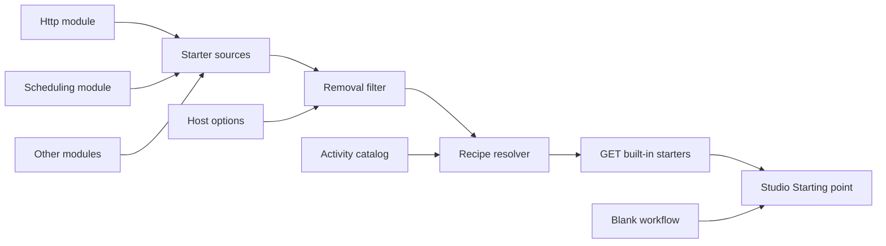

# Requirements

### Overview & Goals
Amend [spec 1167](specs/1167-workflow-templates/spec.md) in place so that:
- built-in workflow starters come from the server;
- server modules contribute them;
- integrators can remove any of them by id;
- a richer first set of starters ships out of the box.

This is a **documentation-only** unit of work. It produces the amended spec and its companion artifacts (plan, tasks, research, checklist, quickstart). It contains no product code.

It follows the in-place amendment pattern of `specs/1179-agents`: a dated amendment note at the top, a reset status, new user stories, and requirements numbered on from the last existing one (FR-009 onward).

### Scope
**In scope (what the amendment specifies)**
- A read-only server list of built-in starters, advertised as its own capability link. The existing custom template CRUD is unchanged.
- Module-contributed starters. A starter disappears when its owning module isn't enabled.
- Integrator removal by starter id through host configuration.
- Version-independent starters: they reference activity types, and the newest available version plus fresh node ids are resolved each time a starter is used.
- Availability explanations, generalizing today's HTTP check.
- Blank workflow stays client-side and is always available.
- Fallback to the current client HTTP recipe on hosts without the capability (keeps FR-008).
- The initial catalog:
  - Hello World Console
  - Hello World HTTP
  - Backend API Call
  - Scheduled job
  - Dispatch child workflow
  - BPMN process
- Gap analysis for Backend API Call, plus the capability the spec requires so it can be built.
- An authoring path: export a Studio template as a starter recipe file (P3).

**Out of scope**
- Implementing any of the above. That's a later claim against the new tasks.
- Per-tenant removal or per-tenant starters.
- Automatic upgrades of workflows already created from a starter.
- Publication or versioning of custom templates. This stays as 1167 already defines it.

### User Stories (appended to 1167 as items 4–7)
4. As an **author**, I choose Hello World Console, Hello World HTTP, Backend API Call, Scheduled job, Dispatch child workflow or BPMN process. I get a runnable, independent workflow that uses the newest activity versions on my server.
5. As a **module author**, I ship starters with my module, so they appear only where my module is installed.
6. As an **integrator**, I remove starters I don't want by listing their ids in host configuration, without rebuilding Studio.
7. As a **template author** (P3), I export a template built in Studio as a version-independent starter recipe that a module can embed.

### Functional Requirements (to be written into spec.md)
- **FR-009**: The server provides a read-only list of built-in starters, advertised as its own Design capability link. Each starter carries:
  - a stable id
  - a name
  - a description
  - the owning module
  - its required activities and expression languages
  - an availability state with a reason
- **FR-010**: Enabled modules contribute starters. A starter whose module isn't enabled is absent, not shown as disabled.
- **FR-011**: Integrators remove starters by id in host configuration.
  - Removed starters don't appear in the list, in Templates or in Starting point.
  - Unknown ids are ignored and reported once as a diagnostic at startup.
  - Removing every starter leaves only Blank workflow.
- **FR-012**: Starters reference activity types, not pinned versions. Each use resolves the newest available version and fresh node ids, and the resulting workflow is independent (FR-007 still applies).
- **FR-013**: If a required activity or expression language is missing, the starter is shown as unavailable with an actionable explanation. It is never created incomplete.
- **FR-014**: Built-ins can't be updated or deleted through the API. Copying one to a custom template still works (FR-003).
- **FR-015**: Blank workflow stays a client starting point with root-activity choice. Server configuration can't remove it.
- **FR-016**: When the server doesn't advertise the built-in list, Studio shows today's client HTTP starter (FR-008).
- **FR-017**: The initial catalog, with acceptance criteria per starter:
  - **Hello World Console**: a Sequence containing WriteLine `Hello World`.
  - **Hello World HTTP**: a Sequence of HttpEndpoint `/hello-world` then WriteHttpResponse with a JSON body.
  - **Backend API Call**: a Flowchart of:
    - HttpEndpoint `/products`;
    - SendHttpRequest GET to an editable URL, defaulting to `https://fakestoreapi.com/products`;
    - WriteHttpResponse returning `text/html`, a styled product table rendered with Liquid.
  - **Scheduled job**: a Timer or Cron trigger then WriteLine.
  - **Dispatch child workflow**: a parent workflow that dispatches a child workflow.
  - **BPMN process**: a minimal start → task → end process.
- **FR-018**: A Liquid binding can turn a JSON response body into data it can loop over. Values interpolated into HTML are escaped.
- **FR-019 (P3)**: Studio can export a template as a starter recipe that references activity types without pinned versions.

### Non-Functional Requirements
- Per ADR 0080, new server types are internal by default. Only the starter contribution interface and the removal options are public.
- The built-in list is computed per host and is the same for every tenant.
- Visible Studio changes require [Studio UX acceptance](docs/contributing/studio-ux-acceptance.md) evidence when implemented.

# Technical Design

### Current Implementation
- `specs/1167-workflow-templates/`:
  - `spec.md`: status `Implemented`, FR-001 to FR-008, 3 user scenarios. A built-in is defined as a "recipe with stable identity and code-owned graph construction".
  - `plan.md`: one paragraph per area.
  - `tasks.md`: T001 to T005, all checked.
  - `checklists/requirements.md`, `quickstart.md`, `verification.md`.
- Built-ins are client-only:
  - `Elsa.Studio.Workflows/Client/src/builtInWorkflowTemplates.ts`
  - `workflow-editor/httpWorkflowStarter.ts` (contains `createHttpStarterState` and `getHttpStarterAvailabilityReason`)
  - `"http"` branches in `WorkflowTemplatesPage.tsx`, `CreateWorkflowDialog.tsx`, `editorHelpers.ts` and the weaver files.
- Server: `essentials/src/Workflows/Design/Api/Capabilities/WorkflowTemplateCapabilitySource.cs` is an internal `IApiCapabilitySource`. It advertises the `workflow-templates*` links under `WorkflowDesignApiCapabilities.CapabilityId`, version 1, and is backed by `IWorkflowTemplateStore`.
- Activities available to the starters:
  - `WriteLine`: writes to the console.
  - `Sequence`
  - `HttpEndpoint` 1.1.0
  - `WriteHttpResponse` 1.2.0: string body, any `ContentType`.
  - `SendHttpRequest`
  - `Timer` and `Cron` in `Activities/Scheduling`
  - `Activities/DispatchWorkflow`
  - `Activities/Bpmn`

### Backend API Call: gap analysis (goes into research.md and the FR-018 rationale)
Gaps found:
1. `SendHttpRequestResult.ResponseBody` is a `string` (`FormattedContent`). It has no parsed-JSON output.
2. Liquid (`PortableLiquidExpressionHandler`) runs in the `binding-readonly-v1` profile and sees only declared parameters, such as an `ActivityResultExpressionParameterBinding` to `ResponseBody`. It has no filter to parse JSON, so `` over the body string can't work.
3. `ILiquidFilter`, `Base64Filter` and `DictionaryKeysFilter` exist but are never registered with the Fluid `TemplateOptions`. They are dead code.
4. A Set Variable workflow intrinsic exists (`Elsa.SetVariable`) but is not a CLR activity. It may enable a preprocessing alternative, but it does not provide JSON parsing inside the current binding-readonly Liquid expression path.

Works today: JavaScript in the WriteHttpResponse `Body` binding (`JSON.parse` plus template literals). That isn't the Liquid experience you asked for.

**Recommended fix (stated in the spec as FR-018 and decided in the plan):**
- add a binding-readonly `parse_json` Liquid filter;
- register the existing `ILiquidFilter` set in the handler;
- use Fluid's `escape` for product fields.

The alternative is an optional parsed `ResponseContent` output on `SendHttpRequest` for JSON responses. It's recorded as an alternative and not chosen: it changes an activity contract and needs a version bump.

**Other risks recorded:**
- The default upstream is a third-party site. Tests must use a local stub, and the URL stays an editable input.
- Host outbound-HTTP policy may block it. That shows up as the activity's `Failed` outcome, not a starter error.

### Key Decisions (already agreed)
- **Separate read-only endpoint** for built-ins, advertised as a new capability link next to the `workflow-templates*` links. Custom CRUD is untouched.
- **Status goes back to Draft**: `**Status**: Draft — built-in starters amendment (2026-11-22)`. The PR that ships the amendment sets it to `Implemented`.
- **Amendment in place**, following the `1179-agents` pattern.

### Key Decisions (proposed in the amendment, confirm on review)
- The existing HTTP starter becomes **Hello World HTTP** and keeps the id `http`, so the FR-016 fallback and older references stay valid.
- The removal setting is host-level options. Working name: `Workflows:Design:Templates:RemovedStarters`, a plain-language name per ADR 0080.
- The server resolves recipes against its own activity catalog. Recipes are JSON embedded in the owning module, with activity-type references and placeholder node ids.
- Who owns which starter:
  - Hello World Console: Primitives/Sequence.
  - Hello World HTTP and Backend API Call: `ActivitiesHttpFeature`. Backend API Call also requires Liquid.
  - Scheduled job: Scheduling.
  - Dispatch child workflow: DispatchWorkflow.
  - BPMN process: Bpmn.

### Architecture Diagram (included in plan.md)

Modules contribute starter sources. A filter applies the host's removal list. A resolver checks each recipe against the activity catalog to work out availability and the newest versions. The read-only endpoint serves the result to Studio, and Studio adds Blank workflow on the client.

### File Structure
- `specs/1167-workflow-templates/spec.md`: **modified**. Status, amendment note, user stories 4–7, FR-009 to FR-019, Key Entities (Built-in starter source, Starter recipe, Removal list), Assumptions, Success Criteria.
- `specs/1167-workflow-templates/research.md`: **new**. Records:
  - the Backend API Call gap analysis;
  - the recipe format;
  - the endpoint and removal decisions;
  - the alternatives that were considered.
- `specs/1167-workflow-templates/plan.md`: **modified**. Adds a "Built-in starters amendment" section with the diagram, server/Studio split, constitution notes and validation.
- `specs/1167-workflow-templates/tasks.md`: **modified**. Adds "Built-in starters amendment — staged delivery" (unchecked T006 onward) and a requirement-to-task traceability table.
- `specs/1167-workflow-templates/quickstart.md`: **modified**. Adds an integrator example for removing starters and a module-author example.
- `specs/1167-workflow-templates/checklists/requirements.md`: **modified**. Adds the amendment's validation pass.

### Risks
- The spec lifecycle doc has no rule for moving an `Implemented` spec back to Draft. The amendment note will cite this request and the rule that the shipping PR restores `Implemented`.
- Keep the [NEEDS CLARIFICATION] markers to 3 or fewer. Defaults are documented as assumptions instead.

# Testing

### Validation Approach
This is a docs-only change, so validation is structural and consistency checking.

### Key Scenarios
- Run the speckit-specify quality checklist against the amended `spec.md` and record the result in `checklists/requirements.md`:
  - every FR is testable;
  - the success criteria are measurable and technology-agnostic;
  - there are no more than 3 [NEEDS CLARIFICATION] markers.
- Traceability: every FR-009 to FR-019 maps to at least one new task in `tasks.md`, and every task cites an FR.
- FR-001 to FR-008 are unchanged, except where the amendment explicitly supersedes text. The 1167 Key Entities line about "code-owned graph construction" is updated and the change is called out.
- The status line uses the lifecycle vocabulary (`Draft — …`).
- All relative links (ADR 0080, `EXTENSION_POINTS.md`, the Studio UX acceptance doc, source paths) resolve. Checked with a link check over the changed markdown files.

### Edge Cases covered in the spec text
- Every starter removed.
- An unknown id in the removal list.
- The owning module is absent, or only a dependency (such as Liquid) is missing.
- An older host without the capability.
- The external upstream is unreachable when Backend API Call runs.

# Delivery Steps

### ✓ Step 1: Amend spec.md with the built-in starters requirements
`specs/1167-workflow-templates/spec.md` carries the dated amendment, user stories 4–7 and FR-009 to FR-019.

- Set the status to `Draft — built-in starters amendment (2026-11-22)`.
- Add an amendment note naming the agreed decisions: separate read-only endpoint, in-place amendment, and the shipping PR restores `Implemented`.
- Append user stories 4–7: author, module author, integrator, template author (P3).
- Add FR-009 to FR-019:
  - server list, module contribution, removal by id;
  - version-independent recipes and availability explanations;
  - built-ins stay read-only; Blank stays on the client; fallback for older hosts;
  - the initial catalog with per-starter acceptance criteria;
  - Liquid JSON parsing (FR-018) and recipe export (FR-019).
- Update Key Entities (Built-in starter source, Starter recipe, Removal list), Assumptions (http id kept, host-level removal, server-side resolution) and Success Criteria. Edge cases: all removed, unknown id, missing dependency, older host, upstream unreachable.

### ✓ Step 2: Record research and the Backend API Call gap analysis
A new `specs/1167-workflow-templates/research.md` explains the decisions and what's missing for Backend API Call.

- Gap findings:
  - `SendHttpRequestResult.ResponseBody` is a string;
  - Liquid is binding-readonly and has no `parse_json` filter;
  - the `ILiquidFilter` set (`base64`, `keys`) is never registered;
  - Set Variable exists as an engine intrinsic, not a CLR activity; it may enable JavaScript preprocessing but does not provide JSON parsing inside Liquid.
- Recommendation: a binding-readonly `parse_json` filter, registering the existing filters, and `escape` for HTML output. Alternatives: a parsed `ResponseContent` output on `SendHttpRequest`, or a JavaScript binding.
- A sketch of the Backend API Call workflow (endpoint `/products`, editable upstream URL, Liquid table template), plus the stubbing and outbound-policy risks.
- The recipe format (activity-type references, placeholder node ids), why a separate endpoint was chosen, the removal options name, and the starter-to-module ownership table.

### ✓ Step 3: Amend plan.md, tasks.md and quickstart.md
The 1167 plan, tasks and quickstart describe how the amendment will be delivered.

- `plan.md`: add a "Built-in starters amendment" section covering:
  - the Mermaid flow (sources → removal filter → resolver → endpoint → Studio);
  - the server/Studio responsibilities;
  - the ADR 0080 internal-by-default note;
  - validation, including the Studio UX acceptance evidence.
- `tasks.md`: add unchecked staged tasks from T006, for example:
  - starter source and endpoint;
  - removal options;
  - the resolver;
  - the Liquid `parse_json` filter;
  - the module starters;
  - the Studio switch-over with fallback;
  - recipe export;
  - evidence.
  Add a traceability table from FR to task.
- `quickstart.md`: add an integrator example for removing starters and a module-author example for contributing one.

### ✓ Step 4: Validate the amendment and record the checklist
`checklists/requirements.md` records a passing validation of the amended spec.

- Run the speckit-specify quality checklist: testable FRs, measurable technology-agnostic success criteria, no more than 3 clarification markers, scope bounded.
- Check that FR-001 to FR-008 are intact and that superseded wording is called out.
- Check that every new FR traces to a task and every relative link resolves.
- Add an "amendment review (2026-11-22)" section with the results and any open questions.