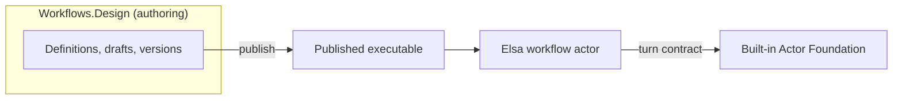

# Elsa Foundation architecture tour

The published Curated Essentials server runs Native and Flowchart workflows on the built-in Actor
Foundation. The stock Workbench source configuration uses the same engine. The default switch
(K13) is published, and K14 removes the earlier engine from the active source tree. See the
[K13 publication receipt](https://github.com/elsa-workflows/elsa-foundation/issues/4229#issuecomment-7231238178)
and [program #4229](https://github.com/elsa-workflows/elsa-foundation/issues/4229).

## What Elsa 4 is made of

Elsa is made of **modular domains**. Each domain publishes contracts and keeps its implementations
behind them. Workflow authoring, publication and execution have separate responsibilities.

The biggest split is between **designing** workflows and **running** them:

- [Workflows.Design](../essentials/src/Workflows/Design/) owns authoring and saved workflow definitions.
- [Workflows.Publishing](../essentials/src/Workflows/Publishing/) compiles an authored version into an
  immutable executable and records which publication serves it.
- [Workflows.Runtime](../essentials/src/Workflows/Runtime/) starts a run against an exact published
  executable. The executable is the boundary between authoring and execution.

### The three execution layers

| Layer | Responsibility |
| --- | --- |
| 1. Actor runtime | Assigns and activates ownership scopes and schedules work for the owner. |
| 2. Durable actors | Stores the inbox and commits each turn's state, recorded effects and journal under the ownership fence. |
| 3. Elsa workflow actor and execution model | Interprets a published Native or Flowchart workflow, evaluates activities and waits, and produces workflow outcomes and History events. |

Layers 1 and 2 form the [built-in Actor Foundation](../essentials/src/ActorFoundation/README.md).
Layer 3 uses the [foundation contracts](../essentials/src/ActorFoundation/Contracts/README.md)
through the [workflow actor](../essentials/src/Workflows/Runtime/WorkflowActor/README.md).
SQLite hosts use one process per file. PostgreSQL supplies database-backed ownership. The Actor
store and the module stores for definitions, publications and identity have separate connections
or paths. See the [Curated Essentials deployment settings](../docker/profiles/essentials-curated/README.md#workflow-execution).

A **shell** is a service container composed from selected features and their declared dependencies.
The Workbench reads its selections from [`shells.json`](../server/apps/Elsa.Workbench.Host/shells.json).
`WorkflowsRuntimeKernelHosting` runs the Actor Foundation and supplies workflow execution to the
retained Runtime API. [Follow a workflow request](how-a-workflow-executes.md) or read the
[execution architecture index](architecture/README.md).

Generated maps track the Design and Runtime project references. For a worked example of how two
domains connect, read [seams and bridges](seams.md).

## The patterns to recognise

| Pattern | In one line | Example |
|---|---|---|
| **Feature inheritance** | A feature builds on another when the relationship is explicit and stable. | Actor workflow hosting depends on the retained Runtime API feature. |
| **Replacement** | A consumer selects the implementation of a contract. | An Actor host selects SQLite or PostgreSQL for its store. |
| **Contribution** | Consumers add implementations that the owner aggregates. | Module authors contribute startup tasks to the shell's task registry. |
| **Events** | One `IEvent` concept; the delivery strategy defines how it is delivered. | A domain publishes an event without knowing who listens. |
| **Startup tasks** | Composition and registry population that happen at start-up. | Filling a registry from contributed descriptors when the shell starts. |
| **Adapters and bridges** | Integration code sits *above* the two sides it connects. | See [seams and bridges](seams.md). |
| **Provider modules** | Provider-specific code lives in provider-suffixed packages. | `...EntityFrameworkCore` packages hold the database stores. |

## Extension points

Every domain documents what you can replace, what you can contribute, and which events it publishes. The repo-wide index is [EXTENSION_POINTS.md](../EXTENSION_POINTS.md); each domain's own catalog sits beside its feature project.

## Working in this repo

| Folder | What is in it |
|---|---|
| `server/apps/` | Runnable hosts, including the `Elsa.Workbench` reference server and `Elsa.Foundation.Host`. |
| `essentials/src/` | The core libraries and default implementations. |
| `essentials/tests/` | Focused tests for that behaviour. |
| `extensions/` | Optional modules, including `Elsa.Integrations.Sdk`. |
| `studio/` | The Studio front end. |
| `docs/` | Lookup knowledge: glossary, skills, maps, reports, reference docs and programme goals. |
| `docs/program-goals/` | The shared backlog, the registry of mid-term goal buckets, and roadmap notes. |
| `specs/` | Work units and feature plans written with **Speckit**, the spec-driven planning tool this repo uses. |
| `.specify/` | Speckit's templates, workflows and extensions, plus the **constitution**. |
| `.claude/` | Speckit adapters for the Claude coding agent. |

> **What is the "constitution"?** Two rule files under `.specify/memory/` (`constitution-framework.md` for framework-wide rules, `constitution.md` for Elsa-specific ones). They hold the enforceable architecture gates, the rules a change must pass. You only need them when a review points you at a specific gate.

## How to go deeper

| You need… | Go to |
|---|---|
| A definition | [Root glossary](glossary/root.md) or [Elsa glossary](glossary/elsa.md) |
| To perform a task | [Skills catalog](skills/catalog.md) |
| Current priorities | [Programme goals](program-goals/README.md), including the named buckets and the `none/free-flow` state |
| Generated facts | [Maps](maps/README.md) |
| Known gaps | [Unfinished work](reports/unfinished-work.md) |
| Enforceable gates | The two constitution files under `.specify/memory/` |
