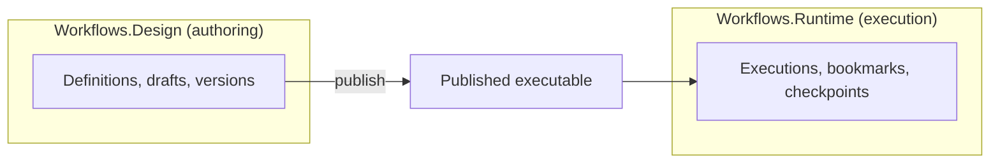

# Elsa Foundation architecture tour

A short orientation for developers new to this repository: what Elsa 4 is made of, the few patterns that hold it together, and where to go next. You do not need to read the project's rulebooks (the "constitution", explained below) first.

## What Elsa 4 is made of

Elsa is being rebuilt as a set of **modular domains**. Each domain publishes its contracts in a `.Core` library, keeps its implementations behind those contracts, and talks to other domains only through a handful of approved patterns, never by reaching into another domain's implementation.

The biggest split is between **designing** workflows and **running** them:

- `Elsa.Workflows.Design.*` owns authoring and saved workflow definitions.
- `Elsa.Workflows.Runtime.*` owns execution.
- Runtime must not depend on Design directly. The **published executable** is the boundary between them: Design produces it, Runtime runs it.

A running server is a **shell**: a service container built from a list of **features** named in configuration. The reference server, the Workbench, reads that list from its `shells.json`. A feature that is not listed registers nothing. [How a workflow executes](how-a-workflow-executes.md) follows one request through the Workbench to a saved checkpoint.

Generated maps track the current Design/Runtime reference signals. Known, deferred exceptions are recorded in reports, not here. For a worked example of how two domains connect, read [seams and bridges](seams.md).

## The patterns to recognise

| Pattern | In one line | Example |
|---|---|---|
| **Feature inheritance** | A feature builds on another when the relationship is explicit and stable. | The database runtime feature depends on the resumption feature, so choosing database storage always brings the recovery pump. |
| **Replacement** | A consumer swaps the one default implementation of a contract. | The EF Core feature replaces the in-memory work queue with a database queue. |
| **Contribution** | Consumers add implementations; one owner aggregates them. | Each activity module contributes its scheduler work handlers; the drain picks the one that accepts each work item. |
| **Events** | One `IEvent` concept; the delivery strategy defines how it is delivered. | A domain publishes an event without knowing who listens. |
| **Startup tasks** | Composition and registry population that happen at start-up. | Filling a registry from contributed descriptors when the shell starts. |
| **Adapters and bridges** | Integration code sits *above* the two sides it connects. | See [seams and bridges](seams.md). |
| **Provider modules** | Provider-specific code lives in provider-suffixed packages. | `...EntityFrameworkCore` packages hold the database stores. |

## Extension points

Every domain documents what you can replace, what you can contribute, and which events it publishes. The repo-wide index is [EXTENSION_POINTS.md](../EXTENSION_POINTS.md); each domain's own catalog sits beside its feature project.

## Working in this repo

| Folder | What is in it |
|---|---|
| `Essentials/apps/` | Runnable hosts. `Elsa.Workbench` is the reference server and the process entry point. |
| `Essentials/src/` | The core libraries and default implementations. |
| `Essentials/tests/` | Focused tests for that behaviour. |
| `Extensions/` | Optional modules, including `Elsa.Integrations.Sdk`. |
| `Studio/` | The Studio front end. |
| `docs/` | Lookup knowledge: glossary, skills, maps, reports, reference docs and programme goals. |
| `docs/program-goals/` | The shared backlog, the registry of mid-term goal buckets, and roadmap notes. |
| `specs/` | Work units and feature plans written with **Speckit**, the spec-driven planning tool this repo uses. |
| `.specify/` | Speckit's templates, workflows and extensions, plus the **constitution**. |
| `.claude/` | Speckit adapters for the Claude coding agent. |

> **What is the "constitution"?** Two rule files under `.specify/memory/` (`constitution-framework.md` for framework-wide rules, `constitution.md` for Elsa-specific ones). They hold the enforceable architecture gates, the rules a change must pass. You only need them when a review points you at a specific gate.

## How to go deeper

| You need… | Go to |
|---|---|
| A definition | [Root glossary](glossary/root.md) or [Elsa glossary](glossary/elsa.md) |
| To perform a task | [Skills catalog](skills/catalog.md) |
| Current priorities | [Programme goals](program-goals/README.md), including the named buckets and the `none/free-flow` state |
| Generated facts | [Maps](maps/README.md) |
| Known gaps | [Unfinished work](reports/unfinished-work.md) |
| Enforceable gates | The two constitution files under `.specify/memory/` |
