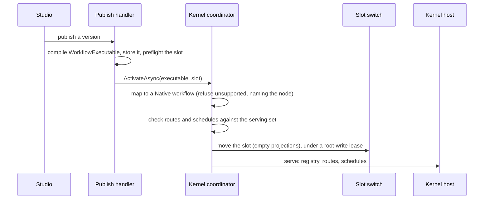

# Designer definitions on the kernel

How a workflow designed in Studio and published through the definitions API runs on the clean-slate kernel. This is
K10's definitions-to-kernel path in the [program plan](../program-goals/clean-slate-kernel.md#milestones), the gap 1 the
[GA test drive](../reports/ga-test-drive-2026-11-24/core-preview-map.md#summary) found. Part of
[#4229](https://github.com/elsa-workflows/elsa-foundation/issues/4229).

## Owner decisions, 25 November 2026

[Recorded on #4229](https://github.com/elsa-workflows/elsa-foundation/issues/4229#issuecomment-7153650829) and in the [decision register](decisions.md#owner-decisions-on-definitions-on-the-kernel-25-november).

1. **A kernel coordinator.** On a kernel host, a kernel implementation of `IWorkflowActivationCoordinator` replaces the
   old core's. It owns the slot switch, maps the compiled executable to a Native workflow, updates the kernel's
   registry, routes and schedules, and serves it. The alternative was an observer on the old coordinator. It was
   smaller, but it would have built on the old core's runtime, which the K13 switch removes.
2. **Host-evaluated expressions, JavaScript and Liquid.** One Native binding kind holds an expression that the host
   evaluates: the existing portable expression evaluator, with the expression's compiled parameters resolved from the
   Native scope. The alternative was JavaScript only, with Liquid in 1.x.

## What stays as it is

- **Design and publishing.** Studio, the definitions API, drafts and versions are unchanged. So are the publish
  handler (`PublishWorkflowRequestHandler`), the compiler (`WorkflowExecutableCompiler`, which produces a
  `WorkflowExecutable`), the executable store and the publication journal (`PublicationActivator`).
  - The handler stores the executable before it activates it. So a publish the kernel refuses leaves a stored
    executable behind, unused, as on the old core.
  - The publication preflight (`WorkflowPublicationPreflightReader`, a sealed class) extracts the old core's triggers
    through `IWorkflowTriggerBindingExtractor` and compares them with the old trigger index. A kernel host replaces
    that extractor with one that reports no old-core triggers, so the preflight checks only the slot and its policy.
    A test run (`StartWorkflowTestRunRequestHandler`) reads the same extractor, so on a kernel host it sees no
    old-core triggers either; test runs on the kernel are outside this path.
    The kernel's own route and schedule checks run in the coordinator (step 2 below). The handler's short-cut for an
    unchanged republish still answers from the slot.
- **Publication slots.** ADR 0043's slots, kept by [ADR 0099](../adr/0099-clean-slate-execution-kernel.md), stay
  unchanged: the slot authority (`IWorkflowActivationAuthority`) and the switch that commits a slot with its serving
  projections (`IWorkflowActivationSwitch`). The kernel coordinator moves slots through the same switch and keeps its
  invariant: the activation a slot names serves, and nothing else does.
  - The switch requires an activation to be prepared in each projection store it is composed with: the trigger
    bindings and the recurring schedules. So the kernel coordinator composes those stores and prepares an empty
    projection in each, as the old coordinator already does for model material. The kernel's own serving state is
    its registry, routes and schedules (below).

The in-memory and EF implementations of the slot authority, the switch, the projection stores and the executable store
ship today in the old core's runtime and persistence packages. The kernel uses them through their contracts. Moving
them into packages of their own is K14 cleanup.

## The kernel coordinator's duties

The switch does the compare-and-swap, and retires or restores the source references the slot moves between. The
coordinator does the rest, as the old one does:
- mints or resumes the activation's source reference;
- runs each sequence under a root-write lease, which fences the artifact's closure from reference garbage collection;
- enforces the activation channel policy (`ChannelNotAllowed`);
- answers the publish of the artifact a slot already serves as `AlreadyActive`;
- checks serving and repairs it (`EnsureServingAsync`, which the activator calls before every activation);
- discards an activation that fails before the switch (`TryDiscardAsync`), and reverts one that fails after it
  (`TryRevertAsync`);
- on deactivate, retires the references of the other serving activations.

It refuses `ActivateMaterialAsync` and `DeactivateMaterialAsync`, as the interface's defaults do: model material
(BPMN) is outside release 1.

## The flow

1. **Map, first.** `NativeExecutableMapper` turns the `WorkflowExecutable` into a `Kernel.Native.Workflow`. It runs
   before the coordinator mints a reference or takes a lease, so a refusal leaves nothing to discard. A refusal fails
   the activation at a new step with the code `activity-unsupported` or `binding-unsupported`, and the node and input in
   its diagnostic. The publish answers with it and the slot does not move. This is the K10 case "publishing a
   definition with `CompensationScope` is refused with the node named". The mapping rules are below.
2. **Check.** The coordinator builds `HttpRoutes` and `NativeSchedules` over the serving set, with the candidate in
   place of what its slot serves now. So a route conflict, or a Timer away from a start position, refuses the publish,
   as the old core refuses such claims at publish.
3. **Switch.** The slot moves through `IWorkflowActivationSwitch`, with empty projections, under the root-write lease.
4. **Serve.** After the commit, the kernel host updates what serves:
   - it adds the workflow to the kernel's registry, a host singleton the shells share;
   - it rebuilds the route table from the serving set;
   - it points each schedule's run at the new artifact (`ScheduleActor.RegisterRunAsync`) and sets its schedule
     (`SetAsync`, with the slot's revision as the revision).

   A failure here reverts the switch, as the old coordinator reverts on a failed observer.
5. **Deactivate.** The coordinator moves the slot off and removes the workflow from the serving set. For each schedule
   it calls `StopAsync`, then `RegisterRunAsync(null)`, in that order.
6. **Ensure serving.** The slot authority lists slots by definition only. So a process that starts reads the
   publication journal's active records, finds each slot and the executable it names, and maps it into the registry.
   `EnsureServingAsync` does the same for one slot when its artifact is missing from the registry, as it is after a
   restart.

## The serving set and versions

- **The registry** holds every artifact that may still run: the one each slot serves, and the ones instances started
  on. A Native workflow's id is the executable's artifact id. An instance keeps the artifact it started on; instances
  that should move to a new version use the migration path. Retiring an artifact from the registry once no instance
  runs it is follow-up work.
- **The serving set** is the artifact each active slot names. Routes and schedules are built from the serving set
  only, so a republished HTTP workflow replaces its route instead of conflicting with its previous artifact's.
- **Schedules** are keyed by definition and node, not by artifact: the schedule actor's key is
  `schedule:{definitionId}:{node}`, and so is its start key. A republish points the existing schedule's run at the
  new artifact and sets its schedule. An unchanged schedule keeps its pending occurrence (#5744). `NativeSchedules`
  takes the definition id for its keys.
- **Instance reads by definition.** The workflow actor's `definition` label holds the definition id, which Studio's
  instance lists filter on, and the artifact id moves into the workflow header's type data, where the actor finds the
  workflow to run. The header's four labels stay as they are: definition, the answered migration plan, and a model's
  two. A migration plan selects its instances by the `definition` label and then by the artifact in their type data,
  and a migration's `Rebind` changes the artifact in the type data, not the label.

## Mapping rules

**Activity types** resolve through `NativeActivityCatalog.Resolve`, which takes the catalog key and the declared key a
compiled node carries. A compiled intrinsic node carries `elsa.intrinsic.{kind}` and skips `Resolve`: the mapper maps
its `IntrinsicKind` (Set, SetOutput, SetCorrelationId, SetInstanceName, Finish) and its variable target directly.
Merge, Reduce, Return and Control intrinsics are refused. One of the eight hidden activities, or an unknown type, is
refused with the node named.

**Structures.** Each structure payload maps onto the Native shape:
- Sequence's child order;
- If's Then and Else;
- Switch's cases, whose `conditionInputKey` bindings become `SwitchCase` conditions;
- the loops' bodies;
- Parallel's branches;
- Flowchart's connections, start node and policy kinds as gateways;
- a GraphActivity descriptor becomes a `GraphBoundary`.

**Variables.** A `RuntimeVariableReference` carries a reference key and a declaring scope; Native names variables. The
mapper maps keys to names through the declarations. Workflow variables, with their initial bindings, become the
workflow's variables. Container-scoped variables are refused until the mapper slice settles their Native form.

**Inputs** become Native bindings:

| Compiled source | Native binding |
|---|---|
| Literal (also Object, Default, Connection) | `LiteralBinding` |
| VariableRead, VariableMember | `VariableBinding`, with the member path |
| WorkflowRequest, WorkflowRequestMember | a read of the run's `input`, with the member key and path |
| ActivityResult, ActivityResultMember | `ResultBinding`, with the Native path of the projection (below) |
| Expression (JavaScript, Liquid) | the host expression binding (decision 2) |
| SecretRead | refused: secrets are outside release 1 |

- **Paths.** `VariableBinding` gains a path, as `ResultBinding` has. A Native path splits on `.`, so a member segment
  that holds a dot is refused.
- **Result projections.** A compiled read names the old core's output key. Native results have their own shapes, for
  example `{ "Value": ... }` for RunJavaScript and `{ "Interval": ... }` for Timer. The mapper holds a table, per
  activity, from projection key to Native path. Native keeps one result per node, so a read of a result an iteration
  scoped (`ProducerScopeId`) reads the latest.
- **Conversions.** A binding's conversion plan is applied by the mapper when it is identity or numeric widening; any
  other plan refuses the binding, because Native has no conversions and its hydrator throws on a type mismatch.
- **Captures and input.** Output captures become `Node.Captures`, and the input contract becomes the run's input.

## Expressions (decision 2)

- **The model.** A new `HostExpressionBinding` in the Native model carries the language, the text, the result type,
  the options and the parameters. Each parameter is a Literal, Variable, ActivityResult, WorkflowRequest or
  WorkflowInstance read. The model resolves the first four from the frame's scope as for any other binding, and the
  last from the instance: its id, and its correlation id, which the model keeps in its state beside the label.
- **Ambient variables.** JavaScript reads visible variables as `variables.X` and through `getVariable`. So the model
  passes the frame's visible variables by name with each evaluation, as the old evaluator does.
- **The host.** It supplies `INativeExpressions` on `NativeExecutionOptions`, a synchronous evaluator, because bindings
  are evaluated synchronously inside a turn. The Workbench adapter calls the default shell's
  `IPortableExpressionEvaluator`, which applies the purity rules of the binding-pure profile and normalizes the result
  by its type. That evaluator and its handlers are scoped services of the shell, so the adapter opens a scope of the
  shell's service provider once per turn that evaluates an expression, and evaluates every expression of that turn in
  it. It faults when an evaluation does not complete synchronously.
  - JavaScript runs on the portable Jint evaluator, which completes synchronously, refuses any other profile, and
    strips the clock, randomness and I/O.
  - Liquid renders through the registered handler, which completes synchronously with the built-in filters and fixes
    the clock and time zone.
- **Failure.** Without an evaluator, or when the evaluation throws, the activation faults with `expression.failed`,
  naming the node and input.

## Where it lives

The mapper, the coordinator and the kernel trigger extractor read `Elsa.Workflows.Runtime.Core` models, the executable and the
activation commands, which layer 3 does not reference. So they live in a host-side project,
`Elsa.Workflows.Runtime.KernelHost`, which references those contracts, the Native model and WorkflowActor. The
Workbench composes them on a kernel host: its Core Preview, with publications enabled, replaces the default shell's
coordinator and preflight, and shares the kernel's registry between the root host and the shell.

## Slices

1. This design note.
2. The expression seam in the Native model, with `VariableBinding` paths and ambient variables, and checks on a
   stand-in evaluator.
3. The host evaluator in the Workbench, over `IPortableExpressionEvaluator`.
4. The workflow actor's definition label and artifact pinning, with migration plans selecting by both, and
   `NativeSchedules` keyed by definition.
5. `NativeExecutableMapper`, with checks from compiled executables of the GA test drive's workflows.
6. The kernel coordinator and the kernel trigger extractor, with activate, deactivate, refusal, discard, revert and
   ensure-serving checks.
7. Core Preview composition: the shared registry, the serving set's routes, the schedule actor hosted beside the
   workflow actor, and the toolbox's `kernel-unsupported` set.
8. The K10 journey: design an HTTP workflow in Studio, publish it, call its route, and see one completed instance.

## Outside this path

- Secrets and Connections in bindings (refused, as above), and the old core's other binding conversions.
- Container-scoped variables, beyond what the mapper slice settles.
- Studio's run views on the projections, which is the rest of K10.
- Several kernel nodes: each rebuilds its registry from the publication journal on start. Telling the other nodes of
  a new activation is a follow-up for the cluster profile.
