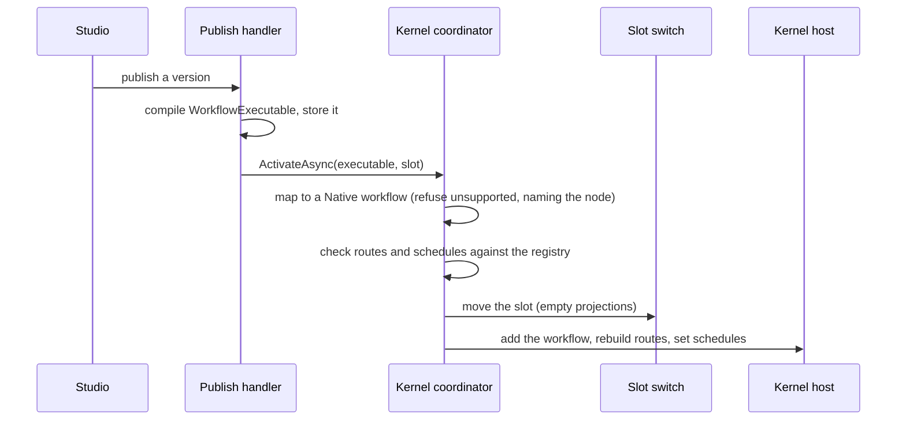

# Designer definitions on the kernel

How a workflow designed in Studio and published through the definitions API runs on the clean-slate kernel. This is
K10's definitions-to-kernel path in the [program plan](../program-goals/clean-slate-kernel.md#milestones), the gap 1 the
[GA test drive](../reports/ga-test-drive-2026-11-24/core-preview-map.md#summary) found. Part of
[#4229](https://github.com/elsa-workflows/elsa-foundation/issues/4229).

## Owner decisions, 25 November 2026

[Recorded on #4229](https://github.com/elsa-workflows/elsa-foundation/issues/4229#issuecomment-7153650829) and in the [decision register](decisions.md#owner-decisions-on-definitions-on-the-kernel-25-november).

1. **A kernel coordinator.** On a kernel host, a kernel implementation of `IWorkflowActivationCoordinator` replaces the
   old core's. It owns the slot switch, maps the compiled executable to a Native workflow, updates the kernel's
   registry, routes and schedules, and serves it. The alternative was an observer on the old coordinator. It was
   smaller, but it would have built on the old core's runtime, which the K13 switch removes.
2. **Host-evaluated expressions, JavaScript and Liquid.** One Native binding kind holds an expression that the host
   evaluates: the existing portable expression evaluator, with the expression's compiled parameters resolved from the
   Native scope. The alternative was JavaScript only, with Liquid in 1.x.

## What stays as it is

- **Design and publishing.** Studio, the definitions API, drafts and versions are unchanged. So are the publish
  handler (`PublishWorkflowRequestHandler`), the compiler (`WorkflowExecutableCompiler`, which produces a
  `WorkflowExecutable`), the executable store and the publication journal (`PublicationActivator`).
- **Publication slots.** ADR 0043's slots, kept by [ADR 0099](../adr/0099-clean-slate-execution-kernel.md), stay
  unchanged: the slot authority (`IWorkflowActivationAuthority`) and the switch that commits a slot with its serving
  projections (`IWorkflowActivationSwitch`). The kernel coordinator moves slots through the same switch and keeps its
  invariant: the activation a slot names serves, and nothing else does. Its own projection sets are empty, as the
  existing material path already prepares them for model material.

The in-memory and EF implementations of the slot authority, the switch and the executable store ship today in the old
core's runtime and persistence packages. The kernel uses them through their contracts. Moving them into
packages of their own is K14 cleanup.

## The flow

1. **Map.** `NativeExecutableMapper` turns the `WorkflowExecutable` into a `Kernel.Native.Workflow`.
   - **Activity types** resolve through `NativeActivityCatalog.Resolve`. The catalog takes the catalog key or the
     declared key a compiled node carries, and the five intrinsic keys. One of the eight hidden activities, or an
     unknown type, is refused with the node named. The refusal fails the activation before the switch, so the publish
     answers with it and the slot does not move. This is the K10 case "publishing a definition with `CompensationScope`
     is refused with the node named".
   - **Structures.** Each structure payload maps onto the Native shape:
     - Sequence's child order;
     - If's Then and Else;
     - Switch's cases, whose `conditionInputKey` bindings become `SwitchCase` conditions;
     - the loops' bodies;
     - Parallel's branches;
     - Flowchart's connections, start node and policy kinds as gateways;
     - a GraphActivity descriptor becomes a `GraphBoundary`.
   - **Inputs** become Native bindings:

     | Compiled source | Native binding |
     |---|---|
     | Literal (also Object, Default, Connection) | `LiteralBinding` |
     | VariableRead | `VariableBinding` |
     | WorkflowRequest | the workflow's input |
     | ActivityResult (also its member reads) | `ResultBinding`, with the projection as the path |
     | Expression (JavaScript, Liquid) | the host expression binding (decision 2) |
     | SecretRead | refused: secrets are outside release 1 |

   - **Captures, variables and input.** Output captures become `Node.Captures`. Workflow variables, with their initial
     bindings, become the workflow's variables. The input contract becomes the run's input.
2. **Check.** Before the switch moves, the coordinator builds `HttpRoutes` and `NativeSchedules` from the registry with
   the candidate in place. So a route conflict, or a Timer away from a start position, refuses the publish, as the old
   core refuses such claims at publish.
3. **Switch.** The slot moves through `IWorkflowActivationSwitch`, with an empty projection set. The source reference,
   compare-and-swap, revert and discard rules are the switch's own.
4. **Serve.** After the commit, the kernel host updates what serves:
   - it adds the workflow to the kernel's registry, a host singleton the shells share;
   - it rebuilds the route table;
   - it calls `ScheduleActor.RegisterRunAsync` and `SetAsync` for each schedule, with the slot's revision as the
     revision.

   A failure here reverts the switch, as the old coordinator reverts on a failed observer.
5. **Deactivate.** The coordinator moves the slot off and removes the workflow from routing. For each schedule it calls
   `StopAsync`, then `RegisterRunAsync(null)`, in that order.
6. **Ensure serving.** A process that starts rebuilds the registry, routes and schedules from the slots the authority
   holds and the executables they name.

## Versions

A Native workflow's id is the executable's artifact id, not its definition id. A republished definition is a new
artifact in the registry, and the route table and schedules point at the artifact the slot names. An instance that is
running keeps the artifact it started with. Instances that should move to a new version use the migration path;
retiring old artifacts from the registry once no instance runs them is follow-up work.

## Expressions (decision 2)

- **The model.** A new `HostExpressionBinding(Language, Text, Parameters)` in the Native model. Its parameters are the
  compiled expression's parameter bindings, each a Literal, Variable, ActivityResult or WorkflowRequest read, which the
  model resolves from the frame's scope as for any other binding.
- **The host.** It supplies `INativeExpressions` on `NativeExecutionOptions`, a synchronous evaluator, because bindings
  are evaluated synchronously inside a turn.
  - The Workbench adapter runs JavaScript through the portable Jint evaluator, which is synchronous under its async
    signature.
  - It renders Liquid through Fluid's synchronous API.
  - Both run under the binding-pure profile: no clock, randomness or I/O, so replay re-derives the same value.
- **Failure.** Without an evaluator, or when the evaluation throws, the activation faults with `expression.failed`,
  naming the node and input.

## Where it lives

The mapper and the coordinator read `Elsa.Workflows.Runtime.Core` models, the executable and the activation commands,
which layer 3 does not reference. So they live in a host-side project, `Elsa.Workflows.Runtime.KernelHost`, which
references those contracts, the Native model and WorkflowActor. The Workbench composes them on a kernel host: its
Core Preview with publications enabled replaces the default shell's coordinator, and shares the kernel's registry
between the root host and the shell.

## Slices

1. This design note.
2. The expression seam in the Native model, with checks on a stand-in evaluator.
3. The host evaluator (JavaScript and Liquid) in the Workbench.
4. `NativeExecutableMapper`, with checks from compiled executables of the GA test drive's workflows.
5. The kernel coordinator, with activate, deactivate, refusal, revert and ensure-serving checks.
6. Core Preview composition: the shared registry, routes rebuilt on activation, the schedule actor hosted beside the
   workflow actor, and the toolbox's `kernel-unsupported` set.
7. The K10 journey: design an HTTP workflow in Studio, publish it, call its route, and see one completed instance.

## Outside this path

- Secrets and Connections in bindings (refused, as above).
- Container-scoped variables, beyond what the mapper slice settles.
- Studio's run views on the projections, which is the rest of K10.
- Several kernel nodes: each rebuilds its registry from the shared slot authority on start. Telling the other nodes of
  a new activation is a follow-up for the cluster profile.
