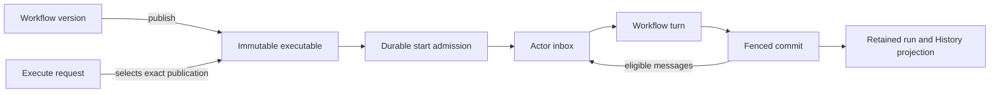

# How a workflow executes

This walkthrough follows a published Native or Flowchart workflow from a Runtime API request to
a committed activity in History. It covers the built-in Actor Foundation in Curated Essentials
and the stock Workbench source configuration. See the
[published K13 default switch](https://github.com/elsa-workflows/elsa-foundation/issues/4229#issuecomment-7231238178).

## From publication to History

### 1. Publish an executable

Publishing compiles an authored workflow version into an immutable executable. The publication
binds that material to a serving slot. A running workflow keeps the material it started with
even after a later publication changes the slot.

### 2. Admit the start

A caller with workflow execution permission posts to
`/runtime/workflows/executables/{artifactId}/execute`. The retained Runtime route selects the live
publication in the shell's tenant, validates the workflow inputs and applies the start policy.
It rechecks the publication before asking Actor Foundation to admit the start.

For a durable start, Actor Foundation records the initial message and its execution identity.
The returned execution ID identifies that run. The admission result and the eventual workflow
outcome are separate. Read the instance to learn whether the run is still active or has ended.

### 3. Run and commit a turn

The owner reads the actor's committed state and eligible inbox messages. The Elsa workflow actor
invokes the Native execution model, which evaluates structured activities or Flowchart nodes.
Depending on the model state, it can finish an activity, follow an edge, or record a wait.

Actor Foundation commits the turn under the current ownership fence. The commit records the new
state, consumed inbox messages, follow-up effects and journal entries together. A stale owner
cannot commit a turn. Eligible messages and due work drive later turns, including after a restart.
See the [ownership and fencing design](architecture/ownership-and-fencing.md).

### 4. Read the retained result

`GET /runtime/workflows/instances/{workflowExecutionId}` gives the authorized run's current status
and publication provenance. For per-activity evidence, read
`GET /runtime/workflows/instances/{workflowExecutionId}/history?name=ActivityCompleted` and follow
the continuation cursor when present. The retained Runtime API projects those entries from the
actor's committed journal. A completed step appears with its commit identity and sequence.

The published release smoke starts a workflow through the API, checks the executable and publication,
waits for completion, then finds the committed `ActivityCompleted` and matching console output.
The [published release receipt](https://github.com/elsa-workflows/elsa-foundation/issues/4229#issuecomment-7231238178)
records this path.

## Where the run is stored

| Host configuration | Workflow execution storage |
| --- | --- |
| Curated Essentials SQLite and local Workbench | Embedded Actor Foundation with one process per database file. Persist the Actor and platform database files together when replacing a container. |
| Curated Essentials PostgreSQL and Workbench Compose from source | A dedicated PostgreSQL Actor database, with separate module storage for definitions, publication material and identity. |

Use the [Curated Essentials workflow execution settings](../docker/profiles/essentials-curated/README.md#workflow-execution)
or [Workbench Compose persistence guide](../docker/compose/README.md#5-verify-postgres-persistence).
The [installed production journeys](https://github.com/elsa-workflows/elsa-foundation/issues/4229#issuecomment-7231333589)
cover both providers.

## Start in the source

| Part | Source |
| --- | --- |
| Shell selection, provider and ownership wiring | [`WorkflowsRuntimeKernelHostingFeature`](../essentials/src/Workflows/Runtime/KernelHosting/WorkflowsRuntimeKernelHostingFeature.cs) |
| Runtime routes | [`WorkflowsRuntimeKernelRetainedApiFeature`](../essentials/src/Workflows/Runtime/KernelApi/WorkflowsRuntimeKernelRetainedApiFeature.cs) |
| Published start and exact source selection | [`KernelPublishedRunDispatcher`](../essentials/src/Workflows/Runtime/KernelHosting/KernelPublishedRunDispatcher.cs) |
| Elsa workflow turn | [Workflow actor](../essentials/src/Workflows/Runtime/WorkflowActor/README.md) and [Native model](../essentials/src/Workflows/Runtime/Native/Model/README.md) |
| Ownership and durable commits | [Built-in Actor Foundation packages](../essentials/src/ActorFoundation/README.md) |
| Retained History | [`KernelRuntimeHistoryPageReader`](../essentials/src/Workflows/Runtime/KernelApi/KernelRuntimeHistoryPageReader.cs) |

For workloads kept on the earlier runtime, see the
[pinned Full compatibility deployment record](https://github.com/elsa-workflows/elsa-foundation/issues/4229#issuecomment-7232199720)
and the
[earlier scheduler walkthrough](https://github.com/elsa-workflows/elsa-foundation/blob/fbac64815d6c7fc25e9576ed6ba40bcba56af3ba/docs/how-a-workflow-executes.md).
[Program #4229](https://github.com/elsa-workflows/elsa-foundation/issues/4229) records the retirement and release evidence.
