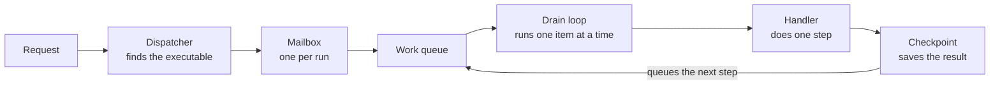
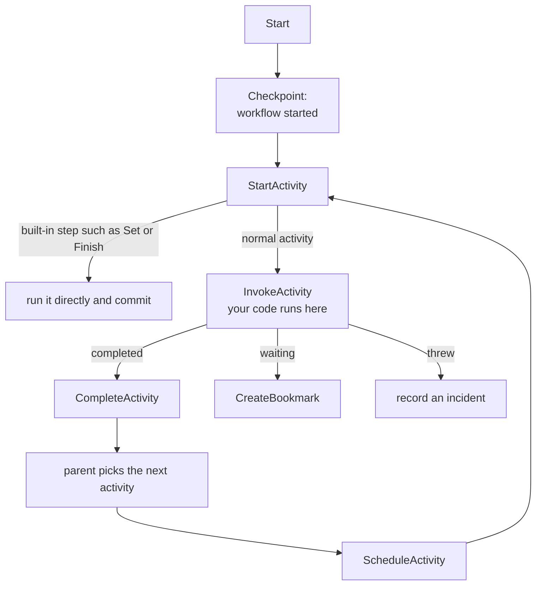

# How a workflow executes

This page follows one request, "run this published workflow", from the moment it reaches the server until the first activity has run and its result is saved. Read it once and you will know which part of the runtime to open when you want to change how workflows run.

## The big picture

Elsa separates **designing** a workflow from **running** it. When you publish a workflow, Elsa compiles it into an **executable**: a frozen, ready-to-run copy. The runtime only ever runs executables, never the editable definition.

Running an executable is a loop of small steps:



Three ideas make this work:

- **Mailbox serialization.** Every command for a run goes through that run's mailbox, and the mailbox handles one command at a time. The ownership fence rejects stale durable checkpoint commits. Lease loss requests cancellation of the active handler; cancellation is cooperative.
- **Small steps.** Each step (start the workflow, start an activity, run it, complete it…) is a separate work item handled by its own small class. A step does its work, then queues the next one.
- **Nothing is saved directly.** A step describes what changed, plus what should happen next, in a **checkpoint**. One component, the committer, writes it.

### Words you will meet

| Word | Meaning |
|---|---|
| Definition / draft / version | The workflow as authored in Studio. A draft is editable; a version is a frozen, numbered snapshot. |
| Executable | What publishing compiles a version into. Immutable; the only thing the runtime runs. |
| Execution | One run of one executable. The API calls it an *instance*. |
| Activity execution | One run of one activity inside an execution. |
| Work item | One queued step for one execution. |
| Drain | Working through an execution's queued work items until there is nothing left to do. |
| Checkpoint | A saved boundary: the state that changed, plus the follow-up steps it implies. |
| Bookmark | A saved "wake me up when X happens" handle, left by an activity that is waiting. |
| Stimulus | The event that wakes a bookmark, such as an HTTP request or an API call. |
| Incident | A saved record of a failure. Recording one does not by itself stop the workflow. |
| Shell / feature | A shell is the server's service container; it is built from a list of features named in configuration. |

## How the server is put together

The reference server, `Elsa.Workbench`, is a small ASP.NET Core program. It does three things:

1. It reads `shells.json`.
2. It builds a **shell** from the features listed there.
3. It routes every HTTP request to that shell.

A feature that isn't listed registers nothing. That is how one codebase supports hosts with very different capabilities. A trimmed extract from the Workbench's `shells.json`:

```json
"Features": {
  "ActivitiesRuntime": {},
  "ActivitiesHttp": {},
  "ActivitiesSequence": {},
  ...
}
```

Three features matter for running workflows: **WorkflowsRuntimeApi** (the HTTP API and the runtime's default services), **ActivitiesRuntime** (the steps that run activity code) and **WorkflowsRuntimeEntityFrameworkCore** (saving to a database instead of memory).

## Following one request

A client starts a published workflow with:

```
POST /runtime/workflows/executables/{artifactId}/execute
```

The Workbench mounts its shell at the root, so this path is served from the host root.

### 1. The endpoint accepts the request

Endpoints are small classes with a route attribute. This one is real, trimmed:

```csharp
[Post("runtime/workflows/executables/{artifactId}/execute")]
[RequirePermission(WorkflowRuntimePermissions.WorkflowRuntimeExecute)]
public sealed class Endpoint(IWorkflowExecutionStartService starter) : ApiEndpointWithResult<...>
{
    public override async Task<...> HandleAsync(ExecuteWorkflow request, CancellationToken ct)
    {
        var result = await starter.ExecuteAsync(request, ct);
        // 429 if the server is shedding load, 409 if the command was rejected, otherwise 200
    }
}
```

The start service reads the executable once to pick up the workflow's default variable values, then passes the request to the **start dispatcher**.

> **Another way in: HTTP-triggered workflows.** A workflow that begins with an *HTTP Endpoint* activity is served under `/workflows/http`. Middleware matches the request against the server's route table, then hands it to the stimulus router. The router starts every published workflow whose trigger matches and wakes every waiting bookmark that matches. From there it uses the same dispatchers as the API, so everything below applies.
>
> *Good to know:* each node keeps its own route table, built from the saved trigger bindings and waiting HTTP bookmarks. The node that publishes an endpoint (or suspends on one) updates its table at once. Other nodes catch up within the HTTP runtime feature's convergence interval (5 seconds by default) and return 404 for that endpoint until then.
>
> One change lags longer: republishing an endpoint with *only* new authorization options (`Authorize`, `Policy`) keeps its template and method, so other nodes' route inventory keeps showing the old security settings until the set of routes next changes. Enforcement is not affected: the middleware reads the authorization options from the saved trigger bindings and bookmarks on every request. See "Multi-node guarantee" in the runtime HTTP module's extension-point notes.

### 2. The dispatcher checks the executable

The dispatcher looks up the executable. It checks that the executable is still the **published** one (a live *Published* source reference points at it), applies any start policy, and wraps the request in a *Start* command.

Where do executables come from? Publishing compiles a definition version and saves the result to the executable store. That store is in memory by default. With database persistence switched on, it is a database store with a cache in front.

### 3. The mailbox makes sure only one writer touches the run

The dispatcher doesn't run anything itself. It drops the command into the run's **mailbox**. There is one mailbox per execution, and it handles one command at a time (ADR 0031, the single-writer rule).

For each command, the mailbox opens a fresh persistence scope and hands the command to the scheduler.

### 4. The command becomes queued work, and the queue is drained

The scheduler turns the command into a **work item** and adds it to the run's work queue. Adding is idempotent: queuing the same item twice has no extra effect. The queue lives in memory by default and in the database when persistence is on.

Then the queue is **drained**. The drain first takes the run's ownership lease. Mailbox serialization keeps one command in flight per run; the lease's fencing token rejects stale durable checkpoint commits; if the lease is lost, the drain requests cancellation of the active handler. Cancellation is cooperative, so a handler that ignores its token can continue while another node owns the run. After the loop it delivers any follow-up work and notifies observers. Observers are where fault outcomes are decided; see [runtime fault behavior](runtime-fault-behavior.md).

The loop itself, as pseudo-code:

```text
// pseudo-code, not the real implementation
while there is queued work for this run:
    claim the next item
    if the pause gate says "not now": stop
    pick the one handler that accepts this kind of item
    run it; mark the item done
    stop if the handler failed or the run has finished
```

### 5. A chain of small handlers does the work

Each handler does one kind of step and queues the next. For our request:



| Step | What it does |
|---|---|
| Start | Re-reads the executable and saves "workflow started". After the save, it queues *StartActivity* for the root activity. |
| StartActivity | Built-in steps (setting a variable, returning, finishing…) run directly, with no activity class involved. Anything else is saved as "activity started" and moves on to *InvokeActivity*. |
| InvokeActivity | **This is where your activity code runs.** It prepares the inputs, creates the activity instance and calls `ExecuteAsync`. Three outcomes: it completed, it is waiting (a bookmark), or it threw (an incident is recorded). |
| CompleteActivity | Saves the completion, then asks the parent activity (for example a Sequence) which activity comes next, and schedules it. The chain repeats from *StartActivity*. |

The full list of step kinds is the `WorkflowExecutionCommandKind` enum.

### 6. Saving state: the checkpoint

Handlers never write to the database. Each returns a **checkpoint commit**. It says what changed (the execution, activity executions, bookmarks, variable values, incidents) and what to do next.

The committer then:

1. lets enrichers add to the commit;
2. tags it with the run's ownership lease, so a node that has lost ownership cannot write;
3. decides whether to save now or fold this checkpoint into the next save, based on the run's [persistence mode](../website/docs/essentials/persistence-modes.md) (*Balanced* by default; *Durable* or *Ephemeral* if the host or workflow chooses them);
4. writes the changes, the follow-up work and the removal of the finished work item **together**.

There are two stores:

- **In memory** (the default). Nothing survives a restart.
- **Database** (EF Core). Writes everything in one transaction, plus a marker that makes replaying the same commit harmless.

The Workbench uses SQLite: each EF module's `Provider` in `shells.json`, falling back to the `ConnectionStrings:Elsa` connection string. The database file is `elsa.db` next to the Workbench program.

> *Good to know:* *Durable* on SQLite is slow under load. For throughput, use the default *Balanced* or PostgreSQL. Details and numbers are in [What Durable costs on SQLite](#what-durable-costs-on-sqlite).

### 7. Waiting and waking up: bookmarks

When an activity needs to wait (for an HTTP call, a timer, an approval), it returns "suspend". The runtime saves a **bookmark**, keyed by the kind of event it is waiting for and a hash of its details, and marks the activity as waiting. The HTTP route table hears about it, so a mid-workflow HTTP endpoint becomes reachable. The queue is now empty, and the run simply waits.

Later, a **stimulus** arrives: an HTTP request through the middleware above, or `POST /runtime/workflows/stimuli`. The runtime finds matching bookmarks and sends a *ResumeBookmark* command to the run's mailbox (again, a single writer). The resume handler uses up the bookmark and continues the activity with the stimulus as input. The chain then carries on as in step 5.

### 8. Picking up after a crash

A database keeps checkpoints and queued work across a crash, but something has to restart that work. A recurring background task, the **resumption pump**, does this. It is always included when database persistence is on.

Each sweep:

1. delivers follow-up work that was saved but never delivered;
2. finds runs that still have work that can be claimed now, plus runs a recovery scan flags;
3. nudges each one by sending a command to its mailbox.

Recovery goes through the mailbox like everything else, so the single-writer rule still holds. The exact crash windows are covered in [durable resumption](runtime-durable-resumption.md).

## Changing the defaults

Every runtime default is registered in one method, `AddWorkflowRuntime()`. It uses `TryAdd`, so a feature that registers its own implementation first wins. Reading that method is the quickest way to learn the default for every runtime contract:

```csharp
// real, trimmed (RuntimeCoreServiceCollectionExtensions.cs)
services.TryAddSingleton<IWorkflowSchedulerWorkQueue, InMemoryWorkflowSchedulerWorkQueue>();
services.TryAddEnumerable(/* each scheduler work handler */);
```

- The runtime API feature calls `AddWorkflowRuntime()`. A host without HTTP can call it directly.
- The activities runtime feature adds the four activity-side handlers (invoke, parent evaluation on completion, notify parent, resume bookmark).
- The EF Core feature swaps the whole storage family for database versions.

Which of these run is decided by the feature list in `shells.json`.

## What Durable costs on SQLite

Under *Durable*, a run commits once per activity. The checkpoints an activity produces are held in memory and committed together when the next activity is scheduled, plus the boundaries every mode commits (suspension, fault, completion, and the claim before an activity that is not safe to repeat).

The EF command budgets file records what each reference workflow costs on the runtime database:

| Reference workflow | Durable | Balanced |
|---|---:|---:|
| Ten WriteLine activities | 320 commands | 98 commands |
| 4-activity HTTP workflow | 195 commands | 101 commands |

SQLite allows one writer, and at its default `synchronous=FULL` each commit is an fsync, so requests queue behind each other's fsyncs. When *Durable* still committed every scheduler hop (about 106 commits per request of the HTTP reference workflow), that workflow plateaued at two concurrent clients on a cloud VM disk, about one request per second. This was measured, not inferred: fsyncs were counted per request, and injecting 5 ms into every fsync locally reproduced the plateau ([#2553](https://github.com/elsa-workflows/elsa-foundation/issues/2553#issuecomment-6102950881)). The plateau has not been measured again for the per-activity *Durable*. Reducing the commit count further is tracked in epic [#2564](https://github.com/elsa-workflows/elsa-foundation/issues/2564).

## Where this lives in the code

All paths are relative to the repository root, under `Essentials/`.

| Topic | Type(s) | Path |
|---|---|---|
| Entry point | `Program` | `apps/Elsa.Workbench/Program.cs` |
| Shell and feature list | — | `apps/Elsa.Workbench/shells.json` |
| Runtime API feature | `WorkflowsRuntimeApiFeature` | `src/Workflows/Runtime/Api/WorkflowsRuntimeApiFeature.cs` |
| Activities runtime feature | `ActivitiesRuntimeFeature` | `src/Activities/Runtime/Elsa.Activities.Runtime/ActivitiesRuntimeFeature.cs` |
| EF Core runtime feature | `RuntimeEntityFrameworkCoreFeature` | `src/Workflows/Runtime/Persistence/EntityFrameworkCore/RuntimeEntityFrameworkCoreFeature.cs` |
| Execute endpoint | `Endpoint` | `src/Workflows/Runtime/Api/Endpoints/Executables/Execute/Endpoint.cs` |
| Start service | `WorkflowExecutionStartService` | `src/Workflows/Runtime/Api/Handlers/WorkflowExecutionStartService.cs` |
| HTTP trigger middleware | `HttpEndpointMiddleware` | `src/Activities/Http/Middleware/HttpEndpointMiddleware.cs` |
| Stimulus router | `StimulusRouter` | `src/Workflows/Runtime/Elsa.Workflows.Runtime/Services/Triggers/StimulusRouter.cs` |
| Multi-node HTTP notes | — | `src/Workflows/Runtime/Http/EXTENSION_POINTS.md` |
| Executable model | `WorkflowExecutable` | `src/Workflows/Runtime/Core/Models/WorkflowExecutable.cs` |
| Publishing | `PublishWorkflowRequestHandler` | `src/Workflows/Publishing/Elsa.Workflows.Publishing/Handlers/PublishWorkflowRequestHandler.cs` |
| Executable store | `IWorkflowExecutableStore`, `InMemoryWorkflowExecutableStore`, `CachingWorkflowExecutableStore`, `EfWorkflowExecutableStore` | `src/Workflows/Runtime/Core/Contracts/IWorkflowExecutableStore.cs`, `src/Workflows/Runtime/Elsa.Workflows.Runtime/Services/Executables/`, `src/Workflows/Runtime/Persistence/EntityFrameworkCore/Stores/` |
| Start dispatcher | `WorkflowStartDispatcher` | `src/Workflows/Runtime/Elsa.Workflows.Runtime/Services/Executions/WorkflowStartDispatcher.cs` |
| Mailbox | `InProcessWorkflowExecutionActorProvider`, `ScopedWorkflowExecutionCommandExecutor` | `src/Workflows/Runtime/Elsa.Workflows.Runtime/Services/Executions/` |
| Scheduler router | `WorkflowSchedulerCommandRouter` | `src/Workflows/Runtime/Elsa.Workflows.Runtime/Services/Scheduler/WorkflowSchedulerCommandRouter.cs` |
| Work queue | `IWorkflowSchedulerWorkQueue`, `InMemoryWorkflowSchedulerWorkQueue`, `EfSchedulerWorkQueueStore` | `src/Workflows/Runtime/Core/Contracts/IWorkflowSchedulerWorkQueue.cs` |
| Drain orchestration | `WorkflowDrainOrchestrator`, `ImmediateWorkflowSchedulerDrainPolicy` | `src/Workflows/Runtime/Elsa.Workflows.Runtime/Services/Scheduler/WorkflowDrainOrchestrator.cs` |
| Drain loop | `WorkflowSchedulerDrainer` | `src/Workflows/Runtime/Elsa.Workflows.Runtime/Services/Scheduler/WorkflowSchedulerDrainer.cs` |
| Start / checkpoint / start-activity / bookmark handlers | `Workflow*SchedulerWorkHandler` | `src/Workflows/Runtime/Elsa.Workflows.Runtime/Services/WorkHandlers/` |
| Built-in steps | `WorkflowIntrinsicExecutor` | `src/Workflows/Runtime/Elsa.Workflows.Runtime/Services/Values/WorkflowIntrinsicExecutor.cs` |
| Invoke activity | `WorkflowInvokeActivitySchedulerWorkHandler` | `src/Activities/Runtime/Elsa.Activities.Runtime/Services/WorkflowInvokeActivitySchedulerWorkHandler.cs` |
| Parent completion | `WorkflowParentActivityCompletionSchedulerWorkHandler` | `src/Activities/Runtime/Elsa.Activities.Runtime/Services/` |
| Example container | `Sequence` | `src/Activities/Sequence/Activities/Sequence.cs` |
| Command kinds | `WorkflowExecutionCommandKind` | `src/Workflows/Runtime/Core/Models/WorkflowExecutionCommand.cs` |
| Checkpoint model | `RuntimeCheckpointCommit` | `src/Workflows/Runtime/Core/Models/RuntimeCheckpointCommit.cs` |
| Committer | `RuntimeCheckpointCommitter` | `src/Workflows/Runtime/Elsa.Workflows.Runtime/Services/Checkpoints/RuntimeCheckpointCommitter.cs` |
| Commit stores | `IRuntimeCheckpointCommitStore`, `InMemoryRuntimeCheckpointCommitStore`, `EfRuntimeCheckpointCommitStore` | `src/Workflows/Runtime/Core/Contracts/IRuntimeCheckpointCommitStore.cs`, `Essentials/src/Workflows/Runtime/Elsa.Workflows.Runtime/Services/Checkpoints/`, `src/Workflows/Runtime/Persistence/EntityFrameworkCore/Stores/` |
| SQLite cost budgets | — | `tests/Activities/Http/IntegrationTests/CommandBudgets/ef-command-budgets.json` |
| Bookmark model | `BookmarkState` | `src/Workflows/Runtime/Core/Models/BookmarkState.cs` |
| Stimulus endpoint | `Endpoint` | `src/Workflows/Runtime/Api/Endpoints/Stimuli/Dispatch/Endpoint.cs` |
| Resume dispatcher | `BookmarkResumeDispatcher` | `src/Workflows/Runtime/Elsa.Workflows.Runtime/Services/Bookmarks/BookmarkResumeDispatcher.cs` |
| Resume handler | `WorkflowResumeBookmarkSchedulerWorkHandler` | `src/Activities/Runtime/Elsa.Activities.Runtime/Services/WorkflowResumeBookmarkSchedulerWorkHandler.cs` |
| Resumption pump | `WorkflowsRuntimeResumptionFeature`, `RuntimeResumptionPumpTask` | `src/Workflows/Runtime/Resumption/WorkflowsRuntimeResumptionFeature.cs` |
| Resumption sweep | `RuntimeResumptionService` | `src/Workflows/Runtime/Elsa.Workflows.Runtime/Services/Recovery/RuntimeResumptionService.cs` |
| Recovery scanner | `IRuntimeRecoveryScanner` | `src/Workflows/Runtime/Core/Contracts/IRuntimeRecoveryScanner.cs` |
| Default registrations | `AddWorkflowRuntime()` | `src/Workflows/Runtime/Elsa.Workflows.Runtime/Extensions/RuntimeCoreServiceCollectionExtensions.cs` |
| Design-side models | `WorkflowDefinition`, `WorkflowDefinitionVersion`, `IWorkflowDefinitionDraft` | `src/Workflows/Design/Persistence/Core/Entities/`, `src/Workflows/Design/Core/Contracts/` |
| Runtime models | `WorkflowExecutionState`, `ActivityExecutionState`, `IncidentState`, `RuntimeSchedulerWorkItem` | `src/Workflows/Runtime/Core/Models/` |
| Extension points | — | `src/Workflows/Runtime/Elsa.Workflows.Runtime/EXTENSION_POINTS.md` |

### Types by step

For readers who want the exact contracts behind each step above:

| Step | Types and members |
|---|---|
| Host start-up | `WebApplication.CreateBuilder(args)` … `app.Run()` (top-level statements); `builder.Services.AddCShellsAspNetCore(...)` lists the feature assemblies; `app.MapShells()` routes each request to a shell and swaps `HttpContext.RequestServices` to that shell's provider. Configuration: `shells.json` and `shells.{Environment}.json`. |
| Shells and features | Feature list: `CShells:Shells:default:Features`. A feature is a class marked `[ShellFeature(name: "...")]` implementing `IShellFeature` (package `CShells.Abstractions`) and registering services in `ConfigureServices(IServiceCollection)`. The default shell mounts at the root because `WebRouting.Path` is `""`. |
| 1. Endpoint | Permission `WorkflowRuntimeExecute`; calls `IWorkflowExecutionStartService.ExecuteAsync`, which reads `IWorkflowExecutableStore.FindAsync(artifactId)` for variable defaults, builds a `WorkflowExecutionStartDispatchRequest` and calls `IWorkflowStartDispatcher.DispatchAsync`. |
| HTTP trigger path | Middleware mounted by `ActivitiesHttpFeature.UseMiddleware` under `/workflows/http`; matches against `IRouteTable`; builds a `StimulusDispatchRequest` for `IStimulusRouter`. Convergence interval belongs to the `WorkflowsRuntimeHttp` feature. |
| 2. Executable | `WorkflowExecutable` holds the root `ExecutableNode`, the resume targets and the incident strategy; it is immutable and content-addressed. Publishing calls `IWorkflowExecutableStore.SaveAsync`. Default store `InMemoryWorkflowExecutableStore`; with EF Core, `RuntimeArtifactsEntityFrameworkCoreRegistration` swaps in `CachingWorkflowExecutableStore` over `EfWorkflowExecutableStore`. The dispatcher checks `IWorkflowExecutableSourceReferenceStore` for a `Published` reference, runs `IWorkflowExecutableStartPolicy`, and builds a `WorkflowExecutionCommandEnvelope` of kind `WorkflowExecutionCommandKind.Start`. |
| 3. Mailbox | `IWorkflowExecutionActorProvider.GetAgentAsync`, then `IWorkflowExecutionActor.EnqueueAsync(envelope)`. Provider: `InProcessWorkflowExecutionActorProvider` (one mailbox per execution id). Executor: `IWorkflowExecutionCommandExecutor`, implemented by `ScopedWorkflowExecutionCommandExecutor`, which resolves `WorkflowSchedulerCommandRouter` per command. |
| 4. Queue and drain | Work item `RuntimeSchedulerWorkItem`; `IWorkflowSchedulerWorkQueue.EnqueueAsync` is idempotent by `(WorkflowExecutionId, WorkItemId)`. Default queue `InMemoryWorkflowSchedulerWorkQueue`, EF `EfSchedulerWorkQueueStore`. `IWorkflowSchedulerDrainPolicy` (default `ImmediateWorkflowSchedulerDrainPolicy`, always drains now); the router pushes a `WorkflowBurstScope` (the drain runs as one burst, so its checkpoints can be committed together) and calls `IWorkflowDrainOrchestrator.DrainAsync`. The orchestrator calls `IRuntimeExecutionOwnershipService.AcquireAsync`, runs the drainer, processes the post-commit outbox and notifies each `IWorkflowSchedulerDrainObserver`. The drainer picks the one `IWorkflowSchedulerWorkHandler` whose `CanHandle` accepts the item's `CommandKind`. |
| 5. Handler chain | `Start` → `WorkflowStartSchedulerWorkHandler` (enqueues a `Checkpoint` item carrying a post-commit intent to start the root); `Checkpoint` → `WorkflowCheckpointSchedulerWorkHandler`, after which `RuntimeSchedulerPostCommitIntentDispatcher` queues `StartActivity`; `StartActivity` → `WorkflowStartActivitySchedulerWorkHandler`, which runs `WorkflowIntrinsicExecutor.ExecuteAsync` when `ExecutableNode.IntrinsicKind` is set (`Set`, `Merge`, `Reduce`, `Return`, `Control`, `SetOutput`, `Finish`, …; no CLR type is activated); `InvokeActivity` → `WorkflowInvokeActivitySchedulerWorkHandler`, which calls `IActivityActivator.ActivateAsync` (`ActivityActivator` picks an `IActivityActivationStrategy` by descriptor kind) and then `activity.ExecuteAsync(context)`; on exception `ActivityFaultIncidentRecorder` commits an incident and the drain reports the item as completed; `CompleteActivity` → `WorkflowCompleteActivitySchedulerWorkHandler`, which enqueues the completion checkpoint and a second `CompleteActivity` item with payload kind `ParentCompletionEvaluation`, accepted only by `WorkflowParentActivityCompletionSchedulerWorkHandler`; that enqueues `ScheduleActivity`, handled by `WorkflowScheduleActivitySchedulerWorkHandler`. |
| 6. Checkpoint | `RuntimeCheckpointCommit` = a named `RuntimeCheckpoint` + a `RuntimeCheckpointStateChangeSet` (execution, activity executions, bookmarks, durable values, incidents, liveness) + `RuntimePostCommitIntent` continuations. Committer order: `IRuntimeCheckpointCommitEnricher` set; lease stamped as `ExpectedFence`; `IRuntimeCheckpointPersistencePolicy` decides persist-now vs fold; intents folded into an outbox and the claimed item's deletion into the same change set; `IRuntimeCheckpointCommitStore.CommitAsync`. `InMemoryRuntimeCheckpointCommitStore` is the default from `AddWorkflowRuntime`; `EfRuntimeCheckpointCommitStore` is registered by `RuntimeEntityFrameworkCoreFeature` through `AddRuntimeEntityFrameworkCore` and writes a create-only checkpoint marker. |
| 7. Bookmarks | `WorkflowCreateBookmarkSchedulerWorkHandler` commits a `BookmarkState` keyed by `(StimulusType, StimulusHash)`, marks the activity execution `BookmarkWaiting` and notifies `BookmarkLifecycleNotifier`. Resume: `IBookmarkResumeDispatcher` uses `IBookmarkStimulusLookup` and sends a `ResumeBookmark` envelope; `WorkflowResumeBookmarkSchedulerWorkHandler` re-reads the executable, activity execution and bookmark, then consumes the bookmark. |
| 8. Recovery | `WorkflowsRuntimeResumptionFeature` registers `RuntimeResumptionPumpTask` as an `IRecurringTask` (depends on the `Tasks` feature); every `WorkflowsRuntimeEntityFrameworkCore` shell depends on it. Each tick calls `IRuntimeResumptionService.SweepAsync`: pending outbox delivery, `IWorkflowSchedulerWorkQueue.ListClaimableWorkflowExecutionIdsAsync` plus `IRuntimeRecoveryScanner.ScanPageAsync` candidates, then a `RunSchedulerWork` envelope per execution whose next item the pause gate allows. Scanner default `InMemoryRuntimeRecoveryScanner` (reads `IExecutionLivenessStateStore`); with EF Core, the same scanner reads the EF liveness store. |
| Defaults | `AddWorkflowRuntime()` registers the `InMemory*` stores, the handler set (`TryAddEnumerable`), drainer, committer, policies and the kill switches `RuntimeBurstCacheOptions` and `RuntimeInProcessHopFastPathOptions`. Called from `WorkflowsRuntimeApiFeature.ConfigureServices`. `ActivitiesRuntimeFeature` adds `InvokeActivity`, `CompleteActivity` parent evaluation, `NotifyParentActivity` and `ResumeBookmark`. |
| Glossary models | `WorkflowDefinition` owns many drafts and versions; `WorkflowDefinitionVersion` is SemVer-numbered and may be promoted from a draft via `SourceDraftId`; activity execution identity is `ActivityExecution`; a scheduler work item has a `CommandKind`. |

## Background

- The single-writer rule is ADR 0031; the published-source-reference check is ADR 0040; further commit reduction is ADR 0080 D2.

Related: [Elsa glossary](glossary/elsa.md) · [runtime fault behavior](runtime-fault-behavior.md) · [durable resumption](runtime-durable-resumption.md) · [persistence modes](../website/docs/essentials/persistence-modes.md)
