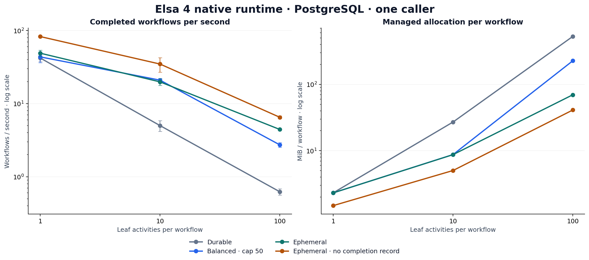
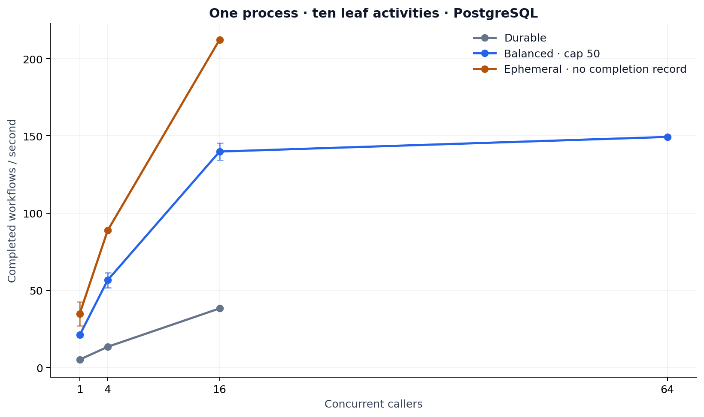

# Native runtime performance assessment — 31 October 2026

Status: measured assessment of commit `ab46bc22a52aa6e456bca6ac0e803c80904de081`; experimental optimization evaluated separately. This assessment retained no runtime source change; the separately qualified implementation is described in the [follow-up report](native-runtime-performance-implementation-2026-10-31.md). Program context: runtime efficiency; this is an owner-requested assessment, not a new wall-clock CI gate.

## Assessment

Deferred persistence and concurrency across independent workflows substantially increase throughput. The engine's current no-op overhead remains high: the Balanced baseline delivers 43.57, 20.95 and 2.73 whole workflows/s at one caller for 1, 10 and 100 leaves. The 100-leaf workflow allocates 226.84 MiB despite doing essentially no business work.

The strongest measured opportunity is unnecessary input-context reconstruction. A narrow zero-input experiment improved the 100-leaf paired comparison by about 79% and cut allocations by about 68%, preserving checkpoint and transaction counts. EF context pooling separately improved median throughput by about 13%. Those gains are workload-specific and have not been tested together.

For deployment planning, use bounded concurrency rather than extrapolating the one-caller rates or multiplying by node count. Ten-leaf Balanced runs reached about 140 workflows/s at sixteen callers; sixty-four callers delivered little additional throughput and much worse p95. The shared-store comparison below measures process topology on one machine, not distributed failover or multi-machine capacity. The priority is to eliminate read/allocation amplification, then qualify the same semantics under failures and representative workloads. The one-leaf Balanced in-memory case failed completion/leaf-count validation twice; it remains an unresolved correctness finding, described below and excluded from throughput.

## Scope and interpretation

The provider coverage is PostgreSQL, SQLite and the in-memory stores; SQL Server and MySQL were not benchmarked. The measurements exercise the native published-workflow start dispatcher, in-process actor, scheduler, activity construction/execution and persistence pipeline. They do not measure HTTP request throughput, Studio, BPMN, the execution-model refactor in another session, or ETL processing. One leaf is a typed activity that increments a counter and immediately completes. Longer workflows use a real Sequence with 10 or 100 such leaves: **1, 11 and 101 total activity executions**, respectively. There are no expressions, business I/O, workflow variables or payloads. Each case repeatedly starts one published definition with warmed executable caches; definition diversity/cache misses are not measured.

Earlier [HTTP performance](runtime-http-performance-2026-07.md) and [checkpoint-store](checkpoint-commit-store-performance-2026-08.md) assessments used different stacks, harnesses and persistence contracts. This is a fresh baseline; those older numbers do not support a direct percentage improvement/regression claim here.

This is intentionally a control-plane overhead test. A workflow/s result is a completed whole workflow; leaf executions/s is workflow/s multiplied by the number of leaves. It must not be read as records/s for an ETL pipeline or as a production capacity promise.

The host is an Apple M5 Pro, 15 logical CPUs, 64 GiB RAM, macOS 27.0.1, .NET SDK 10.0.402/runtime 10.0.13, ARM64 Release with server GC. PostgreSQL 16.15 runs locally in OrbStack, with `fsync`, `synchronous_commit` and `full_page_writes` enabled, 128 MB shared buffers and 100 maximum connections. This includes the local Docker VM/network boundary. Connection pooling is on; EF context pooling is off except where explicitly compared. Every independent case has its own process and fresh database; the two-process cohorts intentionally share one database.

Other sessions were using the machine. The final runner starts after five consecutive two-second samples with external CPU ≤400%, then rejects results if two consecutive samples exceed 500% during the measured interval, including a two-second margin on each side. Earlier cohorts used stricter whole-process/load-average gates; the evidence ledgers identify each policy and its accepted cohort. No result was selected on whether its throughput was fast or slow. The monitor excludes its own runtime process and OrbStack from external CPU. This removes major build/test interference but does **not** make the hardware dedicated or establish a statistical confidence interval; other work inside the shared Docker VM is not separately identified. Accepted runs, exclusions and environment samples are preserved.

## Persistence semantics

The current names are [Durable, Balanced and Ephemeral](../adr/0080-elsa-4-simplification-decisions.md#d2--persistence-modes-balanced-by-default). Durable bundles the checkpoints produced by an activity; it is no longer the old per-checkpoint Immediate mode. Balanced defaults to a cap of 50 activities and flushes at mandatory boundaries. Ephemeral removes the periodic cap, but ordinarily records completion. `EphemeralNoRecord` below is a **benchmark label** for Ephemeral with `RecordCompletion=false`, not a fourth public mode.

The shipped [ReplaySafe fusion options](../../Essentials/src/Workflows/Runtime/Core/Models/RuntimeReplaySafeFusionOptions.cs) remain enabled: eligible schedule/start/invoke stages and completion cascades already run inline within a coalescing burst. These measurements therefore include the existing dispatch-locality optimization; adding fusion is not a new opportunity.

Deferred writes do not mean deferred reads. Nor does Ephemeral mean “never touch the database.” Admission, source/provenance checks, ownership and mandatory boundaries remain. The no-record probe still contains scheduler/liveness writes; absence of a retained workflow execution record is not absence of database writes. Unmarked CLR activities default to External, as documented by [ActivitySideEffectProfileAttribute](../../Essentials/src/Activities/Runtime/Core/Attributes/ActivitySideEffectProfileAttribute.cs). Non-ReplaySafe activities require an attempt claim before execution; dispatch, suspension, incidents and other boundaries can force persistence. The no-record exception applies only to a never-persisted, one-pass run meeting the documented conditions.

Durability and replay are part of the workload contract. A larger cap accepts more replay after a crash. A real external side effect must not be relabelled ReplaySafe just to get the faster numbers. Durable engine state also does not make a remote business effect exactly-once; the integration still needs appropriate idempotency/reconciliation.

## Measured results

### PostgreSQL baseline, one concurrent caller

Two independent processes per cell. Throughput is the median, with the full observed range. p95 is the median of each process’s p95; allocation is managed MiB per completed workflow. The 100-leaf Durable runs each contain 30 measured completions; the other baseline runs contain at least 100. Short tails, particularly p99, are not reliable SLO estimates.

| Leaves | Mode | WF/s | Observed range | p95 ms | MiB/WF | EF commands | Checkpoint commits | EF tx commits |
| --- | --- | --- | --- | --- | --- | --- | --- | --- |
| 1 | Balanced (cap 50) | 43.57 | 36.32–50.83 | 43.2 | 2.31 | 46 | 1 | 2 |
| 1 | Durable | 42.07 | 37.34–46.80 | 43.6 | 2.32 | 46 | 1 | 2 |
| 1 | Ephemeral | 48.99 | 44.23–53.74 | 34.7 | 2.31 | 46 | 1 | 2 |
| 1 | Ephemeral (RecordCompletion=false) | 82.70 | 82.33–83.06 | 20.9 | 1.49 | 33 | 0 | 1 |
| 10 | Balanced (cap 50) | 20.95 | 19.74–22.17 | 98.2 | 8.74 | 76 | 1 | 2 |
| 10 | Durable | 5.00 | 4.17–5.84 | 360.6 | 27.07 | 286 | 12 | 25 |
| 10 | Ephemeral | 19.85 | 17.73–21.97 | 99.2 | 8.72 | 76 | 1 | 2 |
| 10 | Ephemeral (RecordCompletion=false) | 34.79 | 26.99–42.60 | 69.2 | 5.03 | 63 | 0 | 1 |
| 100 | Balanced (cap 50) | 2.73 | 2.53–2.93 | 519.3 | 226.84 | 391 | 3 | 7 |
| 100 | Durable | 0.62 | 0.56–0.69 | 1897.9 | 528.67 | 2176/2339 | 102 | 205 |
| 100 | Ephemeral | 4.43 | 4.40–4.47 | 347.7 | 69.69 | 346 | 1 | 2 |
| 100 | Ephemeral (RecordCompletion=false) | 6.51 | 6.22–6.79 | 241.6 | 41.07 | 333 | 0 | 1 |

Error bars show observed process-to-process throughput ranges, not confidence intervals. The Durable/100 command range includes a background schema-maintenance overlap, explained below. At one leaf the three recorded modes do the same amount of database work, so their small timing differences are not evidence of a useful mode advantage. At ten leaves, Balanced and recorded Ephemeral also share the same commit/command shape. At 100 leaves, Balanced crosses the cap and rereads persisted state; Ephemeral avoids those intermediate commits. Durable includes the composite’s scheduling/completion checkpoints, so the checkpoint total is not simply the leaf count.

The 100-leaf Balanced baseline is 2.73 workflows/s, or 273 leaf executions/s, with 226.84 MiB allocated per workflow. Durable allocates 528.67 MiB per workflow. These are significant engine costs for bodies that do almost no business work.

### Concurrency and independent processes

Ten replay-safe leaves, one runtime process. Balanced at four/sixteen callers has two fresh process repetitions; the other concurrency cells are single exploratory runs. Increasing concurrent callers measures overlap across independent workflows; it does not parallelize the steps within one Sequence.

| Mode | Callers | Repetitions | WF/s | Observed range | p95 ms | Process CPU cores | CPU ms/WF | MiB/WF |
| --- | --- | --- | --- | --- | --- | --- | --- | --- |
| Balanced (cap 50) | 4 | 2 | 56.54 | 51.63–61.45 | 119.3 | 3.08 | 54.6 | 8.72 |
| Balanced (cap 50) | 16 | 2 | 139.87 | 134.22–145.51 | 259.1 | 7.03 | 50.2 | 8.71 |
| Durable | 4 | 1 | 13.32 | 13.32–13.32 | 394.8 | 2.49 | 187.3 | 27.03 |
| Durable | 16 | 1 | 38.19 | 38.19–38.19 | 559.7 | 5.96 | 156.2 | 27.05 |
| Ephemeral (RecordCompletion=false) | 4 | 1 | 88.77 | 88.77–88.77 | 81.9 | 3.37 | 38.0 | 5.06 |
| Ephemeral (RecordCompletion=false) | 16 | 1 | 212.42 | 212.42–212.42 | 255.1 | 6.87 | 32.3 | 5.02 |
| Balanced (cap 50) | 64 | 1 | 149.34 | 149.34–149.34 | 875.9 | 5.91 | 39.6 | 8.70 |

The single-leaf Balanced higher-concurrency probes each have one exploratory process run:

| Callers | WF/s | Observed range | p95 ms | Process CPU cores |
| --- | --- | --- | --- | --- |
| 16 | 301.69 | 301.69–301.69 | 72.6 | 5.91 |
| 64 | 402.22 | 402.22–402.22 | 333.6 | 5.58 |

For ten-leaf Balanced workflows, 64 callers reached 149.34 workflows/s versus a median 139.87 at sixteen, but p95 rose from 259.1 to 875.9 ms. The separate one-leaf probes gained about 33% throughput from sixteen to sixty-four callers while p95 increased about 4.6-fold. This supports measuring a concurrency knee and enforcing backpressure; it does not establish a universal caller limit.

The following uses the same published artifact and shared PostgreSQL database at **eight total callers**: either one process with eight, or two processes with four each. Each configuration has two synchronized cohorts on the same physical machine, with topology order reversed in the second repetition. Every process runs schema initialization/admission and its associated maintenance services; the second process reuses the published artifact. The aggregate measurement spans first measured start to last measured finish.

| Processes | Total callers | Median aggregate WF/s | Observed range | Median pooled p95 ms |
| --- | --- | --- | --- | --- |
| 1 | 8 | 93.18 | 90.31–96.06 | 145.8 |
| 2 | 8 | 92.66 | 90.58–94.73 | 115.2 |

These are shared-store throughput observations using in-process actors in each host. They do not establish multi-machine scaling, distributed transport throughput or failover correctness. More processes still share CPU, GC capacity, the Docker VM and PostgreSQL; there is no justified linear capacity multiplier here.

### Side-effect declarations and configuration tuning

The External test changes the leaf’s side-effect declaration but keeps its body a no-op. It measures the mandatory protection cost, not real network/business I/O. One exploratory process per cell, ten leaves, concurrency one.

| Mode | WF/s | p95 ms | EF commands | Checkpoint commits | EF tx commits |
| --- | --- | --- | --- | --- | --- |
| Balanced (cap 50) | 5.64 | 272.3 | 254 | 11 | 22 |
| Durable | 3.56 | 414.4 | 377 | 22 | 33 |
| Ephemeral (RecordCompletion=false) | 5.24 | 322.5 | 254 | 11 | 22 |

Balanced and Ephemeral with RecordCompletion=false have the same command/commit shape in this External workload. The mandatory attempt claims persist the run before completion, so its final completed state is retained. The small timing difference between these two single-process samples is not a demonstrated mode advantage.

Pooling configurations below each have two fresh process repetitions, with the order reversed for the second comparison; each cap probe has one exploratory run. Pooling rows keep Balanced’s cap at 50 and use ten leaves/four callers; cap rows use 100 leaves/one caller with context pooling off. The ordinary cap-50 baseline above is a separate cohort.

| Leaves | Callers | Cap | EF context pool | Repetitions | WF/s | Observed range | p95 ms | MiB/WF | EF commands | Checkpoint commits |
| --- | --- | --- | --- | --- | --- | --- | --- | --- | --- | --- |
| 10 | 4 | 50 | off | 2 | 57.06 | 53.82–60.29 | 120.7 | 8.73 | 76 | 1 |
| 10 | 4 | 50 | on | 2 | 64.48 | 63.44–65.52 | 106.0 | 7.80 | 76 | 1 |
| 100 | 1 | 10 | off | 1 | 2.27 | 2.27–2.27 | 515.1 | 348.78 | 527 | 12 |
| 100 | 1 | 250 | off | 1 | 5.59 | 5.59–5.59 | 293.9 | 69.79 | 346 | 1 |

Across the two pooling repetitions, median throughput improved by 13% and managed allocation fell by 11%, with unchanged command and checkpoint counts.

A cap above this workflow’s length avoids periodic commits but permits more replay after a crash. Pooling changes object/context reuse; it does not change connection pooling or the workflow’s durability policy. These narrow results require representative tenant/scoped-service validation before any default change.

### Isolated zero-input experiment

The diagnostic patch skips durable-value/activity-view/frame construction only for the default input materializer when both the pinned input contract and the binding set are empty. It still invokes the normal snapshot materializer. Baseline and patch were frozen in separate binary directories; the order was reversed in the second repetition. All four cells use PostgreSQL, Balanced cap 50, one caller.

| Leaves | Variant | WF/s | Observed range | p95 ms | MiB/WF | EF commands | Checkpoint commits | EF tx commits |
| --- | --- | --- | --- | --- | --- | --- | --- | --- |
| 10 | baseline | 18.22 | 17.40–19.05 | 104.0 | 8.78 | 76 | 1 | 2 |
| 10 | fast | 24.68 | 21.39–27.97 | 81.7 | 8.33 | 65 | 1 | 2 |
| 100 | baseline | 3.15 | 3.13–3.17 | 389.1 | 227.01 | 391 | 3 | 7 |
| 100 | fast | 5.63 | 5.30–5.96 | 294.7 | 71.58 | 290 | 3 | 7 |

At 10 leaves, the paired-cohort medians improved throughput by 35% and reduced allocation by 5%, with unchanged checkpoint and transaction counts. The observed speed ratio is 1.35×; it is not a universal multiplier for other workloads.

At 100 leaves, the paired-cohort medians improved throughput by 79% and reduced allocation by 68%, with unchanged checkpoint and transaction counts. The observed speed ratio is 1.79×; it is not a universal multiplier for other workloads.

The patch was reverted from runtime source. Its completion/leaf/state checks passed for these probes, but custom materializers, variable scopes, expressions, recovery and the wider test suite were not qualified. It demonstrates an opportunity, not a production-ready implementation.

### Local-provider exploration

One fresh process per cell, so these numbers are exploratory. In-memory stores do not provide process-crash durability; SQLite has a different concurrency/storage path. Provider figures include their respective engine/store implementations and retained history during each case, and are not a controlled database-product ranking.

| Provider | Leaves | Balanced WF/s | No-record WF/s |
| --- | --- | --- | --- |
| Memory | 1 | Failed validation | 3349.22 |
| Memory | 10 | 156.71 | 588.95 |
| Memory | 100 | 19.25 | 51.59 |
| Sqlite | 1 | 95.19 | 191.44 |
| Sqlite | 10 | 35.87 | 46.69 |
| Sqlite | 100 | 4.74 | 9.18 |

| SQLite Balanced callers | WF/s | p95 ms |
| --- | --- | --- |
| 4 | 56.43 | 332.1 |
| 16 | 68.94 | 795.2 |

Both SQLite concurrency probes passed their completion/state checks. Raising callers from four to sixteen increased throughput from 56.43 to 68.94 workflows/s, while p95 rose from 332.1 to 795.2 ms. These are single exploratory samples; they demonstrate a tail-latency trade-off, not a production concurrency limit. SQLite journal mode and the native library details are retained with the evidence.

## Why this profile costs so much

### Read amplification before activities execute

[RuntimeActivityInputSnapshotMaterializer](../../Essentials/src/Workflows/Runtime/Elsa.Workflows.Runtime/Services/Values/RuntimeActivityInputSnapshotMaterializer.cs) loads durable values and the entire activity execution view before building the input context, even when the activity has no inputs. The [coalescing activity-state wrapper](../../Essentials/src/Workflows/Runtime/Elsa.Workflows.Runtime/Services/Coalescing/CoalescingRuntimeStateStores.cs) still consults the durable store when listing state. Newly created activity/inspection point lookups also fall through to the store when the overlay has no entry.

For the replay-safe PostgreSQL cases below the commit cap, the observed command shape is `43 + 3A` with a completion record, and `30 + 3A` without one, where A is the total number of activities including Sequence. For a one-leaf workflow, 43 of the 46 commands sit outside that recurring per-activity term. Improving the fixed start/admission/commit path therefore matters for tiny workflows too; the zero-input A/B experiment only covers ten and 100 leaves. The recurring three reads per activity are the activity-state page, an activity-state point lookup and an inspection point lookup. Thus ten leaves still produce 76 commands in Balanced mode, although only one checkpoint bundle is persisted. At 100 leaves, cap flushes place earlier activity states into the database, and subsequent full-view reads repeatedly load and validate them.

The merge path also obtains `session.GetActivityUpserts()` (which creates an array), filters and orders it while selecting successive overlay entries. Repeating that work while building the view at every activity increases in-memory work with workflow length. This is a bounded-session data-structure and query-planning opportunity, not merely a database tuning problem. The in-memory activity store also filters a snapshot of the shared store when listing a workflow, so retained history can affect its cost; the Memory results should not be treated as a history-independent CPU ceiling.

### Allocation evidence

A separate warmed PostgreSQL Balanced/100-leaf trace recorded 63,473 sampled allocation events representing approximately 6.95 GB. Strings accounted for 52.1%, byte arrays 11.7% and character arrays 6.3% of sampled bytes. Attribution to the first Elsa frame associated about 23.5% with `EfActivityExecutionStateStore.ReadCheckedCore`, 17.9% with `EfRelationalIdentity.Decode`, and 3.6% with identity projection checks. These are allocation-stack attributions, not exclusive CPU percentages.

[ReadCheckedCore](../../Essentials/src/Workflows/Runtime/Persistence/EntityFrameworkCore/Stores/EfActivityExecutionStateStore.cs) decodes lossless identities, verifies projections and deserializes stored state. Those checks have a purpose; repeatedly requesting data the activity does not need is the first thing to remove. The trace was collected separately, with profiling overhead and shared-host interference, so its throughput is excluded from the baseline. The sampled thread-time trace is also not treated as an on-CPU profile.

At sixteen concurrent callers, the two ten-leaf Balanced runs allocated approximately 1.14–1.24 GiB/s and used about 49–51 ms of process CPU per completed workflow. This is substantial allocation churn even though persistence is deferred. It supports reducing reconstruction and transient objects before increasing concurrency further; it does not apportion all CPU time or prove a single bottleneck.

Allocated bytes/workflow in the tables mean allocation churn, not retained memory or peak RAM. The process peak-working-set API returned an unusable zero on this host; no resident-memory claim is made.

### Fixed context and commit costs

[EfRelationalProviderBinding](../../Essentials/src/Persistence/EntityFramework/EfRelationalProviderBinding.cs) builds and compiles a provider configuration expression when binding a context. Context/options/provider-delegate reuse is worth examining, preserving the actual provider, migrations assembly, schema and tenant boundaries. Context pooling and connection pooling are different mechanisms; pooled contexts must not leak per-request state.

The [checkpoint store](../../Essentials/src/Workflows/Runtime/Persistence/EntityFrameworkCore/Stores/EfRuntimeCheckpointCommitStore.cs) computes a fingerprint, checks an existing marker, acquires the executable root write lease when needed, fences the execution, stages participants, saves participants then the marker, and commits. Participant reads already batch by participant type. The ten-leaf accounting probe executes one workflow-state SELECT shape seven times, as well as repeated liveness reads. That is a concrete starting point for tracing repeated fresh-start checks across scopes. Measure contention on executable coordination/root leases and execution rows under shared-artifact load before attributing a scale limit to them. The remaining fixed command budget includes real admission, ownership, fencing and provenance work; removing those protections is not an optimization.

### Periodic schema maintenance

The second Durable/100-leaf accounting sample contains 2,339 commands versus 2,176 in the first. The 163-command difference is accounted for by schema-finalization queries/updates and schema-version counts; the workflow checkpoint count remains 102 and explicit transaction count remains 205. These extra commands were captured by the process-wide interceptor during the accounting execution, not proved to be caused by that execution.

[EfModuleMigrator](../../Essentials/src/Persistence/EntityFramework/EfModuleMigrator.cs) starts finalization and backfill loops after admission. [Finalization defaults](../../Essentials/src/Persistence/EntityFramework/SchemaFinalization/EfSchemaFinalizationOptions.cs) include a 15-second refresh and a 30-second evaluation; [backfill defaults](../../Essentials/src/Persistence/EntityFramework/SchemaBackfill/EfSchemaBackfillOptions.cs) include a 15-second check; settled backfill audits have a separate one-hour interval. Do not infer that every table is counted every fifteen seconds. This is an additional workload to measure over longer runs and large retained histories, with representative cluster membership/version transitions. Keep schema compatibility protections while reducing avoidable polling or audit work. [The captured SQL](evidence/native-runtime-performance-2026-10-31/schema-maintenance-accounting.json) distinguishes this work from the native workflow command shape.

## Recommended work, in order

First, investigate the repeated in-memory incomplete-start finding described under robustness. Capture the original dispatch/drain result and retained outbox state when it occurs, then verify whether ordinary recovery converges. Treat that as a correctness follow-up, separate from the optimization sequence below.

1. **Build input contexts on demand.** Start with the guarded zero-input path, then literal-only inputs and compiled dependency plans for variables, ancestor scopes and activity results. Preserve custom materializers, output captures, durable input snapshots, expression semantics and recovery behavior. Establish explicit read/command budgets for zero-input and literal-only workflows.
2. **Keep a bounded, indexed execution view per drain.** Reuse the validated baseline and merge each overlay once. Avoid per-item array/filter/sort rebuilding. Track identities known to be newly created so safe negative lookups do not hit the database. Invalidate correctly on commit caps, scope cleanup, lease/fence changes, external mutations and resumed execution. Do not introduce a global cache that can return another tenant's or an older owner's state.
3. **Reuse EF setup where safe, then simplify remaining database work.** Evaluate pooling with representative tenant/scoped services, and cache provider-binding delegates with correct keys. After read elimination, profile the fixed fresh-start command budget and checkpoint round trips. Investigate carrying authoritative fresh/existing admission state through the drain instead of repeating checks across scopes, combine compatible reads/writes, and measure command counts plus actual wire round trips. These are hypotheses to test, not measured gains. Keep marker/state/outbox atomicity, stale-writer rejection and executable lifecycle protection intact.
4. **Reduce repeated serialization and hashing after fixing unnecessary loads.** Validate and normalize immutable model contracts at their appropriate materialization/version boundaries, then reuse them with registry/module-generation-aware invalidation; keep mutable-state and fencing checks at commit. Reuse compiled metadata; avoid repeated canonical JSON materialization and temporary buffers. Preserve deterministic fingerprints and backward-compatible durable representations. Benchmark payload sizes before choosing a more complex storage representation.
5. **Tune bounded concurrency and persistence cadence from evidence.** Use admission backpressure and separate limits for CPU work, database work and external I/O. Raising workflow concurrency can hide latency but can worsen p95, allocation pressure and database contention. Budget database connections across all nodes, and choose lease/renewal settings using measured GC pauses and failure-recovery requirements. A larger commit cap is a recovery trade-off, not a universal default improvement.

Suggested acceptance criteria for the first work unit: zero full activity-view reads for the default zero-input path; unchanged checkpoint/explicit-transaction counts; identical completion and snapshot semantics; coverage across commit caps, custom materializers, scoped variables and restart/replay; then repeat this matrix and a realistic expression/payload workload. For the broader execution-view work, aim for allocation and query growth proportional to the work performed, with a bounded live session view. These are proposed criteria, not currently passed gates.

This ordering keeps the architecture straightforward: remove unnecessary work before introducing another scheduler, distributed cache or custom storage engine. The pooling and zero-input changes were measured separately; their gains must not be multiplied without a combined experiment. The prototype and measurements support the first item; the others are source-supported hypotheses requiring their own controlled A/B tests.

## Implications for the shared execution foundation and ETL

Keep ownership, checkpoint atomicity, recovery, outbox and observability reusable across execution models, while allowing each model to supply a compact state delta and its actual data dependencies. A common foundation should not force every activity/token/record to enumerate the whole native workflow history.

For ETL, make a workflow coordinate **bounded batches or partitions**. Stream records through transforms with backpressure inside those units, and checkpoint offsets/batch progress at explicit boundaries. Avoid treating each record and each column transform as a fully persisted workflow activity. Keep large datasets in external storage and pass references when appropriate. This is an architectural recommendation; this assessment measured no ETL workload or batch size.

BPMN needs its own representative token, gateway, event and subprocess workloads. Native Sequence numbers cannot establish BPMN performance. The important transferable evidence is the cost of horizontal services, especially unnecessary state reconstruction and per-operation storage traffic.

## Robustness and production qualification

**A repeated in-memory correctness failure remains to be resolved.** The first one-leaf Balanced in-memory run returned 14,991 measured starts but executed only 14,990 leaves. Across warmup, accounting and measurement, 17,552 execution states existed and 17,551 were Completed; the scheduler queue was empty and no start exception escaped. The retry returned 14,255 measured starts but executed 14,254 leaves. Its incomplete workflow remained Running at WorkflowStarted with no activity rows and no incident. Both failures occurred in load-qualified runs. These rates are excluded; the case is marked Failed validation rather than reported as completed-workflow throughput. The underlying cause was not determined by this assessment. Accepted start dispatch is not a completion guarantee, and the harness has no background recovery sweep; permanent loss is not established. The finding is that this trivial run did not satisfy the probe’s completion invariant, not proof that recovery would fail. Separate diagnostic runs completed 30,444 measured workflows at sixteen callers and 35,999 at one caller (32,180 and 38,444 including setup). The latter checked leaf completion immediately after every dispatch. These passes do not invalidate the two failures or establish a fix. Both diagnostics ran separately from timed qualification and their throughput is not included. The raw failed result is preserved alongside the later provider measurements.

The successful runs verify completed workflow state, exact leaf counts, expected activity rows and drained scheduler work; relational runs additionally check incidents and pending outbox rows. The Memory probes check workflow state, leaf counts and queued work; they do not perform the relational probes’ exhaustive incident/outbox validation. The diagnostic retry additionally captures incidents for any incomplete Memory workflow. The shared-database process test verifies independent starts under concurrency. It does not demonstrate distributed activation, recovery ownership transfer, or linear multi-machine scale-out.

The existing [distributed actor provider](../../Essentials/src/Workflows/Runtime/Distributed/Elsa.Workflows.Runtime.Distributed/Services/DistributedWorkflowExecutionActorProvider.cs) separates placement/routing from authoritative execution fencing. That is a useful foundation to preserve. This benchmark does not activate that provider or its durable transport, so it cannot price their additional work.

Also review runtime identifier generation for the intended deployment rate. [ShortRuntimeExecutionIdGenerator](../../Essentials/src/Workflows/Runtime/Elsa.Workflows.Runtime/Services/Executions/ShortRuntimeExecutionIdGenerator.cs) uses [ShortIdentityGenerator](../../Essentials/src/Primitives/Primitives/Identity/ShortIdentityGenerator.cs), which combines a millisecond timestamp with 22 random bits and explicitly recommends a different strategy for high-throughput/multi-node generation. [Coalesced commit IDs](../../Essentials/src/Workflows/Runtime/Elsa.Workflows.Runtime/Services/Coalescing/RuntimeCoalescingDrainScopeFactory.cs) use the same generator. Establish collision handling and a scoped uniqueness budget, or select an appropriately unique generator, before relying on much higher aggregate rates. This is a separate source-level concern; no identifier collision was established as the cause of the in-memory failure.

Before calling a tuned engine production-qualified, run a separate fault-and-load matrix:

- Kill an owner before/after a cap flush, before/after an external attempt claim, and around state/marker/outbox commit; restart on the same store and verify the documented replay boundary.
- Force lease expiry and a delayed old owner; prove stale writes are rejected. Deliver duplicate start/resume commands concurrently across nodes and verify idempotency and bookmark consumption.
- Interrupt the database or delay it; verify retries, cancellation, bounded queues, backpressure, outbox redrive and recovery convergence. Include long external calls with explicit idempotency.
- Measure sustained arrival rates, p95/p99 and queue growth with a large retained history and many suspended instances, not just fresh databases. Measure resident memory and database CPU/I/O/locks as well as managed allocations.
- Add representative expressions, payload sizes, fork/join, loops, child dispatch, suspend/resume, timer and real HTTP workloads. Repeat on deployment hardware and a remote database with measured RTT, using multiple machines for genuine scale-out.

Keep the existing deterministic EF-command budgets in CI, per ADR 0080. Add semantic/read/allocation-shape regression coverage where stable; retain wall-clock comparisons as controlled qualification evidence. A no-op benchmark alone is insufficient to certify crash safety or the performance of business integrations.

## Reproduction and evidence

The final accepted dataset contains 71 process measurements and 94,406 measured completed workflows. One additional provider configuration failed its completion checks twice; two separate diagnostic runs passed and are excluded from throughput. All planned provider, concurrency, pooling, cap, optimization and shared-database process checks were exercised.

See [the evidence README](evidence/native-runtime-performance-2026-10-31/README.md) for the frozen harness, exact configurations, binary/source hashes, accepted results, environment/exclusion ledger, allocation summary and experimental patch. [All result tables](evidence/native-runtime-performance-2026-10-31/tables.md) retain the smaller provider, tuning and concurrency cohorts.

Schema initialization, publication and cold starts are outside warm throughput. EF schema-admission, finalization and backfill services started by initialization remain active; their background work is included if it overlaps measurement. Cold latency is recorded separately and is not a full application startup measurement. Baseline figures are medians across two fresh processes per cell; shorter exploratory/tuning cohorts are identified beside their tables. The latency columns are medians of per-process percentiles, not percentiles pooled across differently loaded runs. Single-client baseline throughput is completion throughput at concurrency one, not saturation throughput. Warmup uses serial starts; the concurrency drives include their initial ramp-up in the measured window. These short drives are not long steady-state saturation tests.

SQL accounting comes from one additional warmed execution per process, outside the timing window. The interceptor is process-wide, so overlapping schema maintenance can add commands; it is a sampled window, not an exclusive or invariant per-workflow budget. An EF command can contain multiple SQL statements, and explicit EF transaction-commit events are counted separately. Implicit database transactions for individual commands are not counted by that interceptor. These counts are not physical database connections or verified network round trips. Command execution durations are not used to apportion total latency because reader materialization occurs beyond those callbacks.
