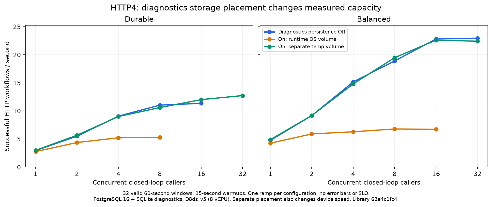

# Runtime Efficiency continuation evidence

Program [#2531](https://github.com/elsa-workflows/elsa-foundation/issues/2531), draft integration [#3601](https://github.com/elsa-workflows/elsa-foundation/pull/3601).
This is an in-progress receipt. It does not establish completion of M0–M5 or current-main throughput. Independent-host capacity below covers independent starts sharing one PostgreSQL server; failure injection and remote Cancel are reported separately, including what did not qualify.
The [baseline assessment](native-runtime-performance-2026-10-31.md) and [first implementation receipt](native-runtime-performance-implementation-2026-10-31.md) retain their original cohorts and exclusions.

## Hydration and preparation

Hydration metadata (#2657) merged in #3598 as `11a07e86686c68bb523334409e66f39deaed068c`, after review and required checks on `f445cea8d370e24c7b9f80a9ce89c4ce6e927e27`.
The first main run was cancelled when main advanced. Containing main `1d77ed131de3305da8b8236f739c63085bff3e73` then passed [CI 41289485400](https://github.com/elsa-workflows/elsa-foundation/actions/runs/41289485400).

Integration head `36444c42792d96e13f9c05a98bd73e9c07ed3ddb` adds demand-driven input reads and weak immutable JavaScript/conversion preparation. Independent early review found fresh-hydration script misses and missing closed-scope read-budget proof; both were addressed and the next three-lens review was clear. Final integrated qualification remains due.

## Owned activity reads: rejected experiment

Three variants tested #2583: private provider-scope rows, sharing private rows under the actual live ownership lease, and priming that lease's bounded read memo from a successfully committed fresh checkpoint. Mutable runtime documents were still reconstructed on each read. Replay and uncertain outcomes never primed the memo. These were experiments and the entire prototype was removed.

| SQLite reference workflow | Current candidate, Durable | Read memo | Commit-primed memo |
|---|---:|---:|---:|
| Ten WriteLines | 336 | 336 | 336 |
| HTTP reference | 204 | 204 | 204 |
| Fork/join with resume | 253 | 252 | 251 |

Balanced/Ephemeral were 90, 104, 180 respectively; only fork/join changed, to 179 and then 178. All ten budget tests passed in each variant. The extra durable-state ownership and invalidation machinery did not justify saving two commands in one fixture. No budget was lowered and no throughput gain is attributed to #2583. The owner later retired #2583 as not planned on this measured negative result (see Owner dispositions).

## Cooperative cancellation of a progressing native drain

The default actor composition publishes a mailbox-local signal while a valid Cancel waits behind an active turn. Discrete and replay-safe fused steps notice it before the next step. The orchestrator flushes its folded segment through the existing fenced checkpoint path and returns `Yielded`, releasing the lease and mailbox so the normal Cancel handler can execute. A cancelled waiter withdraws its signal. The configured concrete local provider is shared with distributed placement. An activity already running must finish or cooperate before handoff; delivery through remote transport was qualified later for a parked execution only; a progressing drain on another node did not qualify (see [Remote cancellation across a durable cluster](#remote-cancellation-across-a-durable-cluster)).

Six real SQLite integration cases cover External and ReplaySafe loop bodies under Durable, Balanced and Ephemeral. Each starts an otherwise unbounded progressing While with no total-cycle cap, requests Cancel through the public actor API while the first body is executing, and proves one completed body, durable Cancelled state, a yielded turn and unchanged activity state after a resumption sweep. A bounded runaway guard makes removal of the behavior fail without hanging.

Three mailbox cases cover a valid waiting Cancel, cancellation of the waiter, and rejection of another partition. They also check that the signal is execution-specific and is cleared before the Cancel turn.

| Deliberate mutation | Failing controls | Restored |
|---|---:|---:|
| Remove scheduler yield check | 6/6 | 6/6 pass |
| Remove fused-step yield check | 3/6 | 6/6 pass |
| Keep a cancelled/acquired waiter's signal | 2/3 | 3/3 pass |
| Omit final folded-segment flush | 6/6 | 6/6 pass |

Whole affected suites on the restored candidate: runtime 3,122 passed, HTTP integration 101 passed, zero failed/skipped. Discovery accounts for all cases: HTTP lists 101; runtime lists 3,111 including three unexpanded theories that execute as 14 rows (4, 2 and 8), yielding 3,122. The nine SQLite command counts stayed 336/204/253 (Durable) and 90/104/180 (Balanced/Ephemeral). The new idle intent check adds no EF command; no budget was raised. These are correctness and command-count results, not throughput measurements.

The first compile attempt used the wrong start-dispatch overload; the first behavioral attempt omitted the resumption-service registration in the test fixture. Those setup failures are retained separately and are not causal red controls. A subsequent replay-safe case exposed one extra fused body iteration; the explicit fused-step check fixed it.

### Independent review corrections

The first cancellation review found a same-key retry race: the first Cancel turn could yield to a second waiting
Cancel, then the second returned Duplicate without draining the first one's queued cancellation. Cancel turns now
suppress cooperative yielding. The real SQLite matrix has twelve cases, adding two same-key waiters in each
mode/profile case. Removing that suppression fails the six duplicate cases; restoration passes all twelve.

Review also found that distribution-first registration could retain an unconfigured mailbox factory. Core and
Distributed now share one internal factory. The same-domain friend grant shares repository DI wiring; third-party
providers can resolve the configured public concrete mailbox and do not need this internal factory. Two behavioral
registration-order cases use the configured mailbox and real scheduler. Restoring the old distributed factory fails
only the distribution-first case; the shared factory passes both.

Recovery assertions now check sweep failures, settled outbox and empty scheduler backlog, followed by a second sweep
that does no work. Replacing the first sweep with a no-op fails all twelve cases; restoration passes all twelve.
The corrected whole suites pass: runtime 3,122, Distributed 114, HTTP integration 107, zero failed/skipped. Discovery
accounts for all cases (runtime's same three delayed theories expand 3,111 discoveries into 3,122 executions).
All nine reference EF command counts remain unchanged. Final independent re-review and program gates are still due.

## Unchanged native roots: candidate #2586

An eligible fenced native checkpoint can update an existing workflow row without acquiring another executable
root-write lease. The live session's durable-record flag is only an eligibility hint. The staging query checks the
actual row and exact full pinned identity inside the transaction; its normal revision CAS prevents deletion or
replacement from becoming an insert. Missing/changed roots roll back before SaveChanges and retry through the
ordinary leased path. Initial roots, model/admission writes, unfenced calls and dirty/externally transacted contexts
keep the leased path. Replay and uncertain-acknowledgement reconciliation retain the immutable marker contract.

| SQLite fixture | Before this change | Candidate | Removed commands |
|---|---:|---:|---:|
| Durable ten WriteLines | 336 | 329 | 7 |
| Durable HTTP reference | 204 | 183 | 21 |
| Durable fork/join/resume | 253 | 246 | 7 |
| Balanced/Ephemeral ten WriteLines | 90 | 90 | 0 |
| Balanced/Ephemeral HTTP reference | 104 | 97 | 7 |
| Balanced/Ephemeral fork/join/resume | 180 | 173 | 7 |

Disabling this optimization restores all measured pre-change counts. The previous committed budgets were
347/206/256 Durable and 101/106/183 Balanced/Ephemeral; those are budgets, not the measured baseline in this table.
Budgets are now lowered to the measured candidate. No throughput improvement is claimed from command counts alone.

Twelve focused controls cover unchanged-root update/replay, stale hints, changed artifact or equal-ID/different-hash
pins, absent record hints, other executions, unfenced/dirty calls, stale fencing, row revision/deletion races and
ambiguous commit acknowledgement. Disabling the optimization fails five controls; removing the actual-row guard
fails three; removing the workflow revision token fails the replacement case. Restoration passes all cases. The row
race controls mutate the SQL row within the test transaction immediately before SaveChanges; they establish the
conditional write and rollback behavior, and are not independent-host race evidence.

Whole local EF persistence: 1,851 passed; HTTP integration: 107 passed, zero failed/skipped. Discovery reconciles all
executions. Independent review, cluster root-deletion races and final program gates remain due (point-in-time; see [Independent-host failure qualification](#independent-host-failure-qualification) for the later results). Initial fixture
attempts omitted required codecs/run-health state and expected the wrong stale-fence exception; they are retained
separately, not counted as causal controls. The saved mutation source differs from the final source only in its XML
summary; the final whole suites ran against the current source.

### Production relational providers

At `29df383ba1124575a26b6424ae854597e9e49245`, the strict native-provider suite passed all 236 discovered/executed
cases over PostgreSQL 16, SQL Server 2022 CU18 and MySQL 8.4.11, zero failed/skipped. The retained-root matrix
passed 24/24; disabling the optimization failed 18 and passed six, and restoring it passed 24/24. Together with
the SQLite controls this covers the actual fast path on all four providers, including public deletion and uncertain
acknowledgement; it does not establish independent-host race behavior or throughput.

Two earlier Azure attempts ran no tests because readiness failed. Retained startup logs identified a MySQL client
password variable interfering with first-time initialization. The next whole run passed 233 and failed three older
smoke tests whose run-health assertions used an unscoped `SingleAsync` against a shared database. Scoping those
assertions to their workflow and persistence scope produced the fresh 236/236 pass. All failed/setup receipts are
retained separately. The task-owned database containers bound only to loopback and were removed, with their
volumes, after every attempt. The existing Azure runner returns to its initial deallocated state after collection.

The core evidence archive was collected locally and its SHA256 verified as
`08a2b4720007004f6f85154c0dec89bc6103fee18968b836cc24c5870425b117`. Discovery and execution both account for
236 tests. The first local extraction attempt used a newer Python tar API than the available interpreter; the same
verified archive was then extracted with checked regular-file names, with no provider rerun or result change.

## Retained boundaries: prerequisite state corrections for #2828

Before enabling any new retained boundary, three controls reproduced stale-state defects. A new segment could
reapply a previously committed dispatch over a later durable lifecycle; an old overlay dispatch could override a
newer trailing checkpoint change; and a later cap fold could restage an already-delivered external outbox item as
Pending. The stores correctly rejected the first and third stale writes rather than silently accepting them, but
that still failed the later checkpoint. The trailing-change control returned Pending instead of Started.

Committed dispatch snapshots now leave the segment's pending write set, explicit trailing dispatch changes win
over the earlier overlay, and folds do not restage outbox items already persisted by an earlier segment. The
canonical claim-completion path also releases its settled immediate-continuation provenance. No new boundary
retains folding yet in this prerequisite slice.

All three baseline cases fail and the corrected cases pass. Individually restoring each stale path fails its
corresponding case and passes the other two; restoration passes all three. Whole suites pass: runtime 3,137,
EF persistence 1,851 and HTTP integration 113, zero failed/skipped, with complete discovery accounting. The next
step is to retain qualified suspension/child-dispatch boundaries, then prove their crash and takeover behavior;
these prerequisite controls do not establish that remaining acceptance.

## Continuing folding after native boundaries (#2828)

The candidate now commits qualified nonterminal suspension, bookmark creation, child dispatch and subsequent
before-user-code attempts immediately, then keeps folding in a new segment. Terminal, admission and control
boundaries retain their conservative path. External outbox work uses durable claims and fresh lifecycle reads while
scheduler continuations retain their local overlay. Seven external-delivery controls include uncommitted exclusion,
renewal, bounded mixed claims and rejection after another owner takes the claim. Reinstating broad external overlay
routing fails five; reinstating stale external exact lookup fails three. Restoring the candidate passes all seven.

Twenty-four mode/boundary/buffer cases fail under the former stop rule and pass with continued folding. The actual
SQLite references execute the workflow and validate completion, resume, settled queues/outbox and no incidents:

| Reference | Mode | Former stop rule | Candidate EF commands |
|---|---|---:|---:|
| Ten WriteLines | Durable / Balanced / Ephemeral | 329 / 90 / 90 | 329 / 90 / 90 |
| HTTP reference | Durable / Balanced / Ephemeral | 183 / 97 / 97 | 183 / 97 / 97 |
| Fork/join with actual bookmark resume | Durable / Balanced / Ephemeral | 245 / 173 / 173 | 229 / 158 / 158 |
| Suspension before 100 WriteLines, then actual resume | Durable / Balanced / Ephemeral | 13,779 / 13,722 / 13,722 | 2,737 / 625 / 585 |

This is a controlled stop-rule comparison on otherwise-current source. Its Durable fork baseline of 245 differs
from the earlier whole-implementation baseline of 246; they are not the same experiment. Six of thirteen budget
cases fail when the former rule is restored, while their workflow outcome assertions still pass. All thirteen pass
after restoring the candidate. The 100 distinct WriteLine states are completed before resume and retain their IDs
and statuses afterward. These are database command counts, not workflows/second or exactly-once Console delivery.

The [bounded process fixture](../../specs/1183-runtime-efficiency-program/evidence/retained-boundaries/README.md)
passes six normal controls and 24 physical SIGKILL/restart cases, all modes by real Event suspension/child dispatch by
before commit/after commit/after queue advancement/mid-body. A fresh process reads the same SQLite database and
recovers using actual sweeps and bookmark resume. Previously durably completed activity identities are preserved;
none of their probe bodies executes in recovery. Uncommitted ReplaySafe work can repeat. Six additional paused-owner
cases let B expire A's lease with an offset clock, recover and finish, then release A. Every A is rejected with
`RuntimeStaleFencingTokenException`, and workflow, activity, incident, queue and outbox rows remain byte-for-byte
unchanged after B's result. These are physical processes on one macOS machine, not independent-host evidence.

The checked-in fixture and its source-hashed result ledger reproduce this witness. The initial private fixture's
missing activity registration and create-only source republish failures are setup failures, not engine failures.
Whole affected suites pass: runtime 3,168, EF persistence 1,851, HTTP integration 116, DispatchWorkflow 380; zero
failed/skipped, with full discovery accounting. The first whole EF run had four obsolete tests that seeded an
uncommitted external child-start claim; those now prove durable completion visibility. The first whole HTTP run
had six coverage failures because continued folding reduced formerly long drains to three/seven cycles. Their
fixtures now put an External step before each WriteLine, preserving the original greater-than-64-cycle assertion
under default options. Neither original coverage assertion nor workflow correctness assertion was removed.

The user guide and resumption mechanics describe the retained session and state that queues without targeted
deletion fall back to immediate checkpoints. That fallback has behavioral controls; its throughput is unmeasured.
Independent-host takeover, final provider integration, full review and containing-main gates remain open (point-in-time; see [Independent-host failure qualification](#independent-host-failure-qualification) for the later results).

### Statement and wire attribution

The opt-in command-cost tool now includes the 103-activity reference. Its first run exposed a missing tool-only
activity-count mapping; the workflow itself completed before the report rejected the unknown reference. After that
mapping and its documentation were corrected, both whole-project measurement cases passed (SQLite and PostgreSQL,
zero failures/skips, discovery 2/2). Both providers ran all four configurations and all seven reference/series shapes.
The tool validates named caller attribution, one transaction per checkpoint marker and wire/savepoint/rollback accounting.

For Balanced: ten WriteLines cost 90 SQLite commands; PostgreSQL batches them into 66 EF commands containing 90
statements and uses 74 wire round trips. The HTTP reference is 97 SQLite commands versus 78 PostgreSQL EF commands,
97 statements and 94 round trips. The long suspension reference is 625 SQLite commands versus 387 PostgreSQL EF
commands, 625 statements and 448 round trips. Equivalent SQL counts do not imply equivalent provider command counts
or network latency. The current Durable ten-WriteLine floor is 329 SQLite commands / 269 PostgreSQL commands /
368 PostgreSQL round trips, and at this intermediate head still exceeds #2584's original SQLite objective of under 300.
The later parent-decision acknowledgement (#2584, below) lowers Durable ten WriteLines to 269.

Raw command TSVs, run JSON and attribution/linear-fit report are in
`/private/tmp/elsa-runtime-efficiency-program/m4-command-cost-qualified/`; rerun using the
[tool instructions](../../Essentials/tests/Activities/Http/CommandCost/Tests/README.md). Nothing in this cohort is timed.

## Avoiding a second queue write for a committed parent decision (#2584)

A private typed value scope identifies the inline pump's current work item. After the actual checkpoint provider
succeeds, a fenced non-retaining outcome with matching execution, source work ID and command ID acknowledges that
exact parent completion. Queue advance then removes that item from its remaining frontier, while preserving the
existing active fused Schedule anchors. Attempt claims, retaining checkpoints and unrelated writes keep their
backstop. A nested scope restores the unfinished outer decision. The scope introduces no per-dispatch allocation,
public checkpoint member or storage format.

The current SQLite references pass with Durable ten WriteLines **269** commands (from 329), HTTP **171** (183), and
long suspension/resume **2,137** (2,737). Other reference counts are unchanged. Disabling only the successful-commit
receipt fails exactly those three lowered budget cases; restoration passes all thirteen. The ten-WriteLine result
meets #2584's original under-300 objective without reviving its obsolete per-hop persistence layer. #2584's
other acceptance item, an owner-reviewed spec of every crash window it changes, is posted on the issue (analysis in
`specs/1183-runtime-efficiency-program/plan.md`) and stays open until the owner reviews it.

Nine focused cases cover accepted versus retaining/attempt/unfenced/unrelated decisions, failed physical writes and
nested receipt isolation. Eight independent mutations each fail their corresponding case and pass the other eight;
restoration passes nine. The checked-in process fixture now passes six normal controls, the original 24 boundary
kill/restarts and six takeovers, plus 16 parent-decision kill/restarts and four parent-decision takeovers. The latter
use an explicit cap of one in Durable/Balanced to reach the physical parent decision; Ephemeral does not produce
that cap-triggered boundary. The after-advance gate requires a physically committed marker, not just an accepted
deferred checkpoint. Across all forty crash cases, completed activity identities persist and their bodies do not run
in the fresh recovery process. All ten old writers are fenced out after B recovers, leaving the inspected durable
rows unchanged. A stale ReplaySafe owner can still enter code before its next physical fence; no exactly-once
external-effect guarantee is inferred. These remain single-machine process checks (point-in-time; see [Independent-host failure qualification](#independent-host-failure-qualification) for the later results).

Whole suites pass with complete discovery reconciliation and zero failures/skips: Runtime 3,177, activity runtime
732, EF persistence 1,851, HTTP integration 116, DispatchWorkflow 380, Distributed 114 and BPMN 513. The first BPMN
attempt ran no tests because a referenced project lacked restored assets; normal restore repaired it. Both whole
command-cost measurement cases also pass. In PostgreSQL, Durable ten WriteLines falls from 269 to 209 EF commands,
25 to 15 transactions and 368 to 278 wire round trips, retaining twelve checkpoint markers. The long suspension
reference retains 109 markers while reducing 216 to 116 transactions and 3,068 to 2,168 round trips. HTTP retains six
markers and reduces eleven to nine transactions and 193 to 175 round trips. This is statement/wire attribution,
not timed throughput. Raw evidence is under `m4-pumped-ack-*` in the custody directory.

The broader atomic queue-publication prototype was removed. Its direct storage cases passed, but its corrected
reference cohort increased Durable ten WriteLines from 329 to 338 and the long suspension run from 2,737 to 2,823.
Those two budget failures were regressions; no budget was raised. An earlier prototype left a queued row, which was
corrected before that measurement. Compile/setup failures and all prototype sources are preserved separately at
`m4-rejected-atomic-queue/`. The narrower acknowledgement resolves the measured cost with the existing transport.
Independent-host/provider integration and final reviewed-head/main qualification remain due (point-in-time; see [Independent-host failure qualification](#independent-host-failure-qualification) for the later results).

## Owner dispositions

[#2582 was retired](https://github.com/elsa-workflows/elsa-foundation/issues/2582#issuecomment-6559721729) as **not planned**
by the owner's explicit 1 November decision. The older controlled terminal-status experiment did not reduce simple
or HTTP command counts, and the owner chose to avoid that low-value plumbing. The required exact issue-reference
search on freshly fetched main `e5896da5f5b93d9c302d67ca99d529f0d7e064b9` returned no landed implementation. This is an
owner disposition, not a completed implementation or an optimization gain.

On 1 November the owner also decided ([#2531](https://github.com/elsa-workflows/elsa-foundation/issues/2531#issuecomment-6563805234)):

- [#2583 is retired as not planned](https://github.com/elsa-workflows/elsa-foundation/issues/2583#issuecomment-6563804568). The best owned-state cache saved two fork/join commands and none on WriteLine or HTTP; all prototype code was removed.
- M1 closes on the two independently causal fixes (UUIDv7 runtime IDs and rollback-safe immediate continuation). The original intermittent incident's historical cause stays **unconfirmed**.
- The [#2564 carry-overs stay open there](https://github.com/elsa-workflows/elsa-foundation/issues/2564#issuecomment-6563805017) and are not delivered here: never-persisted baseline reads, released-liveness retention, and the under-40 SQLite ten-WriteLine target, which is **missed** (Balanced is 90).

## Original incomplete-start investigation

The original failed snapshots remain unexplained. A new cohort ran the unchanged original local Perf binary and runtime in 100 fresh macOS processes, with the original C1/Memory/Balanced/one-leaf shape and an exit-only startup hook to capture the first failing heap. All 1,425,291 total executions completed, with no capture triggered. Eight earlier original diagnostic processes and eight independent Linux diagnostic processes also completed, in separate cohorts. These passes establish neither a causal explanation nor a fix. No throughput inference is made from these shared-machine correctness runs.

### Immediate continuation hidden by clock rollback

A new bounded diagnostic, using the original runtime DLL and a modified harness, moves the clock backwards one
tick while validating `WorkflowStarted`. All three accepted starts stop Running at that checkpoint, with no
activity, incident or scheduler row. Their immediate outbox continuation is still pending. A separate end-to-end
fixture reproduces the stall in all six memory/SQLite by Durable/Balanced/Ephemeral cases on the current candidate
before correction. This establishes a concrete defect that can produce the observed shape. The historical runs did
not retain per-call clock readings or their outbox rows, so this does not confirm their particular cause.
The same diagnostic harness against the corrected candidate completes all three distinct starts with no residual
work or errors. This is a correctness control, with no timing inference.

The correction records local provenance for scheduler continuations a successful commit explicitly declared
without `NotBefore`. While that same segment owns them, its overlay evaluates their initial claim at their
availability timestamp when the wall clock is behind it. The shared claim/fence transition, canonical outbox fields
and checkpoint replay fingerprints remain unchanged. Explicit due times, retry waits, bare materialized rows,
other intent kinds and durable-store visibility retain their rules. The provenance is removed when delivery settles
and does not depend on the materialized-hop option.

All six engine cases now complete their one activity exactly once, with no incident, pending outbox or scheduler
work. Removing the provenance handoff fails all six and two focused owned-continuation cases. Ignoring an explicit
due time fails its control; inferring provenance from a bare outbox row fails its control. Restoration passes the
six engine and four focused cases; all 21 existing/new delayed-delivery cases pass. Earlier fixture compile errors
and an initial query-only candidate that omitted the overlay's claim path are retained, not counted as causal reds.
The restored whole suites pass: runtime 3,134, Distributed 114, EF 1,851 and HTTP integration 113, zero
failed/skipped. Discovery reconciles every execution. The final source differs from the saved mutation candidate
only in a comment describing the provenance handoff. Independent final review and program integration remain due.

The original memory harness counted successful state lookups over its submitted-ID bag, rather than independently
counting distinct stored executions. Its raw `PendingOutbox: 0` field was a placeholder; the incomplete snapshot
retained state/activity/incidents but no outbox observation. Those limitations do not invalidate the missing leaf or
the retained Running state, and must not be read as proof that the continuation was permanently lost.

### Source identifier collisions: independently reproduced defect

The former production default used a timestamp plus 22 random bits per millisecond. With the original runtime DLL
and a fixed clock, 100,000 generated IDs contained 1,142 duplicates. That finite source space also matters across
nodes; a worker number is not present. The candidate uses the platform's UUIDv7 generator for new workflow,
command, envelope, activity, ownership and folded-checkpoint source IDs. Persisted IDs remain opaque strings.
Deterministic replay-chain derivation is unchanged, and explicitly configured generators remain supported.
UUIDv7 has a larger random source space, not a mathematical uniqueness guarantee or a strictly monotonic clock.
See [the .NET API](https://learn.microsoft.com/en-us/dotnet/api/system.guid.createversion7?view=net-10.0) and
[RFC 9562 section 5.7](https://www.rfc-editor.org/rfc/rfc9562.html#section-5.7).

A bounded full-engine diagnostic freezes the clock and installs the actual production generator, replacing the
testing harness's deterministic generator. With the original runtime and compact source it rejected a fresh start
as Duplicate after 1,882 successful starts. The same current candidate with only the compact generator selected
also rejected a fresh start, after 3,472 successes. With the candidate default, both runtime-generated and
caller-generated workflow-ID cases completed 10,002/10,002 distinct executions, with no nonterminal state,
queued work or errors. The original-runtime caller-ID case also completed 10,002 executions. These are modified
diagnostic-harness runs, not unchanged original Perf runs or throughput measurements. Their failure fingerprint
is a Duplicate rejection, unlike the original Running/WorkflowStarted snapshots; the historical cause remains open.

Seven new focused cases cover each ID purpose under 65,536 concurrent fixed-clock calls, rollback of the clock,
ownership IDs and actual folded checkpoint IDs. Restoring the old source fails all seven; the candidate passes.
The frozen-clock allocation probe costs 88 rather than 48 bytes per generated ID, a 40-byte tradeoff for the larger
source space. Full affected suites pass: runtime 3,130, Distributed 114, EF persistence 1,851 and HTTP integration
107, zero failed/skipped. Discovery reconciles every execution, including the three delayed runtime theories.
Final integrated timing must use the actual production default; the original benchmark explicitly selected the
compact generator, and its memory state count did not independently establish distinct workflow IDs.

## Evidence custody and remaining work

Raw logs, TRX, source snapshots, rejected cache patches, hashes and experiment scripts are retained at `/private/tmp/elsa-runtime-efficiency-program` on the qualification machine. Frozen original binaries and original failed results remain under `/private/tmp/elsa-native-perf-20261031`. Heap files, if captured, are private diagnostic artifacts and are not committed.

Remaining acceptance is tracked on #2531 and spec 1183: reconcile older objectives (owner dispositions above), deliver applicable persistence/scheduling/diagnostics work, run representative sustained and failure/recovery cohorts including independent hosts, then review and qualify the exact integration head and containing main. This report is not a substitute for those gates.

## Bounded pump dispatch (#1307)

`MaxConcurrentDispatches` is now configurable on durable timers, recurring starts and recovery re-drives, with a
conservative default of one. Independent executions/schedules can drain concurrently using separate ordinary
persistence scopes. Timers for one execution retain provider order. Each timer/recurrence renewal uses a separate
scope too; claims reclaimed while waiting cannot authorize an old dispatch. Direct hosts without a scope factory
and legacy timer providers retain sequential behavior. Known timer deadlines already wake adaptively (#3481), so
this change addresses the remaining inline-drain ceiling rather than attributing that earlier wakeup improvement
to this program.

Recovery discovery, outbox processing and cursor settlement remain ordered. Candidate purge/re-drive uses separate
scoped service instances, while indexed results preserve discovery order and existing fairness/accounting. Actual
timer/recurring dispatches, recovery re-drives and individual outbox deliveries contribute load charges without
shedding durable work. Nested work reuses its caller's charge. Empty scans and waiting claims carry no charge.
The outbox still processes items sequentially to preserve its continuation/dependency ordering.

The focused controls cover bounded overlap, same-execution order, tenant binding, fresh scope disposal, active
lease-renewal isolation, waiting-claim takeover, terminal purge, result order, faults, cancellation and admission
load cleanup. Eight outbox cases cover claimed and legacy delivery, ambient-charge reuse and empty scans. A real
SQLite contract holds two dispatcher queries open on separate EF contexts while renewal completes through another
context, for timers and recurring starts, and independently proves recovery re-drive context isolation.
Seven source mutations independently remove execution grouping, fresh renewal scopes, timer charges, recurring
parallelism, recovery parallelism, recovery result order and outbox charges. Each fails its corresponding behavioral
control; restored implementation qualification follows. Raw logs retain initial compilation/setup mistakes, the
missing reason in the first fake duplicate response, a scope-disposal assertion taken before its outer scope closed,
and an invalid first EF recurrence seed identity; those are test-fixture corrections, not engine regressions.

This establishes concurrency and ownership behavior. Degree-one versus higher-degree throughput, native-provider
concurrency and independent-host capacity remain part of integrated qualification; no numerical throughput gain is
claimed from these barrier-controlled tests.

Restored local whole-suite qualification after the pump change: **7,026 passed, zero failed, zero skipped** across
Runtime (3,188), Activities Runtime (732), EF Runtime (1,854), HTTP (116), DispatchWorkflow (380), Distributed Runtime
(114), BPMN (513), Scheduling (107) and Resumption (22). Discovery-to-execution accounting has no missing or unmatched
cases, including runtime-expanded theories. After extracting the EF context contract for native-provider reuse,
all three SQLite cases pass again; the native-provider project builds and discovers 245 cases, including nine new
pump cases. Native execution at that point was pending; the later native-provider qualification below passed 245/245. Raw custody: `m4-pumps-*` under the program's temporary evidence root.
The shared-contract extraction initially needed an explicit Resumption test reference and extension namespace;
those compilation attempts ran no tests and are retained separately from passing qualification.

### In-flight claim-renewal acknowledgement

The first native whole-provider run at `071d755fb` executed 245 cases: **244 passed, one failed, zero skipped**.
The SQL Server timer context case completed all four dispatch queries but left one timer. Its prior focused
nine-provider-case run passed; neither result supersedes the other. Timing qualification was held.

A deterministic control then exposed a shared lease defect consistent with that residue: when dispatch returned,
`RunRenewingAsync` cancelled the same token used by an in-flight renewal. A provider write can already have advanced
the revision while its acknowledgement is pending, leaving settlement with the prior revision. Finishing dispatch
now stops future renewals but awaits the started renewal using the caller's I/O cancellation token. Only delay
cancellation is a normal stop. Unrequested provider cancellation loses the claim, and caller shutdown prevents
settlement even if it arrives after the activity body returns. No claim is completed from an uncertain revision.

The final six new controls on the original helper produce **five failures and one passing shutdown control**;
restoring the corrected helper passes all fourteen lease cases. A partial-fix control independently fails both
unrequested-provider-cancellation cases and shutdown after body completion (three failed, three passed). The
value-task source explicitly acknowledges await registration and resumes inline without a test synchronization
context; these are controlled interleavings, not performance thresholds. After repair, ten affected whole suites
pass **7,057 tests, zero failed/skipped**, including 3,194 Runtime and 25 Activity Scheduling cases; discovery and
runtime-expanded theory accounting reconcile without missing or unmatched tests. Final focused guards are rerun
after the explicit registration barrier. Native requalification remains pending. This establishes the defect and
its causal control; the original SQL Server failure did not capture a provider acknowledgement timeline, so its
specific cause remains consistent with, rather than independently proven to be, that interleaving.

Corrected-head native qualification (`63e4c1fc4`) passes all 245 whole-provider cases, with zero failed/skipped,
after five separately retained nine-case pump cohorts also pass (45 additional executions of the same nine cases).
All 15,205 regular files in the source archive match the built source byte for byte. The qualification driver then
failed while writing an obsolete source-restoration receipt (`NameError: code`); its original failed status, logs
and cleanup record are preserved. A separate attestation validates every TRX, reconciles all 245 discovered cases,
checks the unchanged source archive and confirms task-container cleanup. This is a successful test qualification
with a failed driver bookkeeping step, not an unqualified all-green run. The final timing build uses that explicit
attestation. The 34-file raw archive has been collected and SHA-256 verified locally: `ba18f869a3259d93b7dbbb8bbf658c4251dd8580c611722aa5dff7e259d4f07f`, under `azure-m4-pumps-63e4c1fc4-evidence` in the program evidence root. Original failure and attestation records are both retained.

### Integrated measurement preflight

The bounded native qualification driver is frozen at `6d77c4402`, using production libraries at `63e4c1fc4`.
Three local correctness smokes pass (Memory/Balanced/ten leaves/four callers, SQLite/Durable/one leaf/two callers,
and Memory/EphemeralNoRecord/one leaf/four callers), including exact activity/state counts, distinct generated IDs,
no residual queued work/incidents/undelivered responsibility, the coordinated validation gate and refusal to replace
an existing result. Local timing is excluded because this is a shared machine.

The real dotnet-counters 10.0.750501 privacy preflight passes with 136 events, including five Npgsql events whose
pool labels are hashed; complete numeric JSON and FIFO drain are verified. The synthetic process was stopped.
The HTTP capture now records WAL snapshots and UTC measurement boundaries, checks failed PostgreSQL sampling,
and excludes counter shutdown/settlement from its CPU-utilization denominator. Source archives report script hashes
rather than failing on an absent Git checkout. A real PostgreSQL-runtime/SQLite-diagnostics Http4 preflight then
settles all 51 exact-output requests, with zero incomplete instances/incidents and successful WAL/counter assertions.
Its five-second warmup/ten-second window is a tooling smoke and is excluded from throughput evidence.

All preflight attempts remain visible: the first stopped before workload because the helper expected Git metadata;
the next found an undefined operator storage-path variable before host launch; the third completed warmup but
stopped when its unprivileged collector could not read the root-created host log. The fourth fixes log ownership
and passes. These are fixture failures, not passing workload samples. No failed attempt is replaced in the ledger.
The longer 15-second/60-second diagnostics series and independent-host workload/failure qualification remain open (point-in-time; see [Independent-host failure qualification](#independent-host-failure-qualification) for the later results).

Additional affected-model qualification at production source `63e4c1fc4`: the whole ETL suite passes **1,009 tests** and the real-host BPMN suite passes **46**, both with zero failed/skipped cases. Discovery reconciles every case. These are correctness/hosting results on the shared macOS machine, not model throughput or independent-host evidence. Custody: `m5-model-*` in the program evidence root.

### Persisted diagnostics and storage placement

The final library cohort (`63e4c1fc4`) completes **32 valid 60-second target windows**, each after a 15-second warmup,
with zero failed request attempts, all instances settled and no PostgreSQL sampler errors. The total 24,813 requests
includes cold/warmup traffic and is not the timed population. Actual Workbench HTTP4 executes a Sequence,
HttpEndpoint, JavaScript-backed Set and WriteResponse; the expected response is checked. This is HTTP plus runtime
and persistence throughput, not native no-op throughput. PostgreSQL 16 runtime data resides on the eight-vCPU
D8ds_v5's OS volume; persisted SQLite diagnostics are either on that volume or its separate temporary local volume.

| Persistence | Diagnostics persistence | Placement | One caller / s | Highest tested / s | Callers at highest |
|---|---|---|---:|---:|---:|
| Durable | On | Runtime OS volume | 2.750 | 5.300 | 8 |
| Durable | Off | Runtime OS volume | 2.933 | 11.350 | 16 |
| Durable | On | Separate temporary volume | 2.967 | 12.733 | 32 |
| Balanced | Off | Runtime OS volume | 4.767 | 22.950 | 32 |
| Balanced | On | Runtime OS volume | 4.250 | 6.783 | 8 |
| Balanced | On | Separate temporary volume | 4.883 | 22.617 | 16 |

Each configuration has one exploratory concurrency ramp, not replicated estimates or confidence intervals. The
Durable/separate series completed every tested level and did not reach the stopping threshold. Other ramps stop
below five percent incremental gain; Balanced/on/OS peaked at eight callers before the next level stopped it.
Separate placement changes device speed as well as contention, so the comparison does not isolate contention alone.

At those tested peaks, UTC-aligned per-second iostat reports mean OS-volume write waits of **243.5 ms** for
Balanced/on/OS versus **32.8 ms** for Balanced/on/separate (50.5 ms for persistence off). Mean OS queue depth is
144.3 versus 19.7, respectively. These are arithmetic means of interval reports, not operation-weighted latencies.
PostgreSQL observations include WAL-write/sync waits; sampled counts are not durations. This supports an I/O
explanation but does not attribute every write to a named diagnostics component. Marked-request SQL attribution
and the fix/no-fix decision for #2613 were then still open; both are recorded in the attribution section below. Diagnostics fidelity/defaults have not been reduced.

The original first two passing configurations and four recovery configurations are linked by an explicit
attestation. The first separate-device startup failed because its parent directory denied the unprivileged host
access; no timing window was collected. Corrected parent permissions and an unprivileged write preflight precede
the recovery series. Earlier tooling preflight failures remain in the ledger. All **235 raw files** are collected,
SHA-256 verified and checked for protected task credentials; see the [evidence receipt](evidence/runtime-efficiency-program-2026-11-01/README.md)
and its raw archive. This cohort does not complete integrated multi-host/failure or current-main qualification.

The first PostgreSQL schema-only boundary-host attempt also failed before workload: that qualification project
advertised PostgreSQL but omitted the host's provider package. Its package reference and lock are corrected;
the failed primer/controller records remain separate. No production library change is involved.

### Existing finite file ETL profile

The available finite ETL implementation passes six independent-process **100,000-row** samples on a dedicated
D2s_v6 worker (two vCPU / 8 GiB, Linux x64 .NET 10.0.8, SQLite on its OS volume). The workload performs a pinned
one-row lookup over synthetic unique names with 128 padding characters, eight partitions and 1,000-record batches.
Each sample starts a fresh host and executes its first finite invocation; no diagnostics exporter is composed.

| Live attempts | Observed records / second (two samples) | Wall seconds | Allocated bytes / record | Peak process working set |
|---|---:|---:|---:|---:|
| 1 | 3,501–3,588 | 27.87–28.57 | 17,402–22,477 | 186–190 MB |
| 4 | 4,448–4,475 | 22.34–22.48 | 22,374–22,385 | 194 MB |
| 8 | 3,941–4,490 | 22.27–25.38 | 22,543–22,615 | 224–231 MB |

The measurement runs from admission through durable terminal acceptance, including preparation, worker wakeup/JIT
and 100-ms status polling. Input generation, compilation, host migration/startup, validation and native callback
are outside that interval. All samples complete exactly 100,000 accepted records with zero rejected/filtered or
outstanding records/bytes, every partition complete and all output hashes/rows checked. All **600,000 output rows**
and collected chunk digests are independently re-read locally after verified transfer. Chunk filenames address the
effect identity; their content hashes are separately validated against the accepted manifest.

This is standalone ETL acceptance throughput. Each run explicitly owes **one native callback** because no native
adapter is composed; it is not a fully drained parent workflow, clustered ETL or an apples-to-apples native/BPMN
comparison. Two samples show an observed range without confidence intervals. Four live attempts are a useful tested
configuration on this fixture; eight provide no clear gain and consume more memory. This does not justify a global
default change. The [evidence receipt](evidence/runtime-efficiency-program-2026-11-01/README.md#finite-file-etl-cohort)
contains all selected raw files and exclusions. Timing libraries remain pinned to `63e4c1fc4`; final main integration
is qualified separately.

### Named diagnostics attribution and disposition for #2613

A separate, non-timing marked-request profile observes the **same exact foreground SQL multiset** with persisted
diagnostics on/off: **82 commands**, comprising 78 Runtime PostgreSQL commands, two IAM SQLite commands and two
execution-placement SQLite commands, plus **four PostgreSQL transaction commits** in both. All four cold/warm/marked
instances complete in each run. Full EF event receipts have no errors, drops or SQL truncation.

The named additional observed component is `OpenTelemetrySqliteDbContext`: **105 commands and four transaction
commits** during the request/tail phase, including 45 span inserts, trace/resource/summary/membership/ledger work and
associated reads/retention. Those commands carry no foreground trace. Structured logs issue **no observed writes**;
the on case has a separate maintenance SELECT before the request. Both five-second before/after phases are retained.
These are asynchronous bounded-window observations, not a claim of exactly 105 commands for each execution. EF
commands/transaction events are counted; network packet round trips are not measured.

This reproduces a current OpenTelemetry persistence/I/O cost, not the older suspected synchronous structured-log
cause. Current single-caller Balanced on/off rates are 4.250/4.767, rather than the historical near-halving. Source
audit confirms the existing durable drain already groups captures, uses a fresh context/serializable transaction,
and preserves fingerprinted replay ledgers and trace summaries. A capture call waits for durable acknowledgement;
this profile does not prove that backpressure or all application-level waiting disappears under other loads.

**Disposition:** no further engine/structured-logging code change for #2613 in this delivery. Preserve diagnostics
fidelity, replay, acknowledgement and defaults. The measured operational action is to allocate diagnostics its own
appropriately durable storage capacity, with actual provider/volume qualification; the temporary local volume used
here is not a durability recommendation. A future provider-specific bulk-write experiment could reduce SQLite's
per-row span/trace/member inserts and retention passes while preserving the ledger, summary concurrency and
ambiguous-acknowledgement behavior. It needs its own causal command-count/replay controls; the present data does not
justify changing those contracts or claiming an unmeasured gain. The named finding was recorded on #2613 before this
decision. Raw evidence and original failures are in the [attribution receipt](evidence/runtime-efficiency-program-2026-11-01/README.md#named-diagnostics-attribution-and-build-failures).

### Paired native Memory profile

Twenty-four valid short samples compare the original assessment source `ab46bc22a` with integrated production
libraries `63e4c1fc4` on one dedicated two-vCPU/8-GiB D2s_v6 worker, with identical .NET 10.0.8/Linux x64 tooling.
Each shape has two fresh processes per variant, alternating order, ten-second warmup and ten-second target window.
Entry is the public in-process native start API with production IDs and replay-safe no-op leaves; all completion,
activity/body, distinct-ID, queue, incident and physical outbox assertions pass. This is Memory persistence.

| Persistence / leaf activities / callers | Baseline workflows / s | Candidate workflows / s |
|---|---:|---:|
| Balanced / 1 / 1 | 695.0–695.8 | 797.6–802.7 |
| Balanced / 10 / 1 | 84.9–85.0 | 159.3–159.9 |
| Balanced / 100 / 1 | 9.8–10.2 | 17.3–17.4 |
| Balanced / 10 / 4 | 95.3–109.9 | 176.1–181.9 |
| Durable / 10 / 1 | 66.0–71.5 | 91.9–92.1 |
| Ephemeral, no completion record / 10 / 1 | 247.7–249.4 | 247.6–251.8 |

These are descriptive ranges from two short samples, not confidence intervals, a long-lived-service soak or an SLO.
The integrated candidate also contains intervening main changes; specific optimization attribution comes from the
separate causal controls and command counts. The no-record shape shows no material gain in these samples. Allocations
are not uniformly lower: ten-leaf Balanced is approximately 3.62 MB/run baseline versus 3.67 MB/run candidate; the
hundred-leaf case falls from 37.26–37.30 to 33.18–33.22 MB/run. Longer UUID IDs and other integrated changes remain part
of that measured cost. Process peaks retain different numbers of completed records because throughput differs, so
higher candidate peaks are not equal-population heap comparisons or evidence of a cache leak.

The first Durable sample failed only its added **post-measurement validator**: an old stimulus-source API requires a
scope witness absent from ordinary native outbox items. Its original failed series remains retained. Correcting the
validator to enumerate known checkpoint sources through the concrete physical store changes no baseline production
DLL or timed execution code. All four replacement Durable samples pass. Earlier baseline compilation/API adaptation
failures also remain in the raw build ledger. See the [paired receipt](evidence/runtime-efficiency-program-2026-11-01/README.md#paired-native-memory-and-direct-bpmn).

### Direct two-element BPMN profile

Four fresh single-node Workbench samples on a separate two-vCPU/8-GiB D2s_v6 worker qualify the existing direct BPMN
model, Start Event → End Event, through authenticated loopback HTTP with SQLite on its OS volume. Each has a
15-second warmup and 15-second target measured window. One caller produces **4.99–5.02 starts/s**, p95 **311–331 ms**;
four callers produce **4.74–4.93 starts/s**, p95 **3.04–3.28 s**. More callers show no improvement on this fixture.

All **570 total starts**, including cold/warmup traffic, reach TerminalSettled/Completed with empty work. Exact start
replay preserves the execution's final view, physical model rows match, and native workflow/activity/bookmark/queue
rows remain zero. The owned host uses roughly 4.6–5.5 CPU seconds in each actual measured interval and peaks at
468–481 MB. Allocation fields belong to the HTTP client, not the engine. No business task, native wrapper or exporter
is composed. This profile's model, entry point and storage differ from the Memory native and ETL profiles, so it is
not a cross-model speed ranking or clustered BPMN qualification. Provider/transition attribution is the next useful
performance investigation; these rates alone do not establish the cause of the plateau.

Original unreadable-config and reused-port-probe failures are retained. The four-sample comparison uses a fresh
complete recovery series with separate verified ports; it does not select the surviving fastest partial sample.

### Independent-host native PostgreSQL capacity

Thirteen finite waves ran the frozen native Probe (`6d77c4402` driver, production libraries `63e4c1fc4`) on one to four
separate D2s_v6 workers (two vCPU / 8 GiB) that share a single PostgreSQL 16 server on the D8ds_v5 runner's OS volume.
Each node runs four closed-loop callers with a 15-second warmup and a 30-second target window starting at a fixed,
NTP-synchronized UTC instant; every wave uses a fresh pre-initialized database. Each node owns its own published
artifact, so this measures **aggregate independent-start capacity** on a shared database. It is not actor-cluster
placement, ownership transfer or failover.

All **13 waves / 25 node samples** pass: exit zero, completed = states = total runs = distinct run IDs, zero queued
items, incidents and undelivered outbox. Every node's production DLL hashes are identical. All measured windows end at
least 19.2 seconds before the fixed validation release; multi-node windows overlap for at least 30.0 seconds with
start skew below one millisecond. The database-host monitor completed with 1,740 one-second samples, zero errors, no
gap above 1.04 seconds inside the cohort and no ungranted lock observed.

| Shape (Balanced unless noted) | 1 node | 2 nodes | 4 nodes | 4-node p95 (worst node) |
| --- | --- | --- | --- | --- |
| One WriteLine | 49.1 /s | 90.3 /s (1.84×) | 147.7 /s (3.01×) | 180 ms |
| Ten WriteLines | 28.3 /s | 56.5 /s (2.00×) | 88.9 /s (3.14×) | 357 ms |
| Ten WriteLines, Durable | 8.7 /s | 15.0 /s (1.71×) | 20.1 /s (2.30×) | 1,829 ms |

Per-node rates fall as nodes are added while each worker uses about 0.6–1.2 of its two cores, so the workers are not
CPU-bound. On the database host, WAL sync time accumulates 744–975 ms per wall-clock second in every wave, OS-disk
`%util` is 72.6–93% and mean write await rises with node count (Durable: 5.8 → 10.8 → 30.6 ms), while host CPU stays at
or below 61%. That pattern is consistent with commit-flush latency on the shared database volume limiting scale-out,
especially for Durable; it is not a proven bottleneck attribution. `xact_commit` includes read-only autocommit
statements and is not the EF command budget.

Context pooling on one node, four alternating samples: pooling off **30.35 / 32.08 /s**, on **31.88 / 32.00 /s**, with
p95 157–166 ms throughout. The difference is within sample-order drift; no pooling gain is claimed or recommended.

Limits: one ramp per shape, no error bars, one database placement (OS volume), shared-database rather than clustered
ownership and no failure injection. Raw ledgers, per-node results, measured receipts, configurations, controller and
plan plus the database-host monitor are committed with verified custody; see the
[evidence README](evidence/runtime-efficiency-program-2026-11-01/README.md#independent-host-native-postgresql-capacity).

### Actual timer drain by dispatch degree (#1307)

The frozen [timer driver](../../specs/1183-runtime-efficiency-program/evidence/timer-qualification/README.md) ran on one
D2s_v6 worker against the same PostgreSQL server, and against SQLite on the worker's OS volume, with no other owned
workload active. Each run publishes once, completes one warm timer, suspends 100 fresh `Sequence(Delay, ten ReplaySafe
leaves)` executions, makes every timer due and times one real sweep through the ordinary timer pump, bookmark
dispatcher and mailbox. Each case gets a fresh process and database, and degrees run in alternating order.

All **22 runs** pass: 100 completed executions with exactly twelve activity rows and ten body calls each, zero
timers, bookmarks, queue items, incidents and undelivered outbox, and unchanged workflow/activity bytes after a second
empty sweep. Runtime DLL hashes match the `63e4c1fc4` capacity cohort.

| Provider / mode | Degree 1 | Degree 2 | Degree 4 | Degree 8 |
| --- | --- | --- | --- | --- |
| PostgreSQL Balanced (3 each) | 6.0–6.1 /s | 10.3–11.1 /s | 15.3–16.4 /s | 20.7–23.0 /s |
| PostgreSQL Durable (2 each) | 2.3–2.4 /s | — | 7.0–7.5 /s | 10.1–11.0 /s |
| SQLite Balanced (2 each) | 1.6 /s | — | 2.4–2.5 /s | — |

On PostgreSQL, degree 8 drains the backlog 3.5–3.8× (Balanced) and 4.4–4.6× (Durable) faster than the default degree 1.
At degree 8 Balanced averages about 1.7 of the worker's two cores during the sweep, so worker CPU is the next limit for
that shape; Durable averages about 1.4. SQLite gains about 1.5× at degree 4. Allocation per resume does not change with degree
(about 11.8 MB Balanced, 24.3 MB Durable). This measures draining an existing due backlog on one node, not deadline
accuracy, clustered timer ownership or behaviour under concurrent foreground load. The production default stays at
one; changing it is an owner decision these samples inform but do not make.

### Fixture cleanup

After custody was verified, the share server, guest firewall chain, PostgreSQL container and data, privacy helper,
temporary-disk directories and every protected file in the task base were removed from the existing runner. The added
NSG rule was deleted and the remaining rules match the recorded original. The task resource group (four workers,
disks, NICs and evidence storage) was deleted, the existing runner was restored to deallocated, and the local task
SSH key and transfer token were deleted. No task-tagged resource or running VM remains. See `fixture-cleanup.json`.
Failure injection, remote Cancel and the root-GC race were not part of that fixture; they ran on a second, owner-approved fixture below.

### Independent-host failure qualification

A second owner-approved fixture ran owner A and recoverer B on separate D2s_v6 workers against one PostgreSQL 16
container on a third host, all on one private subnet. Every case used a fresh database. The retained-boundary Worker
was published self-contained from this branch; `two-host-controller.py` drove both workers over a task-only SSH key.

On the final engine (Worker r8, including the fence-renewal fix below) all **68 cases pass**:

| Kind | Cases | What is checked |
| --- | --- | --- |
| Crash and cross-host recovery | 40 | SIGKILL of A's process group before/after the boundary commit, after queue advance and mid-body, plus the parent-decision variants; B completes with committed activity identities preserved and committed bodies not re-run |
| Stale-owner takeover | 10 | A paused; B recovers with an expired lease and completes; A is released, rejected by the stale fence, and every core row is byte-for-byte unchanged |
| Root-GC race | 6 | After B completes, B deletes the terminal history through the real deletion store, retires the source references and runs a real executable sweep (two references and two artifacts removed) while A is paused; released A is fenced and nothing is resurrected |
| Database restart, default policy | 6 | PostgreSQL restarts while A is paused before its commit; A dies on `57P01`. Outcome is the documented default: one blocking `SchedulerWorkPoisoned` incident awaiting intervention, all 20 work items completed once, nothing queued or undelivered |
| Database restart, host `RetryNow` policy | 6 | Same interruption with a host policy that retries transient provider failures: B completes the run with no incident and no duplicate rows |

Earlier attempts are retained: the first full run had 50/62 (the reclaim cases collided with database names left by
the shakedown; the interrupt cases asserted automatic completion, which is not the default policy). In the second
series (`failure-r2`) the reclaim and default-interrupt cases hit a stale per-case folder, and its `interrupt-retry`
cases measured a host `RetryAfter` policy: all six runs stalled silently in Running with no incident, because nothing
re-drives `RetryScheduled` scheduler poison records (the drainer records `nextRetryAt`, but no sweep reads it). That
pre-existing defect is already tracked as [#3275](https://github.com/elsa-workflows/elsa-foundation/issues/3275) and is
outside this delivery.

### A lease heartbeat failed fenced checkpoints (found and fixed)

A progressing `While(true)` on a real Workbench with PostgreSQL was poisoned in 2 of 3 runs on this branch and 0 of 3
on main: a `ScheduleActivity` work item hit `DbUpdateConcurrencyException` and became a blocking incident. A
diagnostics-only startup hook showed that the only conflicting entity was the ownership liveness (fence) row. Every
fenced checkpoint bumps that row's revision, and the drain's own background heartbeat bumps it too without changing the
lease. On PostgreSQL a heartbeat committing between the fence read and the save failed the checkpoint. The race exists
on main; this branch's denser commits made it frequent.

`EfRuntimeCheckpointCommitStore` now retries the whole commit, at most three attempts, only when every conflicting
entry is the fence row and the context had nothing else pending. Each attempt re-reads and revalidates the fence, so a
real ownership change still fails as stale. Four new SQLite controls cover the heartbeat on both commit paths, a lease
removed during the race (still stale) and a caller-staged context (no hidden retry). Disabling the retry fails three of
them; dropping the pending-changes guard fails the fourth. On the real fixture the fixed build ran four 50-second loops
with **no poison**, while two of them still logged five or more fence conflicts that the retry absorbed.

### Remote cancellation across a durable cluster

Two real Workbench nodes formed a durable PostgreSQL cluster (membership, runtime, design, publishing, placement,
command transport, database locking and Data Protection on shared PostgreSQL). A workflow parked on a 30-minute Delay
was started through node A's authenticated API; node B's control hook sent two identical actor Cancel envelopes.
Both were forwarded through the durable transport (`Deferred`), and the execution became `Cancelled` by the database
and by node A's own API, with no incident, empty transport and no further activity. This passed in all three complete
runs (`c3`, `c5` and the hook-side result of `c1`, whose controller then failed on a receipt key).

Cancelling a **progressing** drain on another node did **not** qualify, and no Cancel was ever dispatched:

- In `c5` and `c6` the execution's **placement had moved to the sender node B** before the Cancel was sent, while node
  A, which still held runtime ownership, kept executing the loop. The sender's precondition check (placement on the
  owner) therefore failed, correctly. Placement and the executing node can disagree during a long inline drain.
- In `c7` and in the one-run comparisons `p-main` and `p-branch`, placement stayed on node A throughout (150 one-second
  samples each), yet the sender never progressed past picking up its request; the cause is not established.
- `c4` is invalid: a leftover sender from `c3` held the port, so the new sender never started.
- Before the fence fix, `c1`'s loop was poisoned on node A (one incident, rows stalled at 1,618); `c2` never formed
  the cluster, because its control folders already existed.

The main build showed the same stalled sender in its single run. Local cooperative Cancel of a progressing drain
remains covered by the in-process tests only; cross-node behaviour is recorded on #2831 as open.

### Second fixture cleanup

After the 2,178-file archive was verified, the database container and task directory (SSH key, database password,
transfer token) were removed from the runner, the added NSG rule was deleted (remaining rules equal the original), the
task resource group with both workers and its storage was deleted, and the runner was deallocated again. No
task-tagged resource or running VM remains. See `fixture-cleanup-i68.json`.

### Rebuilt backend REST end-to-end suite

The repository's PowerShell REST suite (107 `Test-*.ps1` scripts) ran against a freshly built Workbench from this
branch, using the README's whole-suite loop on a dedicated port. **79 passed**: 77 in the run, plus DelayDeadline (its
first run collided with the external server's port) and SharedPersistence (9/9; the first run met an empty `.nuplane`
store left in the Debug output by this session's own server run, and main passes the same test). Of the remainder:

- 22 are owned qualification scripts that need their own mandatory parameters, so the generic loop cannot run them.
- 3 are package-qualified separately, as the README states.
- ValueCapture is a **pre-existing stale test**: it fails identically on main, because its expected input list omits
  SendHttpRequest's `Connection` input.
- FileBasedDeployment hits a cross-platform harness defect: PowerShell passes `$null` as an empty environment value on
  macOS, so its unconfigured launch fails to bind `PublishOnReconcile`.
- ServerLifecycleGuard is environmental: a .NET-tool PowerShell reports `dotnet` as its own executable.

None of these involve runtime code changed here. Per-script outcomes are in `e2e-rest-summary.json`.
