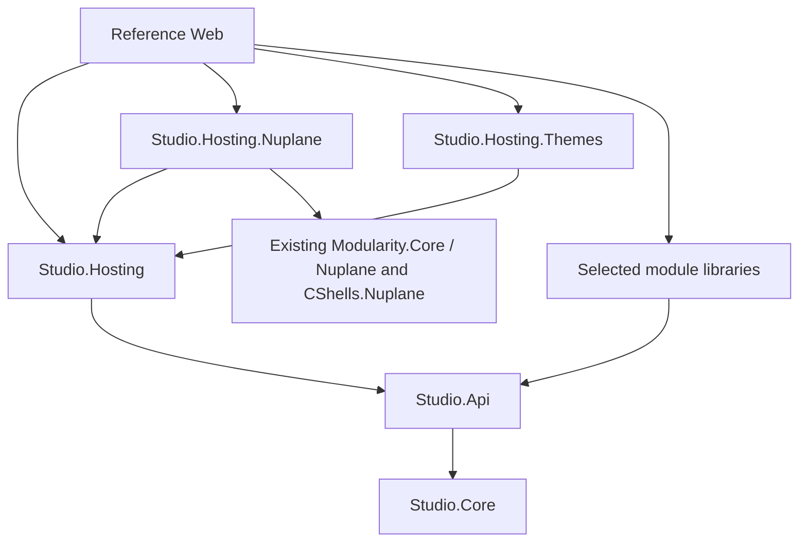

# Studio hosting extraction contract

Selected implementation target for [#3355](https://github.com/elsa-workflows/elsa-foundation/issues/3355),
[Program #3340](https://github.com/elsa-workflows/elsa-foundation/issues/3340). Source baseline:
`621d9492357cdee5adcef4c5b866555ce1c9e298`. These signatures/boundaries are the contract to implement,
not a claim that the new production packages already exist.

## Work-unit plan and gates

This is architecture development after the three completed qualification spikes. Cover every Web C# file,
frontend ownership category, package direction, small consumer API and configuration/storage/lifetime seam.
Success is a reviewed, decision-complete target for the existing implementation leaves. Keep actual extraction,
new product APIs, dependency/publish behavior and final consumers on those leaves. Review inventory coverage,
acyclic references, concrete consumer code, defaults and the safety/compatibility cases below.

Use the qualified [service reuse](studio-hosting-reuse.md), [package-store protocol](studio-package-store-qualification.md)
and [browser delivery](studio-browser-asset-delivery.md). The [framework constitution](../../.specify/memory/constitution-framework.md) (§§2.2/2.23),
[ADR0080](../adr/0080-elsa-4-simplification-decisions.md) and
[ADR0037](../adr/0037-studio-management-bridge-keeps-host-management-key-server-side.md) govern naming, visibility
and the management boundary. Studio's [Theme Store ownership](../../Studio/docs/adr/0008-keep-theme-store-ownership-in-studio-host.md)
and [design-token contract](../../Studio/docs/design-tokens.md) remain authoritative. This contract adds no general settings,
loader, discovery or file-provider framework and reactivates no parked program.

## Packages and dependency direction

All new libraries target the current Studio framework, net10.0, and use the existing Studio version line,
metadata/license/icon and candidate-artifact workflow. Do not introduce a new release train.

| Package | Responsibility and references |
|---|---|
| **Elsa.Studio.Hosting** (new Razor library) | Standard boot/discovery/runtime script, root authentication/bridge, middleware and prebuilt browser shell. References existing Elsa.Studio.Api/Core and CShells.AspNetCore; no Nuplane, Theme Store, full in-box module set, backend identity or cluster dependency. |
| **Elsa.Studio.Hosting.Nuplane** (new optional library) | Studio HTTP/store adapters for package/feature administration and protected package assets. References Hosting, qualified CShells.Nuplane/Nuplane family and lightweight Elsa.Modularity.Core/Nuplane. Never Elsa.Modularity.Api or its backend identity/Attention/cluster closure. |
| **Elsa.Studio.Hosting.Themes** (new optional library) | Theme sources, store/assets and the three Theme Store shell features. References Hosting/Api/Core; no Nuplane dependency. |
| **Elsa.Studio.Api / Core** (existing) | Retain existing module contracts/models, backend options/permission contracts and lightweight core responsibilities. Fix required dependency packaging in #3367; do not relocate all Web implementation here. |
| Existing module Razor libraries | Retain their own features/assets and explicit Api/Core references. No dependency on the reference Web application. |
| Elsa.Studio.Web | Non-packable distribution/composition root: references the three hosting libraries and its chosen in-box modules. |



The reverse edges are forbidden: Hosting cannot reference either optional addon or Web; Api/Core cannot reference
Hosting. No aggregate/re-export package or separate permanent browser-assets package is introduced.

## Complete Web file disposition

All types/DTOs declared in a row's file follow that row unless explicitly replaced below. Their HTTP JSON shape
is retained independently of their C# namespace/visibility. The inventory records all 20 Web C# files at the
pre-adoption snapshot (`d55f5f5229ab4aaeaa728a85f6d41d9050af0a71`). #3356 removes the three local loader/catalog
wrappers below; their source links are pinned to that snapshot so the original disposition stays traceable.

| Current file | Target and decision |
|---|---|
| [Program.cs](../../Studio/src/apps/Elsa.Studio.Web/Program.cs) | Keep only app/distribution choices, early ConsoleStream capture, selected module assemblies and public Add/Use/Map calls. No copied endpoint/auth/store/loader implementation. |
| [ActiveShellStudioApiEndpoint.cs](../../Studio/src/apps/Elsa.Studio.Web/ActiveShellStudioApiEndpoint.cs) | Hosting internal. Keep high-priority manifest/registry routes and use the configured Studio shell with a tracked scope across async reads. |
| [ConfigFileWriter.cs](../../Studio/src/apps/Elsa.Studio.Web/ConfigFileWriter.cs) | Split coordination from IO: Hosting owns the one process-lifetime gate exposed by StudioBuilder.ConfigurationMutationGate. Each addon keeps its small stateless atomic-write helper private and receives that same gate at registration. No production friend grant, duplicate static gate or public generic file utility. |
| [ElsaFeatureManagementApi.cs](../../Studio/src/apps/Elsa.Studio.Web/ElsaFeatureManagementApi.cs) | Nuplane addon internal HTTP/DTO adapter over the existing feature-management application service/catalog contracts. Adopt masking/full-state validation and keyed revision semantics from #3351. |
| [ElsaModuleManagementApi.cs](../../Studio/src/apps/Elsa.Studio.Web/ElsaModuleManagementApi.cs) | Nuplane addon internal HTTP/DTO adapter. Keep upload/feed/registry behavior and permissions; replace direct directory pruning with qualified maintenance. |
| [ElsaThemeStoreApi.cs](../../Studio/src/apps/Elsa.Studio.Web/ElsaThemeStoreApi.cs) | Themes addon internal endpoints, validation and JSON models. Keep reserved IDs, lifecycle/default constraints and asset limits; implement source modes with #3368. |
| [Models/ThemeConfiguration.cs](../../Studio/src/apps/Elsa.Studio.Web/Models/ThemeConfiguration.cs) | Replace app-only type with public StudioThemeStoreOptions in Themes, retaining existing Themes configuration keys plus explicit writable-store paths. |
| [NuplaneStaticWebAssetsEndpoint.cs](../../Studio/src/apps/Elsa.Studio.Web/NuplaneStaticWebAssetsEndpoint.cs) | Nuplane addon internal. Preserve URLs/revalidation/ranges while holding admission through package access; no unprotected physical-path result. |
| [Services/ThemeConfigurationService.cs](../../Studio/src/apps/Elsa.Studio.Web/Services/ThemeConfigurationService.cs) | Themes addon internal root service; keep source/store precedence and validate options before IO. |
| [StudioAssetCaching.cs](../../Studio/src/apps/Elsa.Studio.Web/StudioAssetCaching.cs) | Hosting internal static/fallback behavior. Preserve and test actual revalidation; the asset spike's consumer headers are not delivered Hosting behavior. |
| [StudioBackendManagementBridge.cs](../../Studio/src/apps/Elsa.Studio.Web/StudioBackendManagementBridge.cs) | Hosting internal bridge/client/DTOs. Reuse existing Api backend options/status/routes; keep server-only credentials and fail-closed availability projection. |
| [StudioBridgeAuth.cs](../../Studio/src/apps/Elsa.Studio.Web/StudioBridgeAuth.cs) | Hosting internal named scheme/handlers/cache and stable permission policies. Root ownership, first-request checks and trusted query-token paths remain explicit. |
| [StudioFeatureAssemblies.cs](../../Studio/src/apps/Elsa.Studio.Web/StudioFeatureAssemblies.cs) | Delete app-specific provider/list wrapper. Hosting includes mandatory Api discovery; addons register themselves; Web/callers select additional module assemblies through the framework callback. |
| [StudioNuplaneAssemblyProvider.cs](https://github.com/elsa-workflows/elsa-foundation/blob/d55f5f5229ab4aaeaa728a85f6d41d9050af0a71/Studio/src/apps/Elsa.Studio.Web/StudioNuplaneAssemblyProvider.cs) | Delete; use released CShells.Nuplane package-aware discovery. |
| [StudioNuplaneShellReloadObserver.cs](https://github.com/elsa-workflows/elsa-foundation/blob/d55f5f5229ab4aaeaa728a85f6d41d9050af0a71/Studio/src/apps/Elsa.Studio.Web/StudioNuplaneShellReloadObserver.cs) | Delete; use ChangedOrPending + automatic reload and the existing reporting callback. No detached task/semaphore replacement. |
| [StudioRuntimeFeatureCatalogRefresher.cs](https://github.com/elsa-workflows/elsa-foundation/blob/d55f5f5229ab4aaeaa728a85f6d41d9050af0a71/Studio/src/apps/Elsa.Studio.Web/StudioRuntimeFeatureCatalogRefresher.cs) | Delete; use the existing shared catalog/refresher services, including the current snapshot-returning API. |
| [StudioRuntimeScript.cs](../../Studio/src/apps/Elsa.Studio.Web/StudioRuntimeScript.cs) | Hosting internal. Retain the explicit allowlist/global name and existing configuration keys. No arbitrary IConfiguration serialization or browser management key. |
| [StudioShellActivation.cs](../../Studio/src/apps/Elsa.Studio.Web/StudioShellActivation.cs) | Hosting internal selected-shell activation before routing/authorization. Preserve best-effort static availability; pin shell-service use and handle lookup/disposal races. |
| [StudioShellFeatureConfigurationStore.cs](../../Studio/src/apps/Elsa.Studio.Web/StudioShellFeatureConfigurationStore.cs) | Nuplane addon internal implementation of the existing store contract; configure the same shell/file the host uses, keep the shared gate/atomicity, revisions and deterministic reload. Remove app-specific snapshots/exceptions where shared contracts replace them. |
| [ThemeStoreStudioFeatures.cs](../../Studio/src/apps/Elsa.Studio.Web/ThemeStoreStudioFeatures.cs) | Themes addon. Keep IDs ThemeStoreCore, ThemePicker and ThemeManagement and their dependency/gating behavior. Feature classes remain public for framework discovery; name/helper/DTO implementation stays internal. |

CShells 0.0.31 uses Assembly.GetExportedTypes in
[FeatureDiscovery](https://github.com/valence-works/cshells/blob/b7611aadb49789d3b282749df18ffe68d0eacec5/src/CShells/Features/FeatureDiscovery.cs).
The three public feature classes are therefore a framework-discovery exception to internal-by-default, not a
new application service API. No current internal DTO becomes public merely because its file moves.

Studio is currently domainless in the governing ElsaDomains classifier. No new production InternalsVisibleTo
relationship is authorized by matching Studio package prefixes. The gate is therefore a public integration seam:
third-party Studio hosting extensions that write their own configuration must coordinate with built-in writers.
They borrow the process-lifetime semaphore, hold it across the entire read/revision/modify/write/reload operation,
release in finally and never dispose it. Owned addon registrations capture that same instance; shell copies do not
create or own another gate. The stateless sibling-temp/rename helper may exist privately in each addon: this small
implementation duplication preserves the boundary without exposing a general file/settings framework. Prefer the
existing feature application/store contracts when they already express the desired change.

For endpoint authorization names, extend the existing public Api.Authorization.StudioBridgeAuthorization contract
with the coarse/read/manage policy names and existing permission keys as needed. Third-party modules already use
that contract; addons must not reach into Hosting's private StudioBridgeAuth or duplicate policy strings. The
scheme, handler/cache and actual policy enforcement remain Hosting-owned.

## Frontend and artifact ownership

The whole Web Client source tree/build belongs with Hosting: index/import map, application pages/styles/assets,
vendor shims and browser SDK output. Update the workspace SDK/UI source entry paths when moving it; leave no
second copy in Web. Existing module Client sources/outputs stay with their module libraries. These two ownership
rules cover every source asset; the reproducible asset probe enumerates and byte-checks the complete built payload.

Hosting is the single Razor owner with StaticWebAssetBasePath `/` and `wwwroot/studio`; modules retain
`/_content/<package-id>/...`. Runtime configuration remains code at `/studio-runtime.js`. Reserve the built
`/studio` prefix; do not pretend a runtime prefix option can relocate absolute URLs or application routes.

Default consumers need no frontend toolchain. For a fully custom frontend, document the final application's
direct Hosting PackageReference `ExcludeAssets="build;buildTransitive"`: retained server APIs must work, bundled
assets must be absent and independently selected module assets must remain. Hosting's excluded build integration
must contain no essential server boot/configuration hook. Do not promise transitive re-export behavior; qualify
any intended intermediate-package/PrivateAssets graph separately. A separately named fallback document is another
supported customization; normal same-path overlays collide in the SDK. Preserve actual caching behavior against
emitted filenames, not an assumption that every bundle is hashed.

## Public composition API to implement

Keep the public surface limited to consumer composition, configuration and required framework feature types.
The target entry points are:

| Surface | Signature/consumer reason |
|---|---|
| Hosting registration | `WebApplicationBuilder.AddElsaStudio(Action<StudioHostingOptions>? configure = null) : StudioBuilder` loads/binds host configuration and composes common services. |
| Framework customization | `StudioBuilder.ConfigureShells(Action<CShellsBuilder> configure) : StudioBuilder` selects module assemblies and uses existing framework policy/extension points. Do not invent another feature registry. |
| Root service customization | StudioBuilder exposes read-only `IServiceCollection Services`, `IConfiguration Configuration`, `IWebHostEnvironment Environment` and `SemaphoreSlim ConfigurationMutationGate` references for addon/third-party root registration and coordinated configuration changes; constructor is internal and registration occurs only before Build. |
| Pipeline | `WebApplication.UseElsaStudio() : WebApplication` installs selected-shell activation, routing, authentication/authorization and static-file middleware in the required order. Call before other explicit routing/auth middleware. |
| Core endpoint mapping | `IEndpointRouteBuilder.MapElsaStudio() : IEndpointRouteBuilder` maps runtime/discovery/bridge, shell endpoints, API 404 and SPA fallback. |
| Optional administration | `StudioBuilder.AddElsaStudioNuplane(Action<StudioNuplaneOptions>? configure = null, Action<NuplaneBuilder>? configureNuplane = null) : StudioBuilder`; `IEndpointRouteBuilder.MapElsaStudioNuplane() : IEndpointRouteBuilder`. The existing Nuplane builder callback handles trusted feeds/coordination; do not duplicate its membership model. |
| Optional themes | `StudioBuilder.AddElsaStudioThemes(Action<StudioThemeStoreOptions>? configure = null) : StudioBuilder` registers root services and its feature assembly. Existing shell configuration enables the desired three feature IDs; MapElsaStudio maps their endpoints through CShells. |

StudioHostingOptions is justified by selected ShellName, ShellsFile, IndexFile and trusted QueryTokenPathPrefixes.
StudioNuplaneOptions selects ManagementFile and DirectoryFeedName. StudioThemeStoreOptions contains the existing
ThemesDirectory/DefaultThemeId/ThemesMode plus StoreFile and AssetsDirectory. A public StudioThemeSourceMode enum
provides BuiltInsOnly, DirectoryOnly and AddToBuiltIns for typed callbacks/validation. There are no public handler,
cache, store implementation, reload observer, generic writer or duplicate feature-management contracts.

A basic custom host using Dashboard is this target code, with references to Hosting and the existing Dashboard
package. It is normative planned API usage; it becomes executable product code in the implementation/consumer leaves.

```csharp
using CShells.DependencyInjection;
using Elsa.Studio.Dashboard;
using Elsa.Studio.Hosting;

var builder = WebApplication.CreateBuilder(args);
var studio = builder.AddElsaStudio()
    .ConfigureShells(shells => shells.WithAssemblies(typeof(DashboardStudioFeature).Assembly));
var app = builder.Build();
app.UseElsaStudio();
app.MapElsaStudio();
app.Run();
```

The consumer supplies its own small module configuration, not copied infrastructure. The default `shells.json`
contains CShells:Shells:Default with Features StudioApi/DashboardStudio and root WebRouting path, as the existing
host does:

```json
{
  "CShells": {
    "Shells": {
      "Default": {
        "Features": { "StudioApi": {}, "DashboardStudio": {} },
        "Configuration": { "WebRouting": { "Path": "" } }
      }
    }
  }
}
```

StudioApi is mandatory in the selected Studio shell: validate startup and reject managed changes that remove
it, using the existing feature validation/required metadata where available. The consumer can enable additional
selected module/addon feature IDs in that same file. It is application-owned configuration included by the Web SDK, not an essential package build target.
Adding the two optional capabilities adds their references and these calls before/after Build respectively:

```csharp
using Elsa.Studio.Hosting.Nuplane;
using Elsa.Studio.Hosting.Themes;

// Before Build:
studio.AddElsaStudioNuplane();
studio.AddElsaStudioThemes();
// After the core Use/Map calls:
app.MapElsaStudioNuplane();
```

Here `studio` is the returned StudioBuilder. Web additionally retains its early ConsoleStream hook/root hub
registration and explicit distribution module selection; those choices do not move into the base library.

## Defaults, overrides and storage boundaries

Relative configured paths resolve against the host ContentRootPath once, not the process working directory.
Bind existing sections/keys first, then explicit code callbacks; freeze the registration choices before Build.
Hosting-specific options bind `Studio:Hosting`; Nuplane adapter file/feed selectors bind `Studio:Hosting:Nuplane`.
The existing `Studio`, `Studio:Api`, `Studio:Auth`, `Nuplane`, `CShells` and `Themes` sections retain their meanings;
Nuplane/runtime policies stay on their owning package's options instead of being copied into Studio DTOs.
Validate invalid/blank shell IDs, invalid theme modes and ambiguous feed selection with clear errors.
Shell/file/storage/roster and installed security choices require restart when changed. Runtime configuration must
report the applied authentication posture, not advertise a gate change that has not been installed.

| Setting | Default and supported boundary |
|---|---|
| Hosting ShellName | Default. Activation, manifest APIs, feature writes and resolver fallback all select the same name. Use CShells resolver composition for another name, not only a changed store constant. |
| Hosting ShellsFile | shells.json, loaded with reload-on-change as today and required by the default file-backed composition. A null path explicitly selects host-owned configuration and read-only local feature administration; do not silently write an unrelated file. |
| Hosting IndexFile | studio/index.html. Permit an explicitly selected differently named consumer fallback document. It must resolve through the host's static-file provider, not arbitrary browser-supplied paths. |
| QueryTokenPathPrefixes | Empty. Accept only explicit non-root path prefixes (no blank/root/wildcard); the distribution supplies trusted hub paths, e.g. ConsoleStream; every other endpoint accepts bearer by header only. No ConsoleStream package dependency in Hosting. |
| Nuplane ManagementFile | nuplane-management.json, optional on read and atomically created on an authorized change, preserving the current section/keys. |
| DirectoryFeedName | Unset selects the single configured directory feed, with existing packages fallback only when no configured directory feed exists. Multiple directory feeds require an explicit name; never mutate an arbitrary first match. |
| Theme StoreFile | studio-theme-store.json. Application-owned writable store, separate from optional directory/collection source. |
| Theme AssetsDirectory | theme-assets, retaining the existing upload size/type/token validation and URL contract. |
| Theme ThemesDirectory | Null. When set, retains a directory or single JSON collection source; source entries take precedence by ID over persisted themes as today. This does not redirect the writable store accidentally. |
| Theme ThemesMode/DefaultThemeId | AddToBuiltIns / unset. #3368 applies modes across server/frontend, rejects invalid values and keeps reserved/enabled/published/default constraints coherent. |

One shared process-wide mutation gate covers whole read/revision/modify/atomic-replace cycles, not only the final
write. Reload the configuration root deterministically after shell changes. Reuse the existing secret-aware
application service and keyed revisions; no secret value/default leaks through projections. Paths are trusted
host configuration. Concurrent external/process writers, mutable package-install/control roots as theme/config
storage, and arbitrary client-selected filesystem paths are unsupported; do not imply cross-process transactions.
External configuration providers remain authoritative. If they replace the selected mutable configuration source,
report the operation as read-only/unsupported rather than silently reporting a write to a different file as applied.

## Root, shell and security lifetimes

The host owns authentication/session caches, time provider, backend options/clients, theme/store coordination and
Nuplane's running dispatcher/catalog/administration state. Preserve registrations from the owning packages.
When a root singleton is required inside shells, use CShells `ShareSingletonWithShells<T>` and select aliases
explicitly; no second singleton or disposal owner, and no dependency on the backend Cluster sharing helper.
Per-request/feature services remain scoped to the serving shell. Host endpoints use a tracked BeginScope across
all async shell-service access, handle a generation disposed between lookup/scope acquisition and honor cancellation.
Do not return an unpinned raw IServiceProvider. Respect the framework drain policy; do not invent an unlimited lease.

Preserve ADR0037 and the existing named Studio gate/read/manage policies and 401/403 distinction. No server
management key reaches runtime JS, browser requests or user-session introspection. Manage implies read only where
it already does. Auth-disabled development behavior remains explicit; an enabled Studio policy must validate the
backend bearer even if a surrounding app has another authenticated identity. Cache and clients survive shell
reload, are disposed only by their owner and do not retain request service providers. First-request cold routing
must enforce the real endpoint's policy before any handler runs. Unknown APIs remain 404, not SPA HTML.

## Administration, packaging and implementation acceptance

Use the qualified maintenance service with explicit configured participation/roster, quiescent enrollment and
root/epoch/retention confirmation. Ordinary/unknown profiles refuse execution with diagnostics. Support the actual
qualified coordinated prune path; refusal is not a replacement for it. Migrate the old count/age UI deliberately
to the supported inactive-version-group policy. Package reads retain admission until bytes are detached; bound
buffer sizes/concurrency or qualify protected streaming. Keep the final full browser/large-file checks on #3364.

#3356 aligns the selected CShells/Nuplane/manifest families and removes the three local wrappers. #3357 implements
Hosting boot/discovery/runtime/middleware and the scope/configuration cases; #3358 implements auth/bridge preservation.
#3359 implements the optional admin adapters, validation/stores and safe pruning. #3368 fixes source modes before
#3360 moves that implementation into Themes; add that dependency when this contract is accepted. #3361 owns frontend source/build/archives; #3362 makes Web thin; #3363/#3364 prove
actual package-only/default/custom-frontend/custom-module/optional/auth/storage journeys. #3365 inventories the
full dependency/asset closure and automates both qualification profiles. #3366 supplies final guidance and exit audit.

Feature implementation follows specification/plan/tasks before code; bug fixes follow the existing Quality Fix
Routine. Run appropriate whole affected suites and a causal control. Final acceptance uses actual packed production libraries, not these planned signatures
or temporary wrappers. Check missing module/secret/dependency/asset failures, selected non-default shell/path,
atomic/revision/reload conflicts, cold unauthorized requests, request/reload overlap, optional capability absence,
all theme modes and the direct-reference custom-frontend opt-out. Include current CI/main and artifact provenance.

The consolidated Studio publisher is already manual-only/build-only by default and has a separate explicit
publication opt-in. Keep it inert: build/inspect candidate artifacts without enabling that opt-in, creating tags,
pushing packages, releasing or deploying. No workflow permission or publisher-ownership change belongs here.
