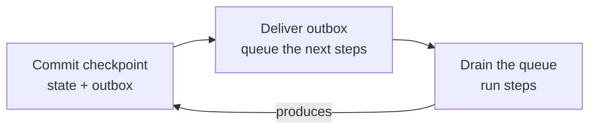

# Recovering a workflow after a crash

**Who this is for:** contributors working on the Elsa 4 runtime who need to know what happens to a running workflow when the server process dies, and what brings it back.

**In one sentence:** saving state to a database (*durable storage*) is only half the job; something must also pick that state up again and carry on (*durable resumption*). This page explains how the runtime does that, which crash windows it covers, and the rules every part of it follows.

## The short version

- Every step a workflow takes is saved in a **checkpoint** together with the follow-up work it implies.
- A background task, the **resumption pump**, sweeps the database every 10 seconds (by default) for work that was saved but never finished, and restarts it.
- Restarting always goes through the run's **mailbox**, so there is still only one writer per run.
- Work can be delivered **more than once** after a crash. Consumers are idempotent **while the item is still queued**; a late scheduler-work repeat after its chain has drained can conflict (see [the late-repeat limit](#the-idempotency-rule)). Running the sweep again is safe on the queued path.
- Under the faster [persistence modes](../website/docs/essentials/persistence-modes.md), a crash can make the last few activities run again. External effects are never sent before their state is saved.

## Words you will meet

| Word | Meaning |
|---|---|
| Checkpoint | A saved boundary: the state that changed, plus the follow-up work it implies. |
| Outbox | Follow-up work saved *with* a checkpoint, waiting to be delivered. Saving it in the same commit means it cannot be lost. |
| Scheduler work queue | The per-run queue of steps waiting to be run. |
| Drain | Working through a run's queued steps until there is nothing left to do. |
| Sweep | One pass of the resumption pump over the database. |
| Re-drive | Nudging a run by sending a "run your queued work" command to its mailbox. |
| Claim | A time-limited lock a worker takes on a row before acting on it. It lapses after its *visibility timeout* (1 minute by default) if the worker dies. |
| Fence | A number that grows each time ownership of a run or row changes. A write carrying an old fence is refused, so a worker that lost its claim cannot overwrite the new owner. |
| Lease / heartbeat | The record a drain writes to say "this node is working on this run". A lease left behind by a crash tells the recovery scanner the run was interrupted. |
| Pause gate | The check that decides whether a run's next step may go ahead (for example, the run is suspended by an operator). |
| Segment | Under Balanced and Ephemeral modes, a stretch of steps whose checkpoints are folded into one commit. |
| Quiesced | The drain's way of saying "the queue is empty; this run is now waiting". |

## How a workflow makes progress

1. A run's mailbox accepts a command and **commits a checkpoint**. This is the durability boundary. The checkpoint records the new state *and* the follow-up work as **outbox** items. Scheduler continuations use the `EnqueueSchedulerWork` kind; modules may contribute other stable kinds.
2. The outbox is **delivered**. The runtime dispatcher (keyed by kind, ordinal comparison) picks the handler contributed for each item. The built-in `EnqueueSchedulerWork` handler adds a work item to the **scheduler work queue**. Other cross-run handlers use the same global delivery path, outside the runs' mailboxes.
3. The scheduler **drains** the queue: it runs activities, schedules children and produces the next checkpoint. Then the cycle repeats.

A crash can hit between any two of these steps. The next section shows what each window looks like and what brings the run back.

## Crash windows

| Window | What is on disk | What is missing | What recovers it |
|---|---|---|---|
| **A.** After the checkpoint commit, before outbox delivery | Checkpoint; outbox row marked *Pending* | The queued work | The sweep re-delivers the outbox row, which queues the work, then re-drives the run. Nothing holds the row for the dead drain, so recovery takes one sweep interval (10 s by default). |
| **B.** After delivery, before the drain | Outbox row *Delivered*; work queued | The drain | The sweep's backlog discovery finds the run and re-drives it. |
| **C.** After the drain picks up a step, before that step's checkpoint commits | The step, still queued | The step's result | The step is only removed from the queue after its effect is saved. Once the dead drain's claim lapses (1 minute by default), backlog discovery finds the run and the step runs again, idempotently. |

All three are recovered. The tests that prove each one are listed in [How this is tested](#how-this-is-tested).

**More on window C.** This includes a crash between the fallback handler's two separate writes (save the activity execution's state, then queue the follow-up step). The re-run is safe because:

- status guards (`existing.Status == Scheduled` / `state.Status == Running`) recognise a first write that was already applied, and
- follow-up work items have deterministic ids (`…:start:…`, `…:invoke:…`), so the idempotent queue absorbs a repeat.

A step that keeps faulting is delivered a bounded number of times, never in a hot loop, because the claim is released when the fault is recorded.

**A second safety net for window C.** Each drain takes an ownership **lease** (writing a lease and a heartbeat to operational state) and releases it in a `finally` block. If a crash prevents the release, the recovery scanner reports the run as *LeaseLost* or *HeartbeatExpired*, and the sweep adds it to the backlog it re-drives (through the mailbox). The two mechanisms work together: the late removal keeps the *step* around for replay, and the lease makes sure the *run* is found even when a crash leaves no queued step.

## What the resumption pump does

The pump is a recurring background task. It ships in its own package, `Elsa.Workflows.Runtime.Resumption`, and its feature is pulled in automatically by the durable persistence features (they declare `DependsOn = ["WorkflowsRuntimeResumption"]`). So choosing database storage always brings the pump with it, and that rule is visible in the feature catalog. The runtime API feature does not add the pump; it comes only with durable storage.

One sweep does three things:

1. **Re-delivers stranded outbox items, for every run and every kind, up to the outbox batch limit** (`OutboxBatchSize`, 100 by default), including `FailedRetryable` items whose retry time has come. Normal per-run delivery during a drain only handles `EnqueueSchedulerWork`, so cross-run work never runs inside another run's mailbox. One sweep pass claims at most that many items, including continuations a live drain has just committed; the drain accounts for that before it reports it is done (see [When the sweep takes a live drain's continuation](#when-the-sweep-takes-a-live-drains-continuation)).
2. **Finds interrupted runs:** runs with queued work that a claim could take right now, plus runs the recovery scanner reports.
3. **Re-drives each run** by sending a `RunSchedulerWork` command **to its mailbox**. The sweep never drains a run itself, so the mailbox stays the only writer.

> *Why a "claimable now" list?* After a restart, nothing else remembers which runs were interrupted. The queue answers "which runs have work a claim could take now", returning distinct run ids in ordinal order after a bound (#2188). Both the in-memory and database queues implement it and pass the same contract tests. An older method that lists every run with *any* queued work still exists; the sweep falls back to it only for a queue that lacks the newer one.

The durable queue itself is an EF Core store (`EfSchedulerWorkQueueStore` over `RuntimeDbContext.SchedulerWorkItems`) swapped in by the EF Core feature, with fenced claims. Adding is idempotent by (run id, work item id); listing is first-in-first-out by (recorded time, sequence, work item id). A claim uses the row's revision for compare-and-set; consuming or completing a claimed item fences on owner and token, so a renewed claim can still be finished by its original claimant.

## The idempotency rule

Delivery is **at least once on both sides**: work can be added twice and taken twice. Consumers are idempotent **while the item is still queued**, so no crash window strands an activity and running the sweep again is safe on that path. A scheduler-work repeat after its chain has drained can re-run a checkpoint whose replay conflicts (the late-repeat limit below).

- **Adding work.** The outbox can be delivered again, by the drain during normal running or by the sweep after a crash. So the same work can be queued twice. The queue absorbs duplicates by (run id, work item id). Re-drive commands carry a fresh key per sweep, while the work items behind them stay single. A run whose backlog survives (for example, a dispatch that raced a crash) is simply re-driven by the next sweep.
- **Taking work.** The drain does not remove a step before running it. On the EF store it claims the FIFO head (revision compare-and-set), runs it in place, and only removes it **after** the step's effect is saved, by completing that claim (owner and token): after a successful commit, or, when the handler faults, before the poison record or the immediate retry is queued. A crash before that complete leaves the step queued, backlog discovery re-drives it, and the handler runs again idempotently. A store without claim transitions still dequeues the FIFO head after the effect is saved.

## Keeping the pump bounded

One restart with a large backlog, or one broken run, must not overwhelm or starve the sweep.

| Limit | How it works |
|---|---|
| **Per sweep** | At most 100 runs are re-driven per sweep (`MaxExecutionsPerSweep`). The recovery scanner keeps half the slots (at least one, at most its batch size) and the backlog the rest, so neither starves the other. Either side may use slots the other leaves. With a cap of one they take turns (#2188). |
| **Across sweeps** | See below. |
| **Per run** | A run whose re-drive fails gets its own growing back-off and is skipped until it passes. Separately, the whole sweep backs off after consecutive failures, up to 5 minutes by default. One broken run cannot block healthy ones. |

**Across sweeps, in detail:**

- Backlog discovery lists only runs whose work is claimable now, so work held by a live claim or a back-off cannot fill the page.
- Every candidate (from the backlog, the recovery scanner or a candidate source) is re-driven only when the drain's own pause gate would let its next step go ahead. A paused step stays claimable, and re-driving it used to just queue one more `RunSchedulerWork` behind it on every pass.
- A held recovery or source candidate still counts as dealt with: the scanner's cursor moves on and the source settles it. Ownership is not at risk, because the next drain always gets a strictly greater fence, whatever a stale lease says.
- Lifting a hold saves hold state; there is no event. The next pass that reaches the run finds the gate open and re-drives it.
- A held run that has finished is still purged and reaped, which re-drives nothing.
- If the gate cannot be asked, the run is not re-driven (its drain would ask the same gate). Its work stays queued, a recovery candidate keeps the scanner's cursor in place so it is offered again, and the sweep logs one warning with the count.
- The sweep reads next steps in one request per page of runs and asks the gate only about runs it can use. A pass reads on past held runs for up to ten pages.
- The sweep remembers where it was in the backlog between ticks (least recently used scopes are evicted first). It resumes after the last run it visited and starts over after a short page, so a fixed set of runs that stay claimable without draining cannot hog the window.
- The position moves past a failed re-drive; that run keeps its work and its back-off, and a later walk reaches it again.
- A queue without claimable discovery keeps the older first-page listing, and the sweep logs a warning once per queue type per host.

## Claims that outlive their lease

The outbox processor and the durable timer pump each claim a batch of rows under one visibility timeout (1 minute by default), then work through the batch one row at a time. Claims near the end of a long batch can lapse, and another node re-claims them.

Both follow one shared rule: **renew a claim just before acting on it, and never act on a claim that cannot be renewed.** The renewal is a compare-and-set on the claim's owner and fence, so a row that was re-claimed is skipped rather than delivered twice.

- **Outbox.** Each item's claim is renewed just before it is dispatched, but not during the dispatch, because intent handlers share the sweep's persistence context. A single dispatch that alone outlives the timeout can still be repeated by another node. Each kind of intent copes with that repeat in its own way:

  | Intent kind | Why a repeat is harmless |
  |---|---|
  | Scheduler work | Deduplicated by work item id while the item is still queued |
  | Child start | Deterministic child id |
  | Resume | Consumes its bookmark once |
  | Cancel | Idempotent |
  | PublishStimulus start | Keyed run id (see [Stimulus START idempotency](serialization.md#stimulus-start-idempotency-is-at-least-once)) |

  The runtime extension-point notes (the per-kind table under the outbox store contract) record each mechanism and its limit. One limit: a scheduler-work repeat that arrives after its whole chain has drained can re-run a checkpoint whose replay conflicts. Redelivery after a crash already had the same exposure.
- **Durable timers.** Each timer's claim is renewed just before it fires and kept renewed while the fire runs. A failed renewal cancels the fire.
- **One lost claim never ends a sweep.** A row whose claim was lost before, during or at the fenced completion of its side effect is logged and skipped. The sweep moves to the next row, then to backlog discovery and re-drive. Whoever holds the row records its outcome.
- **Test-scope clean-up runs separately.** It runs first on every resumption tick, in its own scope. A failure there (a clean-up race, an unreadable scope row) is logged and retried next tick; it does not stop outbox delivery or re-drive.

Other loops use the same claim, renew and fenced-complete shape without the shared helper. Scheduler work claims one item at a time and runs it at once, and its renewal has drain-specific rules (a dispatch deadline, and a claim its own checkpoint consumes). Alteration jobs and transport items are fenced inside the checkpoint commit itself.

## When the sweep takes a live drain's continuation

The sweep claims work across every run, so it can grab a continuation that a live drain has just committed, before the drain's own delivery step gets to it. The drain then finds nothing to deliver, or sees the item reported as superseded (#1798).

The drain used to read that as "done" and return. Nothing was lost (the sweep delivered the item and re-drove the run), but the command answered too early: a start returned *Accepted* before its first bookmark existed, a resume before its workflow had completed. CI tests caught this.

Now the drain treats such a continuation as still its own. It reports *Quiesced* only when no other worker holds one of the run's `EnqueueSchedulerWork` items and no work they queued is left undrained:

| Situation | What the drain does |
|---|---|
| **Another worker holds it** | Lists the run's claimed continuations and waits for those deliveries, polling with back-off from 10 ms up to 500 ms. Then drains the work they queued: it still holds the run's lease, so nothing else would drain it before the command returns. |
| **That worker died** | Its claim lapses after the outbox's visibility timeout (1 minute). The drain never sleeps past the earliest lapse. It then claims the item through the normal durable claim path and delivers it itself. A worker that was merely slow finds its renewal refused and skips the item. |
| **Already delivered** | A sweep that finished delivering before the drain looked leaves only queued work. So after a drain that ran steps and stopped neither on a final status nor at its work-item budget, it also checks the run's queue. |
| **The other worker's attempt failed** | The listing also returns the run's `FailedRetryable` continuations, so a failed attempt waiting for retry is seen even if it failed before the drain first looked. An awaited item that ended failed is found by looking it up once it leaves the listing. A failed attempt is not known to have queued anything, so the drain stops with *OutboxDeliveryFailed* (as for a failed delivery of its own), and the command answers *AcceptedButFaulted* rather than *Accepted*. It does not wait for the retry; that stays with the sweep. |
| **Waiting too long** | All of one drain request's waiting shares one deadline, set at the first wait, so the drain's 64 cycles cannot multiply it. It defaults to the claim visibility timeout plus a 30-second margin: 90 seconds. When it passes with a continuation still held, the drain stops with *OutboxDeliveryFailed*; the item stays with its claimant, then the sweep. Cancellation and a lost lease end the wait like any other drain step. |

**Continuations go first in a sweep batch.** The outbox processor dispatches a batch's `EnqueueSchedulerWork` items before every other kind, each group in claim order. A continuation only queues work, but other kinds can need a run's mailbox: a PublishStimulus start or resume, or a DispatchWorkflow parent resume. A drain waiting for its continuation holds its run's mailbox, so if such an item came first, the batch would wait on the drain while the drain waited on the batch, until the claim lapsed. Each item is still renewed just before its own dispatch.

**Retried continuations.** `EnqueueSchedulerWork` now has a bounded retry policy: four attempts one second apart, the same shape and numbers as a PublishStimulus send and a DispatchWorkflow child start at their defaults. Before, it had none, so one passing enqueue failure (a database blip) made the continuation *FailedFinal* and left the workflow stuck.

- **A failed attempt waits for its retry.** Every failed attempt but the last is recorded as *FailedRetryable* and becomes available again once the delay passes. The drain that failed its own delivery stops with *OutboxDeliveryFailed*, as before. A sweep claims the item when it is due, delivers it and re-drives the run in the same pass, so the workflow carries on at the first sweep after the error clears, provided an attempt is left. One sweeper retries an item at most once per pass, so on a single node at the default 10-second interval the error must clear within about three passes.
- **The drain sees another worker's failure.** Because it is *FailedRetryable*, the drain's listing returns it whenever it happened, and the command answers *AcceptedButFaulted* rather than a false *Accepted*.
- **Retries converge.** The enqueue is one create-only write keyed by the work item's id. An attempt that failed before the write committed queued nothing, so its retry cannot repeat drained work and stays clear of the late-repeat window tracked in #2232. A write that committed but whose acknowledgement was lost did queue the item; its retry is deduplicated while the item is queued, and falls in that window once drained, as redelivery after a crash already could.
- **Exhausted.** The last allowed attempt makes the item *FailedFinal*, logged as `RuntimePostCommitDeliveryFailedFinal` (68103) and counted in the sweep's failed outbox deliveries. Nothing claims it again. This kind records no incident and no poison record on a final failure, before or after this change.

> **Good to know: one case is still open.** *FailedFinal* items are not listed. If other workers made and failed every attempt before the drain's first look, the drain does not see it and still reports *Quiesced*. Attempts are at least the retry delay apart, so this needs the drain's first look to come more than three retry delays (3 seconds) after the commit, with another worker retrying each time. Listing final failures is not the fix: they stay in the outbox, so every later drain of that run would report *OutboxDeliveryFailed*, and skip incident strategy resolution, for good. Telling this drain's failure from an older one needs either a clock comparison (a continuation's recorded time is not always the drain's: a retry boundary records its source work item's time) or reading the run's failed continuations at the start of every drain.

> **Good to know: synchronous HTTP endpoints.** A synchronous `HttpEndpoint` dispatch drains inline, limited by the endpoint's `RequestTimeout`, so under contention the request can wait for its continuation. With continuations first in a batch, that wait is short: the sweep reaches it right after the continuations claimed before it, each just an enqueue. The wait is long only when the claimant died or stalled; then the drain waits up to the claim lapse, and a `RequestTimeout` shorter than that ends the request with the endpoint's timeout status (408 by default) while the workflow carries on through the sweep. An endpoint without a `RequestTimeout` waits at most the drain's wait limit.

The sweep itself is unchanged, so crash recovery still happens at the sweep interval. The cost is latency under contention, plus two reads for a drain that finishes: the claimed-continuations listing, and the one-item queue read after a drain that ran steps.

## Persistence modes and the deferred-save window

[Persistence modes](../website/docs/essentials/persistence-modes.md) is the user guide: what Durable, Balanced (the default) and Ephemeral save, how to choose one per host or per workflow, and what a crash costs in each. This section covers the mechanics behind them.

Every run folds the checkpoints of a **segment** into one atomic commit. The modes differ in how large a segment grows:

| Mode | A segment ends… |
|---|---|
| Durable | at each activity (one commit per activity) |
| Balanced | after the host's activity cap (`MaxActivitiesPerCommit`, default 50) |
| Ephemeral | only at boundaries and at the end of the pass |

Every shell with the runtime API has this machinery: the runtime API feature calls `AddPersistenceModes` after every feature has registered its stores. The run's mode is decided once, when the run is started: the start dispatcher writes the workflow's choice, or the host default when it chose none, onto the start command. The scheduler queue keeps that start until the run's first commit records the mode on the run. Every drain then resolves the mode from that record, or before the first commit from the start the queue still holds, so a run driven again before anything was committed keeps its mode. The queue holds a start's first delivery, so a start delivered again with another mode does not change it. A host composed without the machinery cannot run any mode, so it refuses the run before anything runs.

**The rule that keeps this safe: the durable queue never moves past the last saved state.** Inside a segment, checkpoints are buffered in an in-memory working set that sits over the real state stores, queue and outbox. The step that opened the segment is removed from the durable queue **only** as part of the folded commit, never before. So the durable queue always matches the last saved checkpoint. A crash mid-segment throws away the buffer and leaves that step where it was, and the normal window B recovery replays the whole segment from the last saved state.

**What is buffered:** writes to run, activity execution, durable value and scheduler state, and continuation intents (`EnqueueSchedulerWork`), which are consumed from the buffer within the segment so a folded segment does not save its own continuation.

**What is never buffered:** lease, heartbeat and ownership writes go straight to the operational store. The folded commit still goes through the single checkpoint committer, which stamps the drain's ownership lease as `ExpectedFence` so a stale writer is refused before anything is saved.

**Boundaries that always save.** These checkpoints are never folded away:

- `WorkflowSuspended`, `WorkflowCompleted`, `WorkflowFaulted`, `WorkflowCancelled`, `IncidentRecorded`, `ActivitySuspended`, `ActivityCancelled` and `BookmarkCreated`;
- any checkpoint that carries operational, incident, bookmark, dispatch or alteration changes;
- the attempt claim of an activity that is not ReplaySafe, committed before its body runs;
- the end of a drain, even when the workflow is still running or waiting.

Because a bookmark (including a `Delay` or other timer) is saved at once, an outside stimulus always finds a saved bookmark and never races one that exists only in memory. A fault is saved the moment it is decided. A boundary save is **complete**: it saves the folded state, the boundary checkpoint, any queued steps still only in memory (queued again durably) and undelivered outbox intents, all together. Nothing buffered is lost at a boundary.

**The one boundary that may be skipped.** Under Ephemeral with `RecordCompletion` off, a `WorkflowCompleted` boundary is not saved when:

- the run has no saved record (its workflow row did not exist when the drain began, and nothing in this drain was committed), and
- the folded segment carries nothing that outlives the run: no bookmark, incident, dispatch or dispatch cancellation, alteration outcome, operational change, acknowledged queue item, or outbox item waiting for delivery.

The durable queue is still moved on, after checking that this node still owns the run, so the finished run is not started again and a node that lost the run cannot remove its new owner's work.

**The activity cap (Durable and Balanced).** Durable's cap is one activity, whatever the host says; Balanced's is `MaxActivitiesPerCommit` (default 50). The cap counts distinct activity executions in a segment, not checkpoints, and a ReplaySafe activity's attempt claim never trips it (the claim is taken just before the work runs, so the next checkpoint takes the fold). A checkpoint that would bring one more activity into a full segment forces a save and starts a fresh segment, so a long replayable loop keeps folding at one save per window instead of saving every checkpoint. The cap limits both replay cost (a crash re-runs at most one window past the last save) and memory. Continuation outbox items saved by a cap flush keep delivering from the buffer in the next segment; their outcome is written back at the next save, so no stale *Pending* row is left for a later sweep to redeliver. Ephemeral has no cap: a long pass that meets none of its commit points (a suspension, fault or cancellation, an incident or alteration, a child dispatch, an activity that is not safe to repeat, or the end of the pass) holds its working set in memory.

> **Good to know: activities can run again after a crash.** A crash mid-segment loses checkpoints that were buffered but not saved. They are replayed from the last save plus the queue: recovery re-drives the segment's first step and re-runs the whole segment. So **activities in a lost segment run again**. This is the same at-least-once guarantee as the queue's; folding just sets the replay window to one segment (one activity under Durable). External-facing outbox intents are still delivered **only after** the save, so an activity's external effect is never sent before its state is saved.

**Inspection reads see the segment's own data first.** Building an activity's inspection view reads the inspection store to choose how to merge. Inside a folding segment, the buffer first serves the view the segment already recorded for that activity, so a later checkpoint merges onto it as it would onto a saved one. (Building from the saved baseline instead dropped what the earlier checkpoint recorded, such as the outcome of a root activity that completed in the same commit as its workflow.) An activity the session has not recorded yet is read from the durable store, so each activity's durable row is read at most once per drain.

**Reusing durable-value pages.** Within one eligible folding drain, unchanged provider pages of durable values are not read again. `WorkflowsRuntimeCheckpointPersistence.CoalesceDurableValueReads` defaults to `true`; set it to `false` to compare the same mode without reuse. This switch does not change any run's mode.

- Reuse needs an unambiguous first-party EF backend that still owns its registrations, the shared built-in HMAC continuation codec, and the same live persistence scope. Unsupported, custom, overridden or ambiguous setups fall back to provider reads.
- Each exact page request is keyed by workflow, query, continuation, scope and codec. The provider page is detached, and each logical read merges the current staged changes again. Single-item finds are unchanged.
- Each drain keeps at most 32 pages, 1,024 rows and 4 MiB of counted content. These are retention limits, not exact heap or host-memory guarantees. Going over a limit keeps complete provider results and stops reuse until a successful write boundary or reset.
- Real checkpoint and direct durable-value writes fence reuse before and after the write. Failed or cancelled writes, nested ownership, disposal and drain cancellation switch that session's memo off for good. The memo belongs to its drain and is never saved.
- Reuse does not weaken checkpoint durability or promise fewer queries for every workflow. The [verification evidence](../specs/197-bounded-durable-value-page-reuse/evidence/integration-verification.md) separates the measured EF fixture reduction from live correctness and outstanding delivery gates.

**Checking a run's mode after reconfiguring the host.** The runtime records the effective mode on the start command and then, at the first commit, on the run's saved state (`runtime.persistenceMode`), and carries it forward. Instance detail reports `persistenceMode` and `inspectionGranularity` for that run. To check:

1. Note the `workflowExecutionId` and these fields from a completed run.
2. Restart the host against the same database with a different host mode.
3. Call the authenticated `GET /runtime/workflows/instances/{workflowExecutionId}` for the same id. Both fields should still describe the original run; a new run that chose no mode uses the new host mode.

`e2e-tests/http/Capture-RuntimeDbPaging2392Reference.ps1` prints the run id and does the first detail read. Its optional `-AuthoredPersistenceMode` input exercises the published authoring contract, and `-ExpectedPersistenceMode` the effective mode. This #2392 SetVariable intrinsic reference is still representative, but is not equivalent to the old custom CLR transform. The [normal-host verification](reports/runtime-db-access/cadence-verification.md) recorded the same readback across reconfiguration, and bookmark and incident persistence across a real process restart, under the earlier Immediate/Coalesced names.

**SQL diagnostics.** Temporarily set `Logging__LogLevel__Microsoft.EntityFrameworkCore.Database.Command=Information`, keep structured logs with scopes and UTC timestamps, and look at EF command event 20101. Keep sensitive-data logging off. This counts command executions, not individual SQL statements. Keep diagnostic runs separate from timing runs (which use `Logging__LogLevel__Microsoft.EntityFrameworkCore.Database.Command=Warning`), then restore the host's normal logging.

## How the runtime is composed

The runtime's core services are registered by one method, `AddWorkflowRuntime()`, in the `Elsa.Workflows.Runtime` engine package. The HTTP API feature calls it and then adds only its request handlers. So you can use the runtime from a host without HTTP (a worker, another module, a test harness). A test composes it into a bare service collection and runs a real cancel drain end to end with no API feature present.

**Service lifetimes are deliberate:**

- In-memory reference state is a **singleton** (one per process). So are actor mailboxes and their idempotency caches, clocks, options and pure policies.
- Everything that works through persistence (handlers, pipelines, dispatchers, drainers, checkpoint collaborators, lookups) is **scoped**, so a database provider can tie storage and access policy to one run's scope.
- Two long-lived components cross that line on purpose: mailboxes open a fresh scope per command, and recurring pumps open a fresh scope per tick. Each awaits and disposes its scope.
- Every registration uses `TryAdd*`, so a provider package can register its own store before or after `AddWorkflowRuntime` and win. Scoped stores never become captive dependencies of singletons.
- The persistence-mode decorators (added by `AddPersistenceModes`) wrap the commit store, queue, outbox and state stores registered here, within the active scope.

## No hidden service lookups in the drain path

The drain path does not fetch services from ambient (thread-flowing) state. Two such lookups were removed: one that gave the drainer a request-scoped service provider and state store, and one that carried the mutable workspace to handlers. Both now flow **explicitly**: the drainer injects the run state store directly, and passes the drain request's `AmbientServices` to the pipeline dispatcher, which places it on the pipeline workspace. The nested-invoke handlers (`InvokeActivity`, `ParentActivityCompletion`) read it from there.

Two ambient values remain on purpose, and neither looks up services:

- the **ownership lease scope**, which carries the active lease from the drain to the single commit path (for fencing);
- the **folding-session flag**, which marks the folding session every drain runs in, whatever the run's mode, so the persistence-mode decorators buffer checkpoints. It is registered by `AddPersistenceModes`, keeps the "queue never moves past the last save" rule, and is a documented exception to "no ambient state in the drain path".

## How handlers commit

Scheduler work handlers do not commit inline. A migrated handler also implements the pipeline work-handler contract: the dispatcher places it on the workspace, the pipeline's *Invoke* slot runs it, and the *Checkpoint* slot commits the handler's staged commits **in order, one commit call per staged entry**, exactly as the old inline sequence did. The slot never batches or folds commits; folding is the persistence-mode decorators' job, and batching would change boundary detection and fencing granularity.

The two nested-invoke handlers are the exception: their commits go through a dynamically resolved provider, so they commit inline in the *Invoke* slot and stage nothing. Converting them would change behaviour.

## Known limits and work owned elsewhere

- Multi-node fencing of outbox *delivery ownership*: the durable outbox store rejects `OwnerId` filters today, and the sweep passes none.
- Drainer and handler refactors, runtime-spine decomposition (specs/083) and serializer-policy fixes are tracked in their own work items (see history).
- The [open FailedFinal case](#when-the-sweep-takes-a-live-drains-continuation) above.

## How this is tested

| What | Test |
|---|---|
| Window A | `RuntimeResumptionServiceTests.SweepAsync_DeliversContributedIntentCommittedThroughRealCheckpointAndOutbox`; for a crash between the live drain's enqueue and its *Delivered* mark, `RuntimeLiveDrainDeliveryTests.LiveDrain_CrashWindow_UnmarkedIntent_RedrivesIdempotentlyToNoOp` |
| Window B | `RuntimeResumptionServiceTests.SweepAsync_RedrivesBacklogThroughAgentWithRecoveryEnvelope` |
| Window C (late removal) | `RuntimeSchedulerDrainTests.DrainAsync_RedriveSafe_CrashBetweenFallbackWrites_LeavesSourceItemQueuedForRedelivery_AndConvergesOnRedrive` (crash injected between writes over the real Schedule handler, then a converging re-drive) |
| Window C (poison bound) | `WorkflowSchedulerPoisonDrainTests` |
| Window C (lease detection) | `RuntimeResumptionServiceTests.SweepAsync_DiscoversWindowCExecution_FromOwnershipLeaseLeftByCrash`; lease detectability and no-false-positive tests in `RuntimeExecutionOwnershipTests` |
| Live drain vs sweep | `LiveDrainSweepContentionContract` on in-memory, SQLite and PostgreSQL: the real sweep at the drain's read, and a claimant that delivers late, dies or gets stuck; retry scenarios under the registered policy (drain's own delivery fails then sweep delivers; sweep fails before drain's first read, answered *AcceptedButFaulted* then delivered; every attempt fails until *FailedFinal*) |
| Drain wait outcomes | `WorkflowDrainContinuationSettlementTests`: cancellation, failed attempts before and during the wait, queue-read skip rules, back-off, lapse and per-request deadline on a fake clock, and a batch with a mailbox-needing item ahead of the continuation |
| Batch order and renewals | `RuntimePostCommitOutboxProcessorTests` |
| Mid-segment crash | `RuntimeCheckpointCoalescingTests.CrashMidSegment_DurableQueueStillHoldsSegmentEntry_AndNoPartialCheckpointPersisted` |
| Bookmarks saved at once | `RuntimeCheckpointCoalescingTests.Coalescing_BookmarkSuspend_FlushesDurableBookmarkImmediately` (so the durable timer pump, which reads the saved bookmark store, never races an in-memory bookmark) |
| Timer and bookmark stores never buffered | `RuntimeCheckpointCoalescingTests.Coalescing_DoesNotDecorateDurableTimerOrBookmarkStores_SoDelaySuspensionStaysDurable` |
| Every mode | `PersistenceModeFlushTests`: suspension, resume, fault, handler fault, cancellation and ownership loss |
| Host-agnostic runtime | `RuntimeCoreCompositionRootTests` |

## Where this lives in the code

| Role | Types and members |
|---|---|
| Work queue | `IWorkflowSchedulerWorkQueue` (`ListClaimableWorkflowExecutionIdsAsync(RuntimeSchedulerClaimableBacklogQuery)`, older `ListPendingWorkflowExecutionIdsAsync(int limit)`, `ClaimAsync` / `CompleteClaimAsync` / `ConsumeClaimedAsync`); work item `RuntimeSchedulerWorkItem`; durable queue `EfSchedulerWorkQueueStore` (EF Core store over `RuntimeDbContext.SchedulerWorkItems`, with fenced claims), swapped in by `AddRuntimeEntityFrameworkCore` |
| Drain | `WorkflowSchedulerDrainer`; `WorkflowDrainOrchestrator`; `WorkflowDrainOrchestratorOptions.ContinuationClaimWaitLimit` and `ContinuationClaimWaitMargin`; scheduler claim timeout `RuntimeSchedulerWorkClaimOptions.VisibilityTimeout` |
| Sweep | `IRuntimeResumptionService` / `RuntimeResumptionService` (`SweepAsync`); outbox re-delivery is `ProcessAsync(workflowExecutionId: null, intentKind: null)`; `RuntimeResumptionSweepRequest.MaxExecutionsPerSweep` and `ExcludedWorkflowExecutionIds`; backlog position `RuntimeResumptionDiscoveryStateStore`; recovery scanner `IRuntimeRecoveryScanner` |
| Pump | `WorkflowsRuntimeResumptionFeature`, `RuntimeResumptionPumpTask` (an `IRecurringTask` scheduled by the Tasks domain), `MaxBackoffInterval` |
| Outbox | `RuntimePostCommitOutboxProcessor`; claim listing `IRuntimePostCommitOutboxClaimStore.ListClaimedAsync`; timeout `RuntimePostCommitOutboxProcessing.ClaimVisibilityTimeout`; outbox store `IRuntimePostCommitOutboxStore`; continuation retry policy `RuntimeSchedulerPostCommitIntentDispatcher.RetryPolicy`; shared claim rule `FencedClaimLease` |
| Timers | `DurableTimerPumpTask`, `IDurableTimerStore`; bookmarks `IBookmarkStateStore` |
| Ownership | `RuntimeExecutionLease` (writes `ExecutionLease` + `Heartbeat`); scanner reasons `LeaseLost` / `HeartbeatExpired`; `IRuntimeExecutionOwnershipContextAccessor` |
| Persistence modes | `AddPersistenceModes`; `IRuntimeCoalescingSessionAccessor`; `RuntimeCheckpointCommitter.CommitAsync`; `IActivityExecutionInspectionStore.FindAsync` |
| Pipeline | `IRuntimeExecutionPipelineDispatcher.DispatchAsync`, `RuntimePipelineWorkspace.AmbientServices`, `IRuntimePipelineWorkHandler`, `IWorkflowExecutionStateStore` |
| Composition | `RuntimeCoreServiceCollectionExtensions.AddWorkflowRuntime(this IServiceCollection)` |
| Log events | `RuntimePostCommitClaimLost`, `WorkflowTestScopeCleanupFailed`, `RuntimeResumptionPauseCheckFailed`, `RuntimeResumptionFirstPageBacklogDiscovery`, `RuntimePostCommitDeliveryFailedFinal` (68103) |

Folders: `Essentials/src/Workflows/Runtime/Elsa.Workflows.Runtime/` (engine), `Essentials/src/Workflows/Runtime/Resumption/` (pump), `Essentials/src/Workflows/Runtime/Core/` (contracts and models), `Essentials/src/Workflows/Runtime/Persistence/EntityFrameworkCore/` (database stores).

Related: [Elsa glossary](glossary/elsa.md) · [Runtime extension points](../Essentials/src/Workflows/Runtime/Elsa.Workflows.Runtime/EXTENSION_POINTS.md) · [Resumption extension points](../Essentials/src/Workflows/Runtime/Resumption/EXTENSION_POINTS.md) · [How a workflow executes](how-a-workflow-executes.md) · [Durable timers](runtime-durable-timers.md)

## Design history

This page was first written as the worked reference for roadmap unit **W2** of the Elsa 4 review remediation programme, closing findings **PS-2** and **RT-3**.

- **Before W2 (PS-2):** every store behind the checkpoint could be durable, yet work was still lost. The durable registration swapped eleven state contracts but not the scheduler work queue, so delivered work landed in an in-memory queue that died with the process.
- **Before W2 (RT-3):** nothing ran a recovery pass. The system-wide outbox sweep and the recovery scanner were registered but never called, so an item stranded between commit and delivery, or a `FailedRetryable` item with a future `AvailableAt`, waited forever for an unrelated command.
- **W2** added the durable queue, backlog discovery, the sweep service and the feature-gated pump.
- **#412 item 3** made the drain redrive-safe (remove after the effect is saved), closing window C. (An older "out of scope" note listing ack-based dequeue as remaining work predates this.)
- **W5 / RT-2** added single-writer ownership fencing with lease and heartbeat, the second safety net for window C.
- **W8** added the durable timer pump; **W9** added the folding (coalescing) decorators behind persistence modes.
- **#2195** introduced the renew-before-act claim rule; **#2225** made the drain wait for continuations the sweep took; **#2188** added claimable backlog discovery and the split per-sweep cap.
- **RT-4 / ADR 0033** moved the composition root into the engine package and renamed `AddWorkflowRuntimeCore` to `AddWorkflowRuntime`.
- **RT-7** removed the ambient service locators (`IWorkflowExecutionAmbientServicesAccessor` and the pipeline-context accessor) from the drain path.
- **ADR 0029 Move 2** introduced the slot-invoked handler model.
- Specs **131** (inspection reads) and **197** (durable-value page reuse).
- Still owned elsewhere: drainer/handler refactors (**W1**), runtime-spine decomposition (specs/083), serializer-policy remediation (**PS-3**, **W3**).

Programme context: [review remediation goals](program-goals/elsa-4-review-remediation.md) · [W2 roadmap brief](reports/elsa-4-architecture-review-2026-07/roadmap.md).
