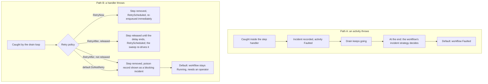

# What happens when something fails at runtime

**Who this is for:** contributors working on, or reading, the Elsa 4 runtime.

There are two kinds of failure, and they take **different paths with different outcomes**:

- **Path A, an activity throws.** Your activity code (or its input, or its construction) fails. This is a normal, expected failure of the *workflow*.
- **Path B, a handler throws.** One of the runtime's own small step handlers fails. This is a failure of the *engine* while running one step.

Mixing the two up is the most common mistake when reading the runtime code, so this page keeps them apart.



In every case the drain stops. `RetryAfter` keeps the step only where the queue can delay its claim and the resumption sweep is composed to re-drive it. Otherwise it is poisoned, so a `RetryAfter` never parks a step on a host that composes no sweep. The sweep still has to run: a host that registers the resumption feature but runs no Tasks host never re-drives it ([#3275](https://github.com/elsa-workflows/elsa-foundation/issues/3275)).

## Words you will meet

| Word | Meaning |
|---|---|
| Incident | A saved record of a failure. *Blocking* incidents hold the run up; *Open* ones do not. Recording an incident does not by itself end the workflow. |
| Resolution outcome | What was decided about an incident. *Empty (null)* means nobody has decided yet; everything downstream keys off that. |
| Incident strategy | The per-workflow rule that decides what an activity fault does to the run. It is fixed into the executable when you publish. |
| Drain | Working through a run's queued steps until none are left. |
| Quiescence | The point where the drain and outbox delivery have nothing left to do for this run (as reported; see the budget note below). |
| Drain observer | A component that runs after a drain finishes and reacts to its result. Fault outcomes are decided here, not in the loop. |
| Poison record | A saved note that one queued step made its handler fail. |
| Ack | Removing a finished step from the queue. |

## The short answer

| | An **activity** throws | A **handler** throws |
| --- | --- | --- |
| Caught by | the scheduler work handler that invoked it | `WorkflowSchedulerDrainer.DispatchAsync` |
| Recorded as | a blocking `IncidentState` (severity `Error`), plus the activity state moved to `Faulted` | a `RuntimeSchedulerPoisonRecord` in the poison store |
| Dispatch result | `Completed`, so the drain loop keeps going | `Faulted`, so the drain loop breaks |
| Decided by | the workflow's authored `IIncidentStrategy`, applied at quiescence | `IRuntimeDomainRetryPolicy`, applied immediately |
| Default outcome | workflow status becomes `Faulted` (default strategy is `Fault/1`) | item parked as `Poisoned`, projected into a blocking incident; **the workflow stays `Running`** (the exceptions are a poisoned first checkpoint and a checkpoint-rule refusal, below) |
| Activity state | `Faulted` with a fault sub-status | untouched, it stays whatever it was |
| Retried by default | no | no (`NoopRuntimeDomainRetryPolicy` returns an explicit `DoNotRetry`) |

**The key difference:** an activity fault never reaches the drainer's fault arm, and
a handler fault never reaches the incident strategy.

> **Why read the observers, not the loop?** Reading the drain loop end to end tells you almost nothing about what a fault does to a workflow. Every collaborator that decides an outcome sits behind an interface the loop does not name: the activity fault is caught inside a step handler, and a handler crash becomes an incident through a different drain observer. The workflow is ended by an authored strategy applied at quiescence, or by BlockingIncidentWorkflowFaultObserver when a non-terminal run still has an undecided blocking incident, a combined parent evaluation is not pending, and the remaining incidents are not all activation failures. That separation is deliberate, so this page starts from the observers and the defaults.

## Path A: an activity throws

### Where it is caught

Inside the work handler, not in the drain loop.
`WorkflowInvokeActivitySchedulerWorkHandler.InvokeActivityAsync` wraps activity work in three
sequential fault boundaries, the first three rows of the table: input materialization, construction
(attempt claim, activation, execution-context), and the activity's own execution. Each one
funnels into the same private `RecordFaultAsync`. The last two rows are outcomes of those boundaries,
not extra sequential catches:

| Boundary | Recorded sub-status |
| --- | --- |
| durable-value listing, contract and input-snapshot checks | `InputMaterializationFailed` |
| attempt claim, activation, execution-context construction | `ActivityConstructionFailed` |
| the activity's own execution | `ActivityFaulted` |
| activation-lease disposal failing on any of the above, or after a successful execution. After success the completed result is discarded, the activity is recorded Faulted with a blocking incident, the handler still returns normally, and nothing is poisoned. | `ActivityDisposalFailed` |
| the activity returning a fault transition rather than throwing | `ActivityReturnedFault` |

`OperationCanceledException` is re-thrown from every arm when cancellation was requested; a genuine
cancel is not a fault. The other three activity-facing handlers (`WorkflowResumeBookmark...`,
`WorkflowParentActivityCompletion...`, `WorkflowNotifyParentActivity...`) use the same recorder with
the same shape.

Between that catch and the capture, these four handlers mask any value resolved from a secret for the
execution with [`IRuntimeSecretMask`](../Essentials/src/Workflows/Runtime/Elsa.Workflows.Runtime/EXTENSION_POINTS.md#iruntimesecretmask-core-elsaworkflowsruntimecore) (spec 188): the thrown arms through `RecordFaultAsync` (the parent handlers'
`RecordParentFaultAsync`), and the returned-fault arm by masking the fault's message once before it
records.

### What it records

`ActivityFaultIncidentRecorder.CommitAsync` commits one `IncidentRecorded` checkpoint holding both:

- the activity execution state as `Faulted` (fault sub-status, `FaultCount` and `AggregateFaultCount`
  incremented, incident id appended, owned container frames closed, open attempt closed with a `Fault`
  transition kind); and
- an `IncidentState` with severity `Error`, status `Blocking`, and **`ResolutionOutcome` null**.

The null resolution outcome is the signal that no one has decided anything yet. Everything downstream
keys off it.

The handler then returns normally. The dispatch is a `Completed` work-item result, the drain loop
continues, and no poison record is written.

### Who decides whether the workflow dies

`IncidentStrategyResolutionDrainObserver`, and only once the outer drain has reached quiescence:

```
if (result.StopReason != RuntimeSchedulerDrainStopReason.Quiesced)
    return;
```

Quiescence is decided by `WorkflowDrainOrchestrator.DrainSchedulerAndPostCommitWorkAsync`: the drain
plus post-commit outbox delivery cycle until a cycle delivers nothing and no continuation of the execution
is left in another deliverer's hands or undrained in its queue (#2225, see
[When the sweep takes a live drain's continuation](runtime-durable-resumption.md#when-the-sweep-takes-a-live-drains-continuation)).
The observer then collects
blocking incidents that have no resolution outcome **and** carry an `ActivityExecutionId`, and hands
them to `IncidentResolutionBatchExecutor`.

An intentional child fault with outward notifications has one further recovery boundary
([spec 126 D6](../specs/126-runtime-child-parent-notification/spec.md#d6--one-intentional-fault-and-its-ordered-notifications-2967)).
Its incident and combined parent work item commit together. If dispatch fails, the durable work may
still await delivery while the local queue is empty. The executor and the backstop both defer
ordinary incident decisions while that exact parent evaluation is pending. The incident's work-item
ID, the child's processed marker and the parent's execution status establish this condition without
a separate pending store. The whole batch waits, because a bubbling ancestor may still decide an
earlier descendant incident. Once the evaluation commits or the parent is no longer `Running`,
ordinary incident policy resumes for any unabsorbed incidents. Poisoned work remains visible for
intervention; this guard does not acknowledge or retry poison records. The hold also survives
exhausted enqueue retries (`FailedFinal`): the original incident stays blocking until a parent
decision commits or the parent ceases to be eligible. Automatic recovery is then exhausted; the
retained failed outbox row and event 68103 are diagnostic evidence, not a generic redrive API.
The [existing final-delivery limitation](runtime-durable-resumption.md#when-the-sweep-takes-a-live-drains-continuation)
still applies.

The executor resolves the incident strategy pinned on the executable (`WorkflowExecutable.IncidentStrategy`,
fixed at publish, not read from live configuration), asks it for an action, and applies the whole batch
in one `IncidentResolutionBatchApplied` checkpoint:

| Built-in action | Effect on the incident | Effect on the workflow |
| --- | --- | --- |
| `FaultWorkflow` | stays `Blocking` | status becomes `Faulted` in the same commit |
| `ContinueWithIncidents` | becomes `Open` | unchanged; the run continues |
| `WaitForIntervention` | stays `Blocking` | unchanged |

`FaultWorkflow` is what the default gives you: `IncidentStrategyCatalogOptions.DefaultStrategy` is
`Fault/1`, `WorkflowExecutableCompiler` pins that reference when nothing is authored, and
`FaultIncidentStrategy` returns `FaultWorkflow` unconditionally.

The executor is fail-closed twice over. If the strategy cannot be resolved, throws, or returns null,
the action falls back to `FaultWorkflow`; if a resolved action throws while executing, its staging is
discarded and `FaultWorkflow` is applied to a fresh staging context. Both fallbacks stamp the outcome
with system source `IncidentStrategyFailure` plus a `phase` metadata entry, so a fault-by-fallback is
distinguishable from a fault the strategy actually chose.

> **Good to know: a budget-truncated drain looks settled.** Quiescence is measured by outbox delivery, not by the scheduler queue being empty, and the
> two can disagree. `WorkflowSchedulerDrainer`'s loop has four exits: the queue runs dry, an item faults,
> an item pauses, or the per-drain work-item budget (`RuntimeSchedulerDrainRequest.MaxWorkItems`,
> unbounded by default) is exhausted. Budget exhaustion is not a distinct stop reason anywhere. The
> drainer reports no explicit reason, `RuntimeSchedulerDrainResult` infers `Quiesced` from an
> all-completed item set, and the aggregate reason the observers actually see is seeded `Quiesced` by the
> orchestrator and never reconsiders the budget. So a budget-truncated drain looks exactly like a settled
> one, and the strategy is applied while work is still queued.

### The backstop, and when it takes over

`BlockingIncidentWorkflowFaultObserver` runs after the strategy observer and faults the workflow
directly, committing a `WorkflowFaulted` checkpoint. It is the reason an incident recorded on a drain
that did **not** quiesce (it stopped on a fault or a pause) still terminalizes the run instead of
leaving it `Running` forever.

It returns without doing anything when any of these hold:

- the workflow is missing or already terminal;
- no blocking incident has a null `ResolutionOutcome` (so anything the strategy observer already
  decided is left alone, including a deliberate `ContinueWithIncidents`);
- a combined parent evaluation is still pending under the durable condition above;
- every remaining blocking incident is an `ArtifactActivationFailed` incident. A missing consumer,
  schema, durable-value storage driver or runtime secret resolver is a deployment problem, so the run is
  kept recoverable while deployment is corrected.

When it does fault the workflow, it also walks each incident activity's ancestor chain and marks the
non-terminal ancestors `Faulted` with sub-status `BlockingIncident`, so an enclosing container does not
sit `Running` under a dead workflow. Sibling branches are not touched.

### Special case: the activity could not be activated

An activation failure (`ArtifactActivationFailed`, classified by `ActivityActivationFailureHandler`)
is recorded differently at the source: the activity is left `Waiting` rather than `Faulted`, and the
incident is written with a `WaitForIntervention` outcome and system source `ActivityActivationFailure`
already attached. That non-null outcome is what makes both downstream observers skip it.

## Path B: a handler throws

### Where it is caught

`WorkflowSchedulerDrainer.DispatchAsync`, in the general `catch (Exception)` arm. Four exception
types are filtered out ahead of it and re-thrown untouched, because none of them is a decided outcome
about this item:

- `OperationCanceledException`, a real cancel or shutdown. The item must stay queued.
- `RuntimeSchedulerWorkClaimLostException`, so a successor may own the work. Never ack, never poison. A delayed
  release refused because the claim was lost throws it too: from the release for temporarily unavailable work, and from
  the fallback acknowledgement for a `RetryAfter`. A coalescing segment that a boundary deactivated refuses that way
  when the step's durable copy is gone, or another owner holds it under a live claim. Whatever holds the durable copy
  keeps it, and nothing recreates a copy that is gone.
- `RuntimeSchedulerWorkConsumeConflictException`, where the atomic commit's fence-checked consume lost to a
  successor; the commit rolled back and persisted nothing.
- `RuntimeStaleFencingTokenException`, where a commit was refused because another node now owns the run. The work
  is the new owner's to run, so this node neither acks nor poisons it. The general arm throws the same exception
  itself when its own ownership check or its fenced poison record refuses (see [What it does](#what-it-does)).

A dispatch that breaches `RuntimeSchedulerWorkClaimOptions.MaxDispatchDuration` deliberately throws a
`RuntimeSchedulerDispatchDeadlineExceededException`, which is neither of the above and therefore lands
here on purpose: a hung dispatch becomes a bounded, visible outcome. A work item no handler accepts
also lands here, via the internal `FaultingMissingSchedulerWorkHandler`.

### Temporarily unavailable work

A handler that throws `RuntimeSchedulerWorkUnavailableException` is usually not a fault. It has its own
arm, ahead of the general one, which writes no poison record. For a step kind that supports a delayed
release (`ResumeBookmark`, `InvokeActivity`, `CompleteActivity`, `NotifyParentActivity`,
`DeliverChildControl`, `Checkpoint`), a live claim that no commit has consumed, and a queue that can
persist the delay, the claim is released until `RuntimeSchedulerWorkClaimOptions.UnavailableRetryDelay`
(5 seconds by default) has passed. The item result is `Deferred` and the drain stops. Apart from the
case below, anything else propagates the exception and leaves the step queued, or already consumed by
its own commit.

One case is settled differently ([#3683](https://github.com/elsa-workflows/elsa-foundation/issues/3683)).
If the dispatch sent a non-retaining checkpoint to the checkpoint store before it threw, the store did
not refuse it outright (see below), and that commit did not consume the claim, the step is not deferred. That checkpoint is durable, or will be at
the coalescing segment's flush, so running the step again would repeat its effect or hit the
replay-conflict check. Inside an active segment the commit consumes nothing: it is buffered, folded at
the cap, or committed by a boundary the segment continues past, and a handler that commits through a
DI scope of its own holds no claim either. The dispatch frame that the `RetryAfter` release reads below
records the attempt in every one of these cases. The drainer opens that frame for every claimed
dispatch of a delayed-release kind, so this holds whatever the provider: on a queue that cannot persist
the delay (an overlay without visibility snapshots, say) such a step is handled as a fault too, instead
of propagating. A step of another kind, or on a queue without claims, opens no frame and propagates.

Such a step skips the unavailable arm and is treated as a handler fault. For an execution with a
selected model protocol, the model-protocol arm catches it first and rethrows it: no acknowledgement,
no record, and the segment's flush is skipped. No model path reaches that today, because a model
execution accepts only `ExecuteModel` work, which opens no frame. Every other such step goes to the
general arm below. It is acknowledged (through the segment's overlay, so the flush commits the effect
and removes the durable copy together), recorded, and its result is `Faulted`, so with the default
policy it surfaces as a blocking incident. It is recorded rather than dropped quietly because the
attempt only says the checkpoint may be durable: a commit that failed some other way, a timeout say,
may not have landed, and a step acknowledged with no record would then be lost without a trace. A
`RetryAfter` decision is not released for it, for the same reason as any dispatch that attempted a
non-retaining checkpoint; `RetryNow` re-enqueues it, as for any fault. A step whose own commit consumed
its claim is unchanged: the exception propagates and nothing is recorded.

A checkpoint store's own refusal is not an attempt. A store throws `RuntimeSchedulerWorkUnavailableException`
to refuse a commit, normally without applying it (EF's model admission can also raise it after the write
landed; see below), and the committer then withdraws that commit's attempt, so a step whose only non-retaining commit was refused this way keeps the delayed
release above. The withdrawal takes back only that commit: a step that sent another non-retaining
checkpoint earlier in the same dispatch stays marked and is handled as a fault, even when that earlier
checkpoint was only buffered and the refused commit was the fold that would have persisted it, because
the segment's flush can still persist it. Any other exception from the store, a `TimeoutException` from
a commit that may have landed included, keeps the attempt.

That is how every current throw site keeps the delayed release. The stores throw it to refuse a bookmark
trigger claim (EF and in-memory, keyed on `ExpectedBookmarkResume`, which only the retaining
`InitialTriggerClaim` carries), a model decision or parent-wait commit (model executions, which open no
frame), or a native worker's admission. That admission rides on the worker's `WorkflowStarted`
checkpoint, which `WorkflowStartSchedulerWorkHandler` queues as a `Checkpoint` step and
`BpmnNativeWorkCheckpointEnricher` stamps with `ExpectedModelExecution`, so it does open a frame. When the authorizing model decision changed, EF
refuses it with `runtime.model.native-admission-unavailable` ("cross-model admission remains owed"), and
because a refusal is not an attempt the step is released and retried, as it was before #3683. EF raises
the same code for a timeout, lease or provider failure of that admission. Some of those can surface after the
write committed; the step is then still released, as before #3683, and its retry ends in a replay-conflict
incident because the rebuilt commit differs from the landed one (#3698). Checkpoint enrichers that refuse with it, such as `WorkflowDispatchControlPolicy.CheckpointFailure`
and the BPMN enricher's own checks, run before the committer records the attempt. Handlers throw it
before any commit or after only a retaining claim: `ResumeBookmark` before its commit or after only its
retaining trigger claim; `InvokeActivity`, parent completion and structural callback evaluation after
only the retaining attempt claim, which covers an activity that throws it inside `ExecuteAsync`, such as
Rules' `RunRules`; BPMN and child control before their commits.

### What it does

Before the numbered steps, the drainer asks whether it still owns the run
([#4032](https://github.com/elsa-workflows/elsa-foundation/issues/4032)). It asks when an ownership lease for the
work item's own execution is ambient, which the drain orchestrator arranges, and when it was given the ownership
service, which `AddWorkflowRuntime` does. The question is `IRuntimeExecutionOwnershipService.EnsureCurrentAsync`
with the lease's fencing token: one read of the run's ownership record. It refuses a lease that another owner
took over, a lease that expired, and a lease that an alteration borrowed; it also refuses when the run's lease
was released or revoked. It does not refuse a run that never had an owner. The refusal is a
`RuntimeStaleFencingTokenException`, and it leaves the drain as a refused commit does. None of the steps below
runs: the step is not acknowledged, released or re-enqueued, the retry policy is not asked, and no poison record
is written. The step stays queued and runs again once its claim lapses (on a queue without claims, on the next
drain).

At the same point the drainer asks the poison store whether it can record under the lease
(`IWorkflowSchedulerFencedPoisonStore.CanRecordFenced`). If that question throws, the exception leaves the drain
here as well, with the step still queued. A drainer with no ambient lease for the execution asks neither question,
and one without the ownership service does not ask the first. Both then run the steps as before.

1. Captures fault info (and inner fault info) through `IRuntimeFaultCapturePolicy`. An exception an
   activity handler lets escape is not masked here; the masking step sits in the handler, between its
   catch and the capture, and covers what such a handler throws only for the aggregate a cancellation
   arm reports when disposal also failed (see [`IRuntimeSecretMask`](../Essentials/src/Workflows/Runtime/Elsa.Workflows.Runtime/EXTENSION_POINTS.md#iruntimesecretmask-core-elsaworkflowsruntimecore)).
2. Asks `IRuntimeDomainRetryPolicy` what to do, passing the prior failure count from the poison store.
   This read runs before step 3. If the poison store throws, the exception surfaces from the drain with
   the item still claimed and not acknowledged, and no record is written; the item is re-driven once its
   claim lapses (on a queue without claims, by the next drain). The exception is an item a checkpoint commit
   of the same dispatch already consumed: no row is left, so nothing is recorded or re-driven, as on `main`.
3. **Ack-deletes the work item** before any poison handling. A handler fault is a decided outcome,
   not a crash, so the source item must leave the queue or a deterministically-poisoning handler would
   be redelivered forever. (A process crash never reaches this line, which is exactly the redrive
   safety the claim protocol provides.) The ack is skipped when a checkpoint commit inside this
   dispatch already consumed the item durably.
   - **Exception: an honored `RetryAfter`.** The claim is released until `now + delay` instead of
     deleted only on positive evidence that running the step again repeats no checkpoint: the handler itself
     threw, and no non-retaining checkpoint was attempted during the dispatch. Anything else is
     acknowledged and poisoned as before. Work the handler did before it failed and outside a checkpoint,
     such as an activity body's external call, runs again, as it does after `RetryNow`. In full, all of
     these must hold:
     - the handler threw. A failed acknowledgement after the handler returned lands in this arm too,
       but the step's effect is durable by then, so it is acknowledged again and poisoned;
     - the dispatch sent no non-retaining checkpoint of its execution to the checkpoint store. The
       attempt is recorded before the store call, whichever DI scope the committer came from, because
       the checkpoint can be durable even when the call throws, and a coalescing segment that only
       buffers it commits it at its flush. A retaining checkpoint does not count: it keeps the step
       queued for redrive by design;
     - the same delayed-release rule as temporarily unavailable work: a step kind that supports it
       (`ResumeBookmark`, `InvokeActivity`, `CompleteActivity`, `NotifyParentActivity`,
       `DeliverChildControl`, `Checkpoint`), a live claim not yet consumed by a commit, and a queue
       that can persist the delay. Inside a coalescing segment that queue must support claim transitions,
       list items with their visibility (`IWorkflowSchedulerWorkVisibilityReader`) and delay a queued item
       by its identity (`IWorkflowSchedulerWorkDeferral`). Lacking any of these, the segment keeps the
       conservative path of a queue without visibility snapshots: a `ResumeBookmark` step is claimed from
       the durable queue after a flush, and any other step claimed from the segment is not delayed, so
       `RetryAfter` is poisoned and temporary unavailability propagates with the step still queued and
       no delay;
     - a resumption re-driver is composed (an `IWorkflowDispatchDurabilityEvidence` naming
       `Resumption`, contributed by `WorkflowsRuntimeResumptionFeature`);
     - the fault was not caused by a checkpoint rule;
     - the delay ends no later than the last representable time, `DateTimeOffset.MaxValue`.

     The step stays the only queued copy. It is not claimable before the delay ends, and the resumption
     sweep's backlog discovery then re-drives it. While it waits, the execution's later queued steps wait
     behind it, because the queue serves each execution in order. A coalescing segment persists the delay
     at its flush on the step itself, by identity, not on the queue's head: work another writer queued
     for the execution while the segment held it can sit ahead of the step and runs first, and the step
     still waits until its delay ends (#3690). If the queue refuses the release while the drain still owns
     the item, the item is acknowledged and poisoned instead. A refusal because the claim was lost refuses
     the acknowledgement too, so the drain throws claim-lost and records nothing, as for any lost claim. A
     coalescing segment that a boundary deactivated refuses this way when the step's durable copy is gone,
     or another owner holds it under a live claim.

     One case is left ([#3700](https://github.com/elsa-workflows/elsa-foundation/issues/3700)). An active segment records the release in its overlay at once and persists
     it only at its flush, after the flush commit has landed. If by then the step's durable copy is gone, or another owner
     holds it under a live claim, this drain has lost the step. The flush fails with an
     `InvalidOperationException`, as it does when any other work it tracks goes missing, although its
     commit landed. The drainer has already recorded `RetryScheduled` with a `NextRetryAt` that this drain
     did not persist: whoever holds the durable copy decides when the step runs. The flush commit is fenced
     on the run's ownership, so this happens only when the step's durable copy leaves the drain after that
     commit and before the release.
4. Calls `HandleHandlerCrashAsync`, which records a `RuntimeSchedulerPoisonRecord` whichever answer
   came back:

| Retry mode | Disposition | Requeue |
| --- | --- | --- |
| `RetryNow` | `RetryScheduled` | re-enqueued immediately through the queue contract |
| `RetryAfter`, step released | `RetryScheduled` | the released step runs again once `NextRetryAt` passes, when the sweep re-drives it; each later failure asks the policy again with a higher failure count, so a policy can bound the retries |
| `RetryAfter`, not released | `Poisoned` | none; shown as a blocking incident like `DoNotRetry`. This covers `Start`, `ScheduleActivity`, `StartActivity` and other kinds without delayed release, hosts without the resumption sweep, a failed acknowledgement after the handler returned, a dispatch that attempted a non-retaining checkpoint, checkpoint-rule faults, a release the queue refuses, and a delay past `DateTimeOffset.MaxValue` ([#3275](https://github.com/elsa-workflows/elsa-foundation/issues/3275)) |
| a policy that throws | `Poisoned` | none; treated as no decision, with retry mode `PolicyFailed` and the exception type in the record's metadata |
| `DoNotRetry`, `Fault`, or no policy | `Poisoned` | none |

   The record is written under the drain's ownership lease when the poison store can check that lease
   in the same unit of work as the write (`IWorkflowSchedulerFencedPoisonStore`). The ownership check above
   already turned away a drain that had lost its run, so this covers only the time since that check: a lease
   that was taken over, expired or was borrowed in between. The store then throws
   `RuntimeStaleFencingTokenException`, nothing is recorded, and the drain ends with that exception. What step 3
   and a `RetryNow` re-enqueue did is not undone:
   - Outside an active coalescing segment those writes are durable. The step is acknowledged, re-enqueued for
     `RetryNow`, or released for an honored `RetryAfter`, and it has no record. That is also what a process
     crash at that point leaves.
   - In an active coalescing segment the re-enqueue goes to the drain's overlay, and so does the acknowledgement
     or the release of a step the drain claimed from that overlay. The orchestrator skips the flush when the
     drain throws, and disposing the scope does not flush either, so nothing of the faulted step is durable.
     Replay starts from the last durable segment.

   The record is written with no ownership check, as before, when the drainer has no ambient lease for the
   execution, and when the poison store cannot make the check: a custom store or decorator without the
   capability, or a poison store in another backend than the run's ownership state (EF poison with in-memory
   ownership, or the reverse).

5. Returns a `Faulted` work-item result. `DrainAsync` breaks out of its loop, and the orchestrator's
   aggregate stop reason becomes `Faulted`.

The **default** retry policy is `NoopRuntimeDomainRetryPolicy`, which returns an explicit `DoNotRetry`
decision (not a null, not a no-op): a handler fault parks as `Poisoned` on the first failure. The
default poison store is `InMemoryWorkflowSchedulerPoisonStore`, so poison records are process-local
until a durable provider is composed.

There is no composition in which step 4 is skipped for a drain that still owns its run. A drain whose lease
was taken over, expired or was borrowed by an alteration does not reach step 4 when the ownership check refuses
it, and has its record refused when it loses the lease after that check, as described above. The poison store is a **required constructor
parameter** on `WorkflowSchedulerDrainer` (#1271); passing null throws. This matters because step 3 has
already ack-deleted the work item by the time poison handling runs, unless it released an honored
`RetryAfter` instead, so a drainer that could be built without a store would drop the item with no
trace: nothing recorded, no incident ever projected, and the retry decision never acted on, which
means even a `RetryNow` decision would not re-enqueue. That
configuration used to be reachable by constructing the drainer directly, which tests and custom
compositions do; it is now a construction-time failure. The retry policy stays optional by contrast,
because its absence is indistinguishable from the registered default answering `DoNotRetry`, which is
why the table above puts "or no policy" on the same row.

### How it becomes visible

`PoisonedSchedulerWorkIncidentObserver` runs ahead of both other observers, and only when the drain
result reports a faulted item. It lists the poison records for the execution, skips anything still
`RetryScheduled`, and commits one `IncidentRecorded` checkpoint per `Poisoned` record: severity
`Critical`, status `Blocking`, and a resolution outcome of `WaitForIntervention` with system source
`PoisonedSchedulerWork`.

Two properties matter for operators. Incident ids are deterministic per work item and an existing
incident is never overwritten, so a resolved incident stays resolved and repeated drains are
idempotent. And incident recording is best-effort surfacing of an already-durable poison record: a
persistence failure is caught and logged with the original fault, and the drain continues.

### What it does not do

It does not terminate the workflow. The `WaitForIntervention` outcome is non-null, so
`BlockingIncidentWorkflowFaultObserver` filters the incident out and leaves the workflow in its
existing status; the strategy observer skips it too, both because the drain stopped on a fault rather
than quiescing and because its intervention outcome is already decided. Activity lifecycle stays whatever
it was, typically `Scheduled` or `Running`; an attributable activity gains the incident association
and an inspection projection in the same `IncidentRecorded` checkpoint.

### Exception: a poisoned first checkpoint

A poisoned first checkpoint is one of two cases where Path B faults the workflow (the other is a checkpoint-rule refusal, below) (#2537). The execution never reached a checkpoint, so it
has no workflow to leave non-terminal, and a durable provider refuses an incident without its workflow and
run-health projection. Before this, such a run appeared nowhere: not in the instance list, not as an
incident. When the drain ran this execution's start command, the observer now builds the execution from
that command and commits it `Faulted`, together with the incident, in one `WorkflowFaulted` checkpoint.
The incident's outcome is `FaultWorkflow`, still with system source `PoisonedSchedulerWork`.

A dispatched child qualifies only where the dispatch store can project its parent's resume, the same rule
`CheckpointRuleViolationWorkflowFaulter` applies to a refused first commit (#1799). Unlike that faulter,
this applies to root starts too: a poisoned start's caller has often already timed out, so the faulted
execution is the operator's only trace. Without the start command, for example on a later re-drive, there
is nothing to build the execution from, and only the incident is attempted, as before.

Activity command payloads supply the exact activity execution and executable node address. A portable
input failure also records its input key, expression language, phase and failure classification. The
observer synthesizes payload-free failed-input evidence linked to the incident: there is no successful
value snapshot to invent. Existing fault capture and sensitive inspection permissions govern the cause;
protected inputs retain their redacted cause. Unattributable engine failures keep a run-level incident.
Cancellation, lost claims and checkpoint-rule failures retain their existing handling.

Instance summaries distinguish historical totals from current Open/Blocking and Blocking counts.
Resolved/Suppressed records remain history. The API advertises health filtering through its additive
capability relation; the filter applies before authorized total counts and cursor paging. Studio uses
this current health to show intervention cues without rewriting workflow or activity lifecycle.

> **Good to know: how this was found and how it is tested.** In the A1 revision,
> `EfWorkflowExecutableStore.TryAcquireRootWriteLeaseAsync` read and rewrote the shared per-artifact
> coordination row's lease dictionary. Concurrent starts of the same artifact competed on its revision;
> exhausting the optimistic-concurrency retries threw `Runtime coordination changed concurrently.` before
> `EfRuntimeCheckpointCommitStore` could write the `WorkflowStarted` checkpoint. This is a coordination
> revision conflict, not evidence of `SQLITE_BUSY` or `SQLITE_LOCKED`. [Spec 200](../specs/200-root-write-lease-rows/spec.md)
> replaced those shared lease writes with independent rows (#2539); the early-failure visibility contract
> described here still needs to hold if a first checkpoint fails.
>
> `PoisonedFirstCheckpointContractTests.First_checkpoint_coordination_failure_is_poisoned_and_projected_durably`
> replays that exhausted-retry failure through `IWorkflowExecutableRootWriteLeaseManager` before the first
> write callback. The real checkpoint handler and scheduler drainer then produce the durable poison record.
> The SQLite test checks that no execution, incident, run-health projection, or checkpoint marker was written,
> then runs the observer and reads the faulted execution, blocking incident, and incident-bearing run-health
> projection through a fresh context. A repeated observer notification must not duplicate them. The seam
> reproduces the historical failure boundary deterministically; it does not recreate the removed shared-row
> race or explain the other cancelled requests reported separately in #2536.

So the honest one-line answer to "what happens by default when a handler faults" is: **the work item
is dropped from the queue, parked as poisoned with no retry, and surfaced as a blocking critical
incident, while the workflow itself stays `Running` and needs an operator.** The two exceptions are a
poisoned first checkpoint, above, and a fault caused by a checkpoint rule, below.

## When a checkpoint rule refuses a commit

A `RuntimeCheckpointCommitValidationException` means a checkpoint rule refused a commit. Redelivering the
same work commits the same checkpoint and is refused again, so leaving the workflow `Running` would
leave it at its last accepted checkpoint forever, and a parent waiting on it as a child would never
resume (#1780). Such a refusal therefore faults the workflow, whichever path it arrived on:

- a **handler's** commit is refused: Path B still runs in full, and the drainer marks the faulted item
  result `CheckpointRuleViolation`;
- a **drain observer's** commit is refused, such as the incident strategy's `FaultWorkflow`: the
  refusal escapes the drain inside the observers' `AggregateException`.

`WorkflowDrainOrchestrator` hands the drain's result or failure to
`CheckpointRuleViolationWorkflowFaulter` while it still holds the execution lease. When the workflow
has accepted state and is not yet terminal, the faulter commits a `WorkflowFaulted` checkpoint built
from that last accepted state, never from the refused commit: the workflow moved to `Faulted`, and one
blocking `Critical` incident of failure type `CheckpointRuleViolation` with a `FaultWorkflow` outcome
and system source `CheckpointRuleViolation`. Nothing else, so the refused content is not offered again.
The ordinary enrichers still run, so a waited child's dispatch moves to `Faulted` and its parent-resume
intent is queued exactly as for a child's business fault.

What the drain reports is unchanged: a refused handler commit still returns `AcceptedButFaulted`, and a
refused observer commit still throws. The in-process actor marks that `AcceptedButFaulted` result with
`runtime.dispatch.checkpointRuleViolation`. Only a fault commit that itself fails is added to the failure, so
a workflow that could not be faulted is never reported as handled.

A workflow with no accepted state has nothing to fault out of the store, which is the refused **first**
commit. For a root start that is where it stops: the refusal is reported to its caller, and a durable
execution that never ran would add nothing. For a dispatched child the refusal has nowhere else to go, so
the child is faulted into existence from its start command, which still carries its whole identity: pinned
executable, parent, correlation, tenant, partition, run kind, nesting depth, authority and test scope, which
is exactly the set a dispatch is matched on. The commit is the same terminal shape a child with accepted
state gets, so the ordinary enrichers move its dispatch to `Faulted` and queue the parent-resume intent just
as for a child's business fault, and nothing new has to know about refusals. That is what carries a refusal
home when the start was forwarded through distributed placement and acknowledged before the child ran, where
the delivery result the local path relies on never reaches the parent (#1799).

When a rule refuses the child's content it refuses this commit too. Then the fault commit's failure is
reported as above, `ChildStartExecutor` fails the start permanently, and the dispatch reaches
`DispatchFailed` with its dead letter and delivery incident, so a waiting parent resumes through
`DispatchFailed` rather than through the child's outcome. Any other failure, such as a lost lease, a
concurrency conflict, or an infrastructure fault, faults nothing here, because a retry can still succeed.

## The order observers run in

Observers run in registration order inside `WorkflowDrainOrchestrator.NotifyObserversAsync`, after the
drain has finished (and after the coalescing flush, on a coalescing host). The order is load-bearing
and the registrations say so:

1. `NoopWorkflowSchedulerDrainObserver`, a placeholder.
2. `PoisonedSchedulerWorkIncidentObserver`, poison records to blocking incidents. Registered before
   the fault observer so the incident it projects is visible in the same notification pass.
3. `IncidentStrategyResolutionDrainObserver`, the authored strategy, at quiescence only.
4. `BlockingIncidentWorkflowFaultObserver`, the backstop that terminalizes on an undecided blocking
   incident.

For an **ordinary** observer exception, `NotifyObserversAsync` does not stop at the first failure: it
runs every observer, collects the exceptions, and throws a single `AggregateException` at the end. One
broken observer therefore cannot silently suppress the ones behind it, though the aggregate does
surface out of the drain call.

**Cancellation is the exception, and it truncates the chain.** A `catch (OperationCanceledException)
when (cancellationToken.IsCancellationRequested)` arm sits ahead of the general catch and throws
immediately rather than continuing the loop: bare when nothing had failed yet, or as an
`AggregateException` carrying the earlier failures when something had. Either way the observers behind
it never run.

That has a visible consequence on host shutdown mid-drain. If the poison observer (2nd of 4) is the
one that observes cancellation, neither the strategy observer nor the fault observer runs, so an
activity-fault blocking incident is left with a null `ResolutionOutcome` and the workflow stays
`Running` with nobody having decided its outcome. The incident is durable and the next drain of that
execution will resolve it, but until then the run looks undecided rather than faulted.

The registrations themselves live at the end of `RuntimeCoreServiceCollectionExtensions.AddWorkflowRuntime`.
Issue #1230 (backlog item C2) is building a test-asserted inventory of the default registrations;
when it lands, cite it for the exhaustive list rather than duplicating one here.

## The defaults that decide outcomes

| Seam | Default | What it means |
| --- | --- | --- |
| `IIncidentStrategy` (per workflow, pinned at publish) | `Fault/1` (`FaultIncidentStrategy`) | an unhandled activity fault terminalizes the run |
| `IRuntimeDomainRetryPolicy` | `NoopRuntimeDomainRetryPolicy` → `DoNotRetry` | no handler-fault retries; poison on first failure |
| `IWorkflowSchedulerPoisonStore` | `InMemoryWorkflowSchedulerPoisonStore` | poison records are process-local until a durable provider is composed; the drainer requires one by construction, so there is no "no store" mode |
| `IRuntimeFaultCapturePolicy` | `DefaultRuntimeFaultCapturePolicy` | what of the exception reaches durable state; an activity handler masks resolved secret values before the capture ([`IRuntimeSecretMask`](../Essentials/src/Workflows/Runtime/Elsa.Workflows.Runtime/EXTENSION_POINTS.md#iruntimesecretmask-core-elsaworkflowsruntimecore)), and the policy reports the original type for a `SecretMaskedException` |
| `IIncidentStateStore` | `InMemoryIncidentStateStore` | same caveat as the poison store |

The four seams are registered with `TryAdd`, so a host or module that registers its own first wins.
The incident strategy is different in kind: it is not a single registered default but a per-workflow
reference pinned into the executable at publish, resolved against the strategy catalog at runtime.
Changing the catalog default only affects workflows published afterwards.

## Where this lives in the code

| Claim | Source |
| --- | --- |
| activity faults are caught in the work handler and funnel to one recorder | `Essentials/src/Activities/Runtime/Elsa.Activities.Runtime/Services/WorkflowInvokeActivitySchedulerWorkHandler.cs` (`InvokeActivityAsync` fault arms, `RecordFaultAsync`) |
| the recorded incident is `Blocking` with a null resolution outcome, and the activity goes `Faulted` | `Essentials/src/Activities/Runtime/Elsa.Activities.Runtime/Services/ActivityFaultIncidentRecorder.cs` (`NewIncident`, `NewFaultedActivityState`) |
| activation failures are recorded pre-resolved and leave the activity `Waiting` | `ActivityFaultIncidentRecorder.NewIncident` / `NewFaultedActivityState`, `Essentials/src/Workflows/Runtime/Elsa.Workflows.Runtime/Services/Incidents/ActivityActivationFailureHandler.cs` |
| the strategy observer runs only at quiescence and only for activity-scoped undecided incidents | `Essentials/src/Workflows/Runtime/Elsa.Workflows.Runtime/Services/Incidents/IncidentStrategyResolutionDrainObserver.cs` |
| the strategy is pinned on the executable and applied in one checkpoint, with a fail-closed fallback to `FaultWorkflow` | `Essentials/src/Workflows/Runtime/Elsa.Workflows.Runtime/Services/Incidents/IncidentResolutionBatchExecutor.cs` |
| `FaultWorkflow` keeps the incident blocking and faults the workflow; `ContinueWithIncidents` opens it and does not | `Essentials/src/Workflows/Runtime/Elsa.Workflows.Runtime/Services/Incidents/IncidentResolutionActions.cs` |
| the default strategy is `Fault/1` | `Essentials/src/Workflows/Runtime/Core/Models/IncidentStrategyCatalogOptions.cs`, `Essentials/src/Workflows/Publishing/Elsa.Workflows.Publishing/Services/WorkflowExecutableCompiler.cs` (`ResolveIncidentStrategy`), `Essentials/src/Workflows/Runtime/Elsa.Workflows.Runtime/Services/Incidents/FaultIncidentStrategy.cs` |
| the fault observer skips terminal workflows, decided incidents, and activation failures; it faults non-terminal ancestors | `Essentials/src/Workflows/Runtime/Elsa.Workflows.Runtime/Services/Incidents/BlockingIncidentWorkflowFaultObserver.cs` |
| handler faults are caught in the dispatch arm, with claim-lost / consume-conflict / stale-fence / cancellation excluded | `Essentials/src/Workflows/Runtime/Elsa.Workflows.Runtime/Services/Scheduler/WorkflowSchedulerDrainer.cs` (`DispatchAsync`) |
| the retry decision is read before the ack, and a policy that throws counts as no decision | `WorkflowSchedulerDrainer.DecideRetryAsync` |
| ack-before-poison, and the release of an honored `RetryAfter` in its place | `WorkflowSchedulerDrainer.DispatchAsync` (fault arm), `CanReleaseWithDelay` |
| a non-retaining checkpoint attempt is recorded before the store call, on the dispatch's async flow | `RuntimeSchedulerDispatchFrame`, `RuntimeCheckpointCommitter.CommitAsync` |
| temporarily unavailable work is released with its delay, or handled as a fault after a non-retaining checkpoint attempt | `WorkflowSchedulerDrainer.DispatchAsync` (`RuntimeSchedulerWorkUnavailableException` arm and its filter) |
| a store's unavailable refusal withdraws that commit's attempt and no other | `RuntimeCheckpointCommitter.CommitAsync`, `RuntimeSchedulerDispatchFrame.CheckpointAttempt.Withdraw` |
| the retry-mode ladder that turns the decision into a record | `WorkflowSchedulerDrainer.HandleHandlerCrashAsync` |
| the poison store is required by construction, so an ack-deleted fault always leaves a record | `WorkflowSchedulerDrainer` constructor (`ArgumentNullException.ThrowIfNull(poisonStore)`) |
| the dispatch deadline is routed into the poison ladder on purpose | `WorkflowSchedulerDrainer.RenewClaimUntilStoppedAsync`, `RuntimeSchedulerDispatchDeadlineExceededException` |
| the default retry policy returns an explicit `DoNotRetry` | `Essentials/src/Workflows/Runtime/Elsa.Workflows.Runtime/Services/Incidents/NoopRuntimeDomainRetryPolicy.cs` |
| poison records become blocking critical incidents with a `WaitForIntervention` outcome, idempotently and best-effort | `Essentials/src/Workflows/Runtime/Elsa.Workflows.Runtime/Services/Incidents/PoisonedSchedulerWorkIncidentObserver.cs` |
| a poisoned first checkpoint records the execution `Faulted` from its start command, with the incident | `PoisonedSchedulerWorkIncidentObserver.ReadUnstartedExecutionAsync`, `StartCommandExecution` |
| observer order, and the defaults table | `Essentials/src/Workflows/Runtime/Elsa.Workflows.Runtime/Extensions/RuntimeCoreServiceCollectionExtensions.cs` |
| quiescence is the orchestrator's aggregate stop reason, and observers are notified after the drain | `Essentials/src/Workflows/Runtime/Elsa.Workflows.Runtime/Services/Scheduler/WorkflowDrainOrchestrator.cs` (`DrainSchedulerAndPostCommitWorkAsync`, `NotifyObserversAsync`) |
| a checkpoint rule refusal faults the workflow under the drain's lease, with a commit built from its last accepted state, or from the start command when a dispatched child's first commit was refused | `WorkflowDrainOrchestrator.DrainAsync`, `Essentials/src/Workflows/Runtime/Elsa.Workflows.Runtime/Services/Incidents/CheckpointRuleViolationWorkflowFaulter.cs`, `WorkflowSchedulerDrainer.DispatchAsync` (`checkpointRuleViolation`) |

Behavioral guards worth reading alongside the code:

- `Essentials/tests/Activities/Runtime/Tests/FaultIncidentExecutionTests.cs`:
  `FaultActivity_WorkflowFault_IsAuthoredByTheIncidentStrategy` and
  `FaultActivity_WithContinueWithIncidentsStrategy_LeavesTheWorkflowRunning` establish, end to end,
  that the strategy and not the fault observer decides Path A's outcome.
- `Essentials/tests/Workflows/Runtime/Tests/PoisonedSchedulerWorkIncidentObserverTests.cs`:
  `ObserverChain_PoisonedRecord_PreservesSystemWaitAndNonterminalWorkflow` establishes that Path B
  leaves the workflow non-terminal.
- `Essentials/tests/Workflows/Runtime/Persistence/EntityFrameworkCore/Tests/PoisonedFirstCheckpointContractTests.cs`:
  a poisoned first checkpoint records the execution `Faulted` with its incident on every store (#2537).
- `Essentials/tests/Workflows/Runtime/Tests/WorkflowSchedulerPoisonDrainTests.cs`: the retry-mode ladder,
  including that the default policy neither retries nor re-enqueues, and
  `DrainAsync_HandlerFaultWithNoRetryPolicyAtAll_StillLeavesADurableRecord`, which pins that an empty
  queue after a fault is always paired with a poison record.
- `Essentials/tests/Workflows/Runtime/Tests/RuntimeSchedulerDrainTests.cs`:
  `Constructor_RequiresThePoisonStore_SoAnAckDeletedFaultCannotVanish`.
- `Essentials/tests/Workflows/Runtime/Tests/CoalescingResumeDurableClaimBoundaryTests.cs`: the
  `Unavailable_*` tests run a real active segment and show that a step which buffered, folded or
  committed a non-retaining checkpoint before reporting unavailability is recorded and not run again
  after the flush, while one that committed nothing, or only a retaining checkpoint, is still released
  (#3683). `Unavailable_refusal_of_the_commit_itself_in_an_active_segment_still_releases_the_work` shows a
  commit the store refused as unavailable is no attempt.
- `Essentials/tests/Workflows/Runtime/Tests/RuntimeSchedulerWorkDeferralTests.cs`:
  `Store_refusing_a_commit_as_unavailable_is_not_a_checkpoint_attempt` releases a `Checkpoint` step whose
  only commit the store refused, and records one whose earlier non-retaining commit landed. The EF
  counterpart, `EfRuntimeModelCheckpointTests.A_refused_native_admission_checkpoint_step_is_released_for_retry_not_poisoned`,
  runs a real native admission refusal through the drainer.
- `Essentials/tests/Workflows/Runtime/Tests/BlockingIncidentWorkflowFaultObserverTests.cs`: every skip
  condition and the ancestor-faulting rule.
- `Essentials/tests/Workflows/Runtime/Tests/IncidentResolutionBatchExecutorTests.cs`: batch atomicity and
  both fail-closed fallbacks.
- `Essentials/tests/Workflows/Runtime/Tests/CheckpointRuleViolationWorkflowFaulterTests.cs`: the fault commit
  carries only the workflow state and its incident, and no other failure faults a workflow.
- `Essentials/tests/Workflows/Runtime/Persistence/EntityFrameworkCore/Tests/DispatchWorkflowStoreContractTests.cs`:
  on both stores, a waited child whose terminal checkpoint is refused ends `Faulted` and its parent
  resumes, while a transient commit failure faults nothing.

## Not covered here

- Retention, resolution APIs, and the operator surfaces that act on an incident once it exists.
- The drain and claim protocol itself. See [durable resumption](runtime-durable-resumption.md) for
  crash windows and redelivery, ADR 0029 for the execution pipeline, ADR 0031 for the burst drain, and
  [persistence modes](../website/docs/essentials/persistence-modes.md) for when checkpoints are committed.
- Cancellation. A cancel is not a fault on either path and is committed by its own checkpoint service.
- Child-fault propagation to a parent fork/join. The invoke handler rides a parent-evaluation work item
  on the incident checkpoint so a join resolves deterministically instead of waiting for a completion
  that never arrives; the joining semantics belong with the container activities, not here.

## Background

This page grew out of backlog item **D1** (issue #1226): three of the seven findings in the execution-model comparison that produced it reached the wrong conclusion by reading the drain loop instead of the observers. Related history: the required poison store (#1271), checkpoint-rule faulting (#1780, #1799), the poisoned first checkpoint (#2536, #2537, #2539, spec 200; A1 revision `e59c9393e6f2b01e6e43686cea04da9767b21aef`), drain/continuation settlement (#2225), secret masking (spec 188), and the planned registration inventory (#1230, backlog item C2). ADR 0029 covers the execution pipeline and ADR 0031 the burst drain.

Related: [Elsa glossary](glossary/elsa.md) · [Runtime extension points](../Essentials/src/Workflows/Runtime/Elsa.Workflows.Runtime/EXTENSION_POINTS.md) · [How a workflow executes](how-a-workflow-executes.md) · [Durable resumption](runtime-durable-resumption.md)
