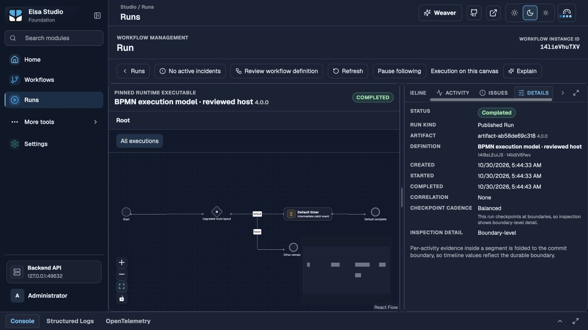

# Final affected-runtime upgrade and existing Studio compatibility

T041 repeats the actual legacy-host and existing embedded-BPMN Studio journeys after the native/model/ETL, retry, broadcast and sibling-cancellation changes. The standard Workbench suite passes **7/7** at `de0e800384b91268827af674e195b1097455dd45`. The two actual Studio families execute at `905b6a491d4372fda5c1b71607d1edbc37020c06`. The only intervening change is the Studio capture controller's use of the existing .NET SQLite reader and full owned-process identity checks. Production files under `Essentials/src` and `Extensions/Etl/src` are unchanged from the latest runtime fix `c40881fd0209dd1f2e8765358c3afd3f007247ab`.

These are original whole-store upgrades, not reconstructed model-state fixtures. The six legacy family manifests retain 33 resulting whole stores: eight partial forks; pending native parent and retained terminal outcomes; called acknowledgment cuts; all four broadcast cuts including empty/re-armed decisions; escalation, sibling policy and compensation recovery; and multi-instance iteration recovery. [The portable results](legacy/results.json) keep each family's precise counts and limits. All 22 original whole-store inputs are accounted for across the host and Studio journeys, and all 104 frozen baseline assets remain unchanged.

Both Studio families open the actual saved definition, export JSON and BPMN XML, edit only the gateway name, save, review, publish, execute the exact published artifact, execute a separate Test Run and inspect the original run. Initial JSON and XML exports exactly match their captures. Published versions 3.0.0 and 4.0.0 and all four new executions complete through the real native Delay, with two completed activities, no incidents and no remaining waits. After an owned Workbench restart, old and new complete API views and physical full pins remain unchanged. The original 84/92 executable payloads/incarnations, migrations and five-node saved/published layout are preserved.

The Studio captures contain twelve whole stores and twelve visually inspected screenshots. Their coupled Runtime/Design backups use the host's .NET provider while the owned Workbench is paused, and include read-only snapshot receipts. No execution, queue, claim, receipt or clock is seeded. All 41 listed legacy hosts and all six Studio/Workbench children are no longer visible after their owning controllers exit. The user's hosts and existing browser tabs were preserved; the temporary qualification tab was closed.



## Verification

```sh
python3 tools/bpmn/qualify-hosting.py verify-upgrade --manifest specs/1017-direct-bpmn-hosting/evidence/final-compatibility/legacy/partial-forks/manifest.json
# Repeat for native-parents, called-ack, broadcast, controls and multi-instance.
python3 tools/bpmn/verify_studio_upgrade.py --manifest specs/1017-direct-bpmn-hosting/evidence/final-compatibility/studio/manifest.json
ELSA_BPMN_CAPTURE_MANIFEST="$PWD/specs/1017-direct-bpmn-hosting/evidence/baseline/partial-forks/manifest.json" python3 -m unittest discover -s e2e-tests/bpmn -p test_qualify_hosting.py -v
python3 -m unittest discover -s e2e-tests/bpmn -p test_verify_studio_upgrade.py -v
```

Legacy portable controls pass **54/54**; Studio controls pass **23/23**, both with zero skips. The Studio suite verifies both historical and final receipts and rejects rehashed corrupt authoring, layout, XML, run kind, old run projection, full pins, native material classification and missing/mismatched provider backups. The [top-level manifest](manifest.json) binds 134 assets, including all seven nested manifests, raw TRX, build/verification logs, process observations and [qualification](qualification.json). Executing sources are retained separately; historical witnesses are not relabelled.

For a fresh process qualification, build the hosting test project and run its `FullyQualifiedName~Legacy` filter with `ELSA_BPMN_HOST_SOURCE_REVISION` and a fresh `ELSA_BPMN_HOST_EVIDENCE_DIRECTORY`. Build the Studio browser workspace before Studio.Web; start `tools/bpmn/run_owned_studio_upgrade.py` separately for `original` and `layout`, then perform the browser steps above. The controller's `restart` and `finish` commands capture and stop only its own children. The first Studio build overlapped frontend regeneration and refused the temporarily absent SDK asset; after the browser build finished, the scoped host build passed with zero warnings/errors. Both logs are retained. Initial verifier diagnostics are retained separately and are not counted as passes.

This proves selected SQLite legacy-host and existing embedded-BPMN Studio compatibility. Non-SQLite actual-host upgrades and #2907's first-class direct-model Studio acceptance are not inferred. Draft Test Runs retain their existing empty layout-sidecar behavior; saved/published layout is checked separately. Development sign-in returned to Workbench's root and the owned Studio URL was explicitly reopened; automatic return-URL support is not claimed. T042–T047, complete-PR review (0/6), exact-head CI, the deferred GitGuardian finding and remaining program acceptance stay open. Further affected runtime changes require another affected-source qualification.
