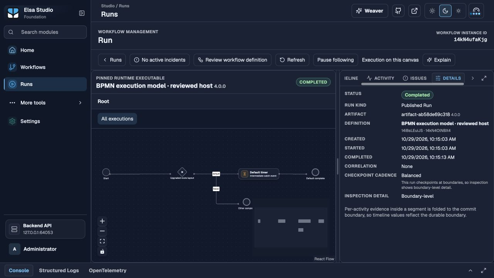

# Actual existing Studio upgrade

Both actual pre-writer Studio captures were restored into isolated source-built Workbench/Studio pairs at **801042981812d52b327fa0d008a09f12d6160a94**. This is existing embedded BPMN compatibility. It does **not** complete #2907's first-class direct-model Studio acceptance, native/ETL integration, or final-source qualification after those changes.

| Restored capture | Original publication | New published run | New Test Run | Original material retained |
|---|---|---|---|---|
| `baseline/studio` | 2.0.0 | 3.0.0: `14kMnh602pZ` | `14kMt4kYdc5` | 84 executable payloads/incarnations |
| `baseline/multi-instance-and-studio` | 3.0.0, five saved layout entries | 4.0.0: `14kN4ufaKjg` | `14kN7YfFlUj` | 92 executable payloads/incarnations |

The actual browser opened definition `14iBsLEuiJS`, exported JSON and BPMN XML, changed only gateway `route`'s label, saved, reviewed and published, ran the exact published artifact, and inspected its exact completed execution. A separate Test Run also completed through the real native Delay. All four new runs have two completed native activities, no incidents and no remaining waits. The saved five-node layout is preserved in authoring/export and the version 4 published run.

Both initial JSON exports match the captures exactly, including native activity-version bindings. Both initial XML exports are byte-identical to the captures. The edited JSON and XML differ only in the intended gateway label. The frozen authoring fingerprint remains `41aa0bb979ea46fc2533b057e3677f408ab54c3411fecfafaa238a2adae38c92`, verified against both actual Design stores at all three stages.

The original run views remain exactly equal to their captured observations after migration, another Workbench process and final inspection. Their physical full pins remain equal to the original stored pins. All original executable content/incarnations and applied migration versions remain intact. The four new complete views also remain unchanged after restart. Twelve whole-store snapshots retain these stages; their gzip and decoded hashes are bound by [manifest.json](manifest.json) and each process receipt.

Test Run inspection identifies its retained draft source; an identical compiled body can reuse the immutable published executable's physical pin. Both boundaries are checked separately. Draft Test Runs retain the existing empty layout-sidecar behavior documented by `StartWorkflowTestRunRequestHandler.BuildTestRunReferenceAsync`; this receipt does not claim that their standalone run canvas uses the published layout. Published execution and saved authoring layout are verified separately.

All twelve screenshots were visually inspected. The images show the original editor/run, successful publication, completed Published Run and Test Run, and the exact run after Workbench restart. [Version 4 after restart](layout/restarted-published-run.jpg):



## Verification and reproduction

```sh
python3 tools/bpmn/verify_studio_upgrade.py \
  --manifest specs/1017-direct-bpmn-hosting/evidence/studio/manifest.json
python3 -m unittest discover -s e2e-tests/bpmn -p test_verify_studio_upgrade.py -v
```

The two process receipts are stored as lossless gzip, with compressed and decoded hashes. The verifier checks all 66 raw asset hashes, exact original inputs, source/binary/browser identities, distinct owned processes, authoring/XML/layout, old and new full run views, physical terminal states/pins/waits, retained material/migrations and frozen descriptors. Nine rehashed corrupt copies are rejected: altered saved layout, native binding, XML default flow, Test Run kind, original run projection, physical full pin, native/model classification, missing screenshot declaration, and an altered decoded process hash. These controls do not replace the actual browser journey.

Build the production Workbench/checked-reader hosting test project and Studio.Web from one clean committed source. Build Studio's frontend workspace too. Start `tools/bpmn/run_owned_studio_upgrade.py` with `--family original` or `--family layout`, the three built assembly paths and a fresh output directory. The controller prints its owned URLs and writes a private `ready.json`; open that Studio URL, sign in with the disposable Development seed and perform the steps above. This qualification's default identity return-origin list redirected sign-in to Workbench's root; explicitly reopening the owned Studio URL continued the authenticated journey. It is not automatic return-URL qualification.

Write `{"action":"restart"}` to the output directory's `command.json` for the owned Workbench restart; inspect the same exact execution again. Write `{"action":"finish"}` to capture final observations and stop only the controller's children. The controller records its own process ancestry/start identities, assembly versions/hashes and relative frontend asset hashes. Original compressed stores are read-only inputs. SQLite backups include committed WAL data; only the new closed evidence copy is made standalone. User hosts and the existing Project #62 browser tab were preserved; the temporary browser tab was closed.

[qualification.json](qualification.json) records the executed focused checks and their source limits. Further native/model/ETL changes require T041's final upgrade/Studio repeat. All previous upgrade families retain their own executing source identities; no earlier witness is relabeled.

T030/T032/T033 are complete for this phase: all104 original asset hashes and all22 whole-store inputs are accounted for; the current whole-host suite passes10/10, BPMN379/379, interchange130/130, native API/checkpoint compatibility16/16 and verifiers54/54+10/10. Local payload checks pass11 with one existing Linux-only I/O-error probe skipped. The [same-source full Linux serialization suite](https://github.com/elsa-workflows/elsa-foundation/actions/runs/40847492397/job/123359045006) passes62/62 with zero skips; that local skip is not reported as a pass. T031 and the real native/model/ETL bridge, settlement, retry, final T041 repeat and remaining operational/clustered acceptance stay open.
