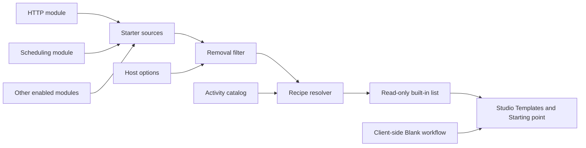

# Implementation plan
Use existing Workflows Design assemblies, permissions and atomic-write infrastructure. Introduce a separate template document/read-write port in Design Persistence Core and an EF adapter/table in the existing Design context. Regenerate the pre-GA Initial migrations for all four providers using repository tooling. Store authored state and layout/presentation separately from workflow lifecycle data.

Add capability-advertised Design APIs and a client template catalog combining immutable built-in recipes with custom snapshots. Reuse the existing workflow editor through an explicit document adapter, with template lifecycle controls hidden and draft validation probes disabled for template identities. Use revision-aware serialized writes and preserve local state on errors. Add Save as template from the live workflow draft, and clone custom template documents into independent workflow drafts when creating.

Constitution: keep Core provider-neutral, no runtime domain dependency changes, no new heavy package or project. Use existing tenant access and credential-literal validation. Template JSON is authored content, never executable activity template material. Generic workflow state remains unchanged. Public cross-assembly ports only; track APIs where enforced. Draft Model X/versioning rules are not relied on.

Validation: template CRUD/revision/tenant/built-in/dependency tests; EF restart and four-provider model migrations; full affected suites; real owned Workbench API journey; rendered browser create/save/edit/copy/delete/use in light/dark. Production frontend bundle budgets, typechecks/lint, architecture and generated-map checks. Commit and push a draft PR with evidence; never merge without exact-head gates and review.

## Built-in starters amendment

This amendment adds a module-contributed, version-independent catalog beside the existing custom-template store. The catalog is computed per host and shared by its tenants; custom template CRUD, persistence and lifecycle remain unchanged.

### Server responsibilities

- Enabled modules contribute stable starter identities, metadata, required activity types and expression languages, and authored recipes. A starter is absent when its owner module is not enabled.
- Host options apply `Workflows:Design:Templates:RemovedStarters`. Unknown ids are ignored and diagnosed once at startup; a complete removal leaves the client-side Blank workflow.
- A resolver checks the server's activity catalog, calculates availability with an actionable reason, selects the newest available version for each recipe activity on every use, and replaces placeholder node ids while remapping references.
- A separate read-only built-in list is advertised by a Design capability link. Built-ins cannot be mutated through custom template APIs; copying one creates a custom template.
- The Backend API Call recipe requires the HTTP activities and Liquid. Its binding-pure Liquid `parse_json` filter parses `SendHttpRequest.ResponseBody`, and escaped Liquid output renders the HTML response. The upstream URL is editable; tests use a local HTTP stub.

### Studio responsibilities

- When the server advertises the capability, Studio consumes its built-in list in Templates and Starting point and reflects availability/removal. Custom templates continue to use their existing APIs.
- Blank workflow remains client-side with the root-activity picker and cannot be removed by server options.
- When the capability is absent, Studio retains the existing client HTTP recipe for older hosts.
- A workflow created from a recipe receives an independent graph; future recipe changes never upgrade that workflow.

### Extension and constitution boundaries

Per [ADR 0080](../../docs/adr/0080-elsa-4-simplification-decisions.md), new server types are internal by default. Only the starter contribution interface and removal options are public extension points; the read-only capability is the wire contract consumed by Studio. The [extension-point catalog](../../EXTENSION_POINTS.md) is the architecture reference.

Recipe resolution uses the current activity catalog to meet FR-012; it does not ratify or expand the draft Elsa constitution §E2.8 activity-versioning rule. Recipe serialization likewise does not ratify provisional §E2.9 workflow-state scope. If implementation requires a new or conflicting rule in either area, route that decision through [Constitution Readiness](../../docs/program-goals/constitution-readiness.md) before treating it as settled.

### Delivery and validation

The staged tasks in [`tasks.md`](tasks.md) order the internal contribution contract, host removal options, recipe resolution, read-only endpoint, Liquid filter, module recipes, Studio capability/fallback, P3 recipe export and acceptance evidence. The FR-to-task matrix keeps the staged work traceable without marking any amendment task complete.

Validation covers module enablement and missing dependencies; removed, unknown and all-removed ids; newest activity versions and fresh node identities; read-only built-ins and custom-copy behavior; capability-absent fallback; and all six catalog recipes. Backend API Call tests use a local HTTP stub for successful JSON, malformed JSON, escaping and unreachable-upstream outcomes. Visible Studio work requires the goal/reference/states, composed-host rendered proof and independent inspection described in [Studio UX acceptance](../../docs/contributing/studio-ux-acceptance.md); a green unit or isolated browser suite alone is insufficient.
