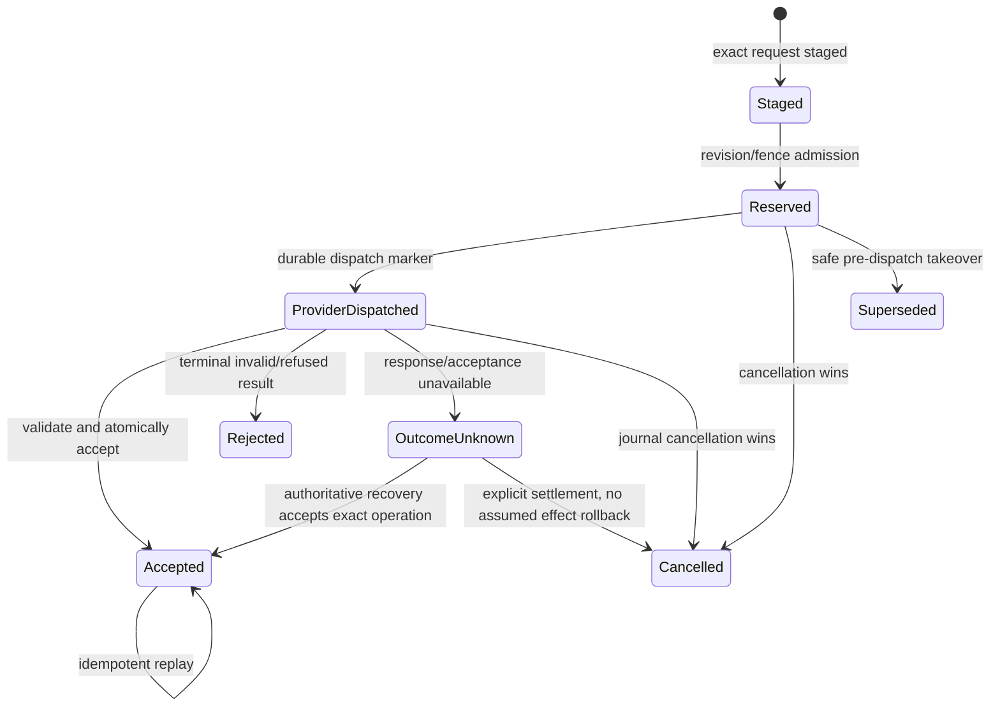
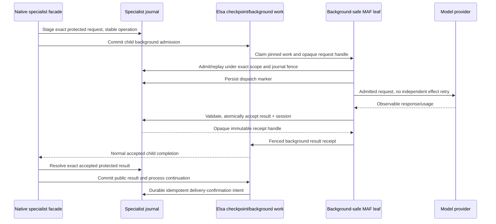

# Specialist state, identity and transactions

**Status**: Proposed M1 model. These are logical shapes, not frozen C# signatures or an implemented schema.
Meanings belong to the [glossary](../../docs/glossary/elsa.md); architecture choices are in [plan.md](plan.md).

## Existing authorities retained

| Existing record/authority | Specialist use |
|---|---|
| ActivityDefinition/AuthoringState | Stable definition/type key, presentation, content authority, head/recommendation |
| ActivityDefinitionDraft + revision | Public interface and provider manifest, exact saved candidate, conflict checks |
| ActivityDefinitionVersionPublication/ExecutableActivityTemplate | Immutable specialist behavior, schemas, model/resource policy and runtime requirements |
| WorkflowExecutable/activity invocation | Exact placed contract/artifact, input snapshot, logical invocation/OperationKey and process completion |
| ConnectionDocument/ConnectionState.Version | Operational tenant connection settings/auth state/secret references under existing CAS |
| Native background work/receipt/checkpoint/outbox | Worker delivery/fence, process acceptance/cancellation and durable settlement responsibility |

There is no separate specialist definition/version table. Derived collection/evaluation views retain
foreign identities and never become publication authority.

## Published behavior

The provider manifest contains instructions, model connection reference/type, model ID, supported
settings and capability snapshot identity, optional field-level JSON constraints, continuity/resource/
tool/budget policy and schema version. The compiler derives exact input/result JSON schemas and result
projections from the public contract, validates constraints and includes all behavior in the artifact hash.
Credentials, live SDK agents/sessions, mutable connection documents and UI layout are not behavior payloads.

The runtime descriptor retains exact definition/version/hash, compiled schemas, model/adapter/codec
identity and policy. Connection authority is resolved at point of use; an artifact never requires a draft
lookup. An operational authorization denial is a domain outcome, not permission to lose an artifact reader.

## New logical records

| Record | Identity and principal fields | Invariants |
|---|---|---|
| SpecialistConversation | Opaque ID; exact tenant + trusted owner/run-as + specialist version; revision; active operation/generation; accepted session codec/reference; retention policy | No caller-authored tenant/owner authority; one admitted turn at a revision; version changes create a fresh conversation |
| SpecialistTurn | Stable logical OperationKey; canonical request fingerprint; conversation/base revision; admission generation; lease/fence/expiry; immutable artifact/source invocation; protected input/session references; dispatch marker/provider continuation identity; state | Same operation + same fingerprint replays; changed arguments conflict; lease expiry after dispatch never permits a blind provider request |
| AcceptedTurn | Exact operation/generation and receipt ID/hash; validated result; accepted SDK session; usage status; model/capability/resource references; accepted revision/time | Result/session/usage/receipt and conversation revision advance in one journal transaction; immutable accepted content |
| TurnDelivery | Exact workflow/artifact/parent invocation/child work association; accepted receipt; native source commit/intent; process application/cancellation disposition | Delivery facts do not rewrite accepted conversation history; duplicate/conflicting notifications are explicitly reconciled |
| CancellationTombstone | Exact scope + logical operation + admission generation/source; canonical cancellation intent; settlement status | Exists even before admission; never targets whichever newer operation currently occupies a conversation |
| EvaluationSet/Case | Tenant/owner, specialist definition, revision; named input and explicit assertions/rubrics | Case content is versioned; no credentials; source/permission checks before execution |
| EvaluationRun/CaseResult | Exact candidate/version/hash and set revision; runtime execution/turn references; observed results/usage/status | Repeatable identity, no overwriting earlier evidence, distinct contract/quality/incomplete outcomes |
| ModelCapabilitySnapshot | Connection type/provider/model, revision/hash and observed/configured source; supported modes/options/ranges/limits | Unknown is distinct from supported; no secret values; snapshot is evidence, not a future service guarantee |

Opaque IDs are references, not bearer permissions. Use existing normalized tenant/physical scope
and canonical length-framed identity conventions; delimiter concatenation cannot identify authority.
Every lookup, CAS, lease renewal, result, receipt and purge checks the complete resource scope.

## Turn states and authority

Staging is not permission to dispatch. Native background admission must commit first. A staged
request left by a crash before that checkpoint can be reconciled/purged without having invoked a model.
The worker resolves an exact staged handle, validates its native invocation/artifact association,
obtains a current journal fence and writes ProviderDispatched before invoking the provider.

At acceptance, the journal atomically compares scope, request fingerprint, base revision, operation,
generation, unexpired fence and admissible state. It commits validated result/session/usage/receipt and
advances the conversation once. Late or cancelled workers cannot replace that pair. Replaying an older
accepted operation returns its original result without setting the conversation back to its old revision.

OutcomeUnknown cannot enter Reserved through ordinary retry. Only an authoritative provider continuation/
idempotency mechanism for the same operation, or an explicit authorized recovery action, may settle it.
Starting unrelated new work requires a new fresh conversation or an explicit fork/recovery decision;
it does not convert the uncertain operation to failed-with-no-effect.

## Native facade and worker

The worker's public result is a concrete registered receipt-handle type with a persistable unprotected
policy. It contains no content or credentials. Its custom activation strategy returns the exact registered
background-safe CLR capability, with pinned descriptor/schema, Background placement and
SupportsBackgroundExecution. It has no stateful/structural/checkpoint-participant protocol and cannot Suspend.

The facade is a native structural/checkpoint participant. It resolves the handle through scoped
services, checks receipt/result/artifact/operation/parent association, and emits typed public JSON
through `IRuntimeActivityCheckpointParticipant.PrepareCompletionCheckpointAsync`. Structural Complete
alone supplies only outcome/ActivityUnit. The background leaf does not implement that participant.
Journal payloads are encrypted, but the initial native profile supports sensitivity/redaction only,
with RequiresEncryption=false. Native encryption-required values/captures and secret-bound business
inputs are explicitly unsupported/refused before dispatch, not decrypted or downgraded by the facade.
A handle alone grants no access. Qualify supported redacted flow and unsupported-policy negatives;
do not infer native encryption support from the journal or the M0 plain fixture.

## Separate transaction boundaries

| Boundary | Atomic facts | Crash/retry behavior |
|---|---|---|
| Generic publication | Existing ordered runtime/design/receipt guarantees | Reuse its review/idempotency protocol; no specialist write side effect |
| Journal staging/admission | Exact request/operation, scope/revision reservation and journal fence | Matching retry resumes/replays; different fingerprint conflicts |
| Journal acceptance | Validated result, accepted SDK session, usage/receipt and conversation revision | Return accepted result without another model request |
| Native background checkpoint | Fenced worker receipt acceptance, activity/process changes and outbox responsibility | Existing runtime replay/fencing owns delivery |
| Journal settlement | Exact applied/cancelled notification and its durable source/intent identity | Idempotent repair; cannot cancel a newer turn or erase accepted history |
| Connection save/revoke | Existing metadata version CAS and its declared secret-reference protocol | Preserve rollback/conditional-delete semantics; do not infer a cross-store secret transaction |

No journal/database write is smuggled into Runtime EF through IRuntimeCheckpointCommitEnricher.
It contributes durable post-commit intents, following the existing ETL boundary.

## Cancellation and ordering

1. Journal cancellation wins before acceptance: tombstone/fence invalidation prevents acceptance;
   previous accepted session remains unchanged. Cancellation before staging/admission blocks a delayed worker.
2. Journal acceptance wins first: later cancellation returns AlreadyAccepted and preserves the accepted
   session/result. The process may nevertheless cancel before it applies that result.
3. Native process cancellation commits first, but outbox delivery is delayed: journal acceptance may
   still win during that gap. Native receipts cannot continue the cancelled process. Show **completed,
   not applied to process**, with settlement evidence; never label that turn cancelled or claim rollback.
4. Exact operation/generation/source identities and tombstones make reordered/duplicate settlement safe.
   Durable handlers require valid native source proof; a transport context is not authorization.

Next-turn admission follows the journal's terminal decision and accepted revision. It does not wait
for a process that may have independently cancelled. Unknown/pending preceding work cannot expose an
unaccepted session. Clients can inspect process-application disposition separately.

## Protection, retention and compatibility

Use the existing Secrets Core protection/key-ring boundary for journal payloads, wrapping infrastructure
failures as specialist-domain failures. Protected content includes a canonical scope/type/codec envelope
that is checked after unprotection; ciphertext relocation cannot become another tenant's session.
Use durable configured keys in durable hosts; missing/retired keys must not silently create fresh history.
No raw key, credential, private reasoning or unredacted SDK object enters observable execution evidence.

Default content retention is host-configured, with a documented 30-day default for completed conversations
and evaluation content. Active/admitted executions pin the content/readers they require. Purge does not
erase deduplication/cancellation authority while native work can replay: retain a terminal operation
tombstone for at least the associated execution/recovery retention window. A purged content reference
produces an explicit unavailable/retained-marker outcome; it never authorizes a new model call for an
old OperationKey. Administrative deletion is authorized/audited and reconciles active work first.

Pin specialist version, adapter identity, session format/version and resource observations. Retain old
artifact/session/receipt readers and required keys during supported upgrades/disable operations.
Disable new admission independently of in-flight workers/readers. Schema/key/codec migration is explicit;
rollback cannot read a newer format unless that compatibility is qualified. [Support contract](contracts/support.md).

## Required causal tests

Force admission overlap, wrong tenant/owner/version, same-ID cross-scope records, changed fingerprint,
lease expiry/supersession, both journal cancellation winners, pre-admission tombstones, delayed native
cancellation, crash after provider dispatch, after journal acceptance, before/after native receipt, and
before/after settlement acknowledgement. Include unknown usage and retained-reader/key rotation/purge.
Observe accepted journal/session revisions and native parent completion/effect count independently.
