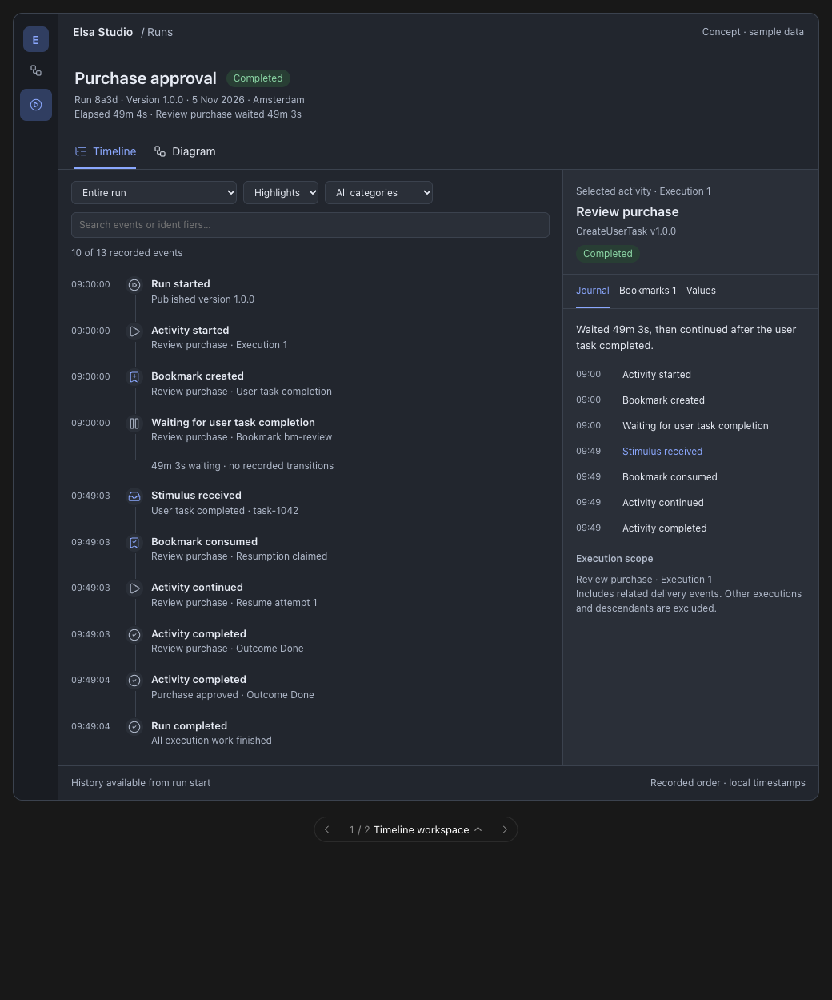

# Selected reference: Timeline workspace

Owner selection, 5 November 2026; [feature #3849](https://github.com/elsa-workflows/elsa-foundation/issues/3849). Normative requirements and acceptance scenarios are in the [specification](../spec.md).

This is the selected layout: a full-width diagnostic workspace with run timeline on the left and selected activity/event/bookmark inspector on the right. Diagram remains a primary peer view. The diagram-dominant alternative is not the selected default direction.

The image contains invented purchase-approval data and illustrates hierarchy/navigation only. It is not proof of production capture, duration accuracy, accessibility or composed UX acceptance. It does not replace the exact-head downloadable evidence required by the [Studio acceptance workflow](../../../docs/contributing/studio-ux-acceptance.md).

## Reading and navigation

- The compact header provides run identity, pinned version, progress/waiting and elapsed context. History coverage/settlement remains separate from current run status.
- Timeline and Diagram share exact execution selection. Selecting an activity updates its inspector without implicitly filtering run history.
- Timeline is oldest first. Highlights reduces routine detail, All events exposes retained chronology, and counts disclose presentation reduction. Scope/category/search belong to the timeline.
- Selecting an event reveals provenance and causal links. Following a filtered-out event shows scope context; Back restores the investigation.
- Activity inspection has a summary followed by Journal, Bookmarks and Data. Execution/iteration/attempt selection precedes these views when needed; confirmed singleton scope does not need a redundant selector.
- Bookmark counts distinguish active/lifetime entries. A handle opens its retained lifecycle and related delivery/continuation. Current eligibility/expiry is separate from recorded transitions.
- Readable labels, kind icons and restrained semantic color support scanning. Long IDs and implementation type names remain secondary detail, using existing copy affordances where useful.
- Narrow layouts place the inspector after the timeline. Primary controls wrap and keyboard navigation remains usable.

## States to qualify in the real product

Exercise completed user-task approval, active wait, duplicate delivery, continuation fault, expired unconsumed bookmark and partial history. The spec additionally requires multiple-bookmark races, re-arming, repeated/parallel executions, retry/recovery, child/broadcast links, mode/no-record behavior, capture/retention changes and authorization boundaries.

Loading, stale/read failure, denied access, unsupported capability, empty filtered results and missing linked targets need explicit states. Live updates preserve reading position and selection. Diagram labels must not imply historical reconstruction.

Composed acceptance must inspect these states in both themes and narrow/desktop layouts, distinguishing assertion success from independent visual acceptance. No product behavior is accepted by this reference alone.
