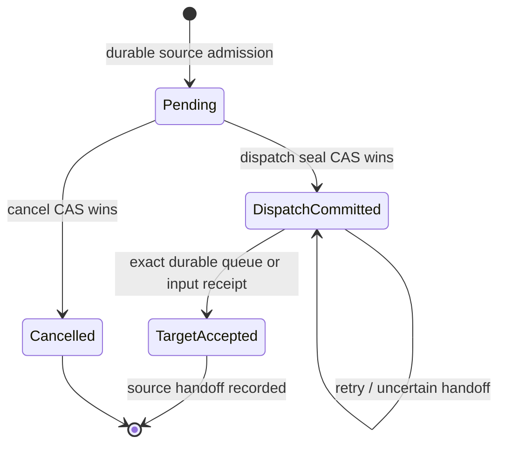

# Standalone trigger data model

**Status**: Proposed; align with the reviewed runtime/target/API contracts before production implementation.

All keys below are logical identities within the server-selected tenant/persistence access scope. Physical providers encode and compare full scoped identities with their normal collision checks. A browser-supplied tenant or hash never establishes authority.

## Authored live resources

| Aggregate | Required facts | Invariants |
|---|---|---|
| Trigger resource | Stable ID, name, family/type contract version, configuration JSON, revision, desired Enabled/Paused state, association-set revision, management origin, timestamps/audit and deletion tombstone. | Type/configuration validate through the installed descriptor. Configuration is live resource state outside the business graph. Refused update changes none of the effective revision, route, schedule or association set. |
| Subscription | Stable ID, trigger ID, logical target definition, explicit slot name, execution-model key, mapping revision/content, Enabled/Paused state, grant identity/revision and management origin. | One association per trigger/target slot. Mutation checks both subscription revision and enclosing association generation. Replacement follows the slot; captures never follow a replacement. Unpublished target authoring is disabled/validation-pending. |
| Invocation grant | Stable scoped identity, trigger/subscription/target-slot scope, allowed operation, active/revoked state, revision, granting/revoking actor and timestamps. | Authority belongs to the resource. Creator permission changes do not revoke it. Only an authorized manager creates/replaces/revokes a grant; new admission compares its actual active revision. No bearer credential or user claims snapshot. |
| Endpoint reservation | Normalized method/template identity, resource owner, owner/configuration revision, response mode and route generation. | First successful activation reserves it; paused previously activated resources retain it. Embedded and standalone owners participate in one exclusive conflict boundary. Reviewed change transfers ownership atomically; a failed change retains the old claim. |
| Resource schedule | Stable resource/schedule ID, owner configuration generation, interval/Cron expression, timezone where applicable, absolute next-due cursor, desired state and fenced claim. | One schedule per resource, not subscriber. Updating future configuration fences unaccepted old claims. Accepted occurrences remain independent retained sources. |

Operational eligibility is a projection over desired state, installed family/model support, active grants, serving slots and input compatibility. It does not rewrite authored settings. Show total/enabled/eligible subscription counts separately. A previously enabled resource with no currently eligible subscriptions is EnabledUnavailable and becomes eligible again when those facts recover; explicit Pause remains sticky. Last-association removal pauses the resource in the same mutation.

## Accepted immutable delivery

| Record | Required facts | Invariants |
|---|---|---|
| Source | Source kind/version, exact scoped ID and content fingerprint, immutable source payload/envelope, trigger/configuration/association generations, accepted timestamp, admission policy/result and complete evaluated recipient set. | True external sources have no invented workflow publisher/checkpoint. Workflow-origin Event keeps its actual canonical source. Identity replay returns the winning capture; changed content conflicts. Accepted material is never remapped or rematched. |
| Evaluated recipient | Subscription ID/revision, eligibility result, safe failure code/field findings and captured target/inputs only when accepted. | RequireAll commits no accepted recipients when one enabled recipient refuses. AcceptAvailable records accepted and refused rows explicitly. Disabled subscriptions are excluded intentionally, with counts/evidence; they are not promised recipients. |
| Accepted target | Logical definition/slot and observed revision, publication/source provenance, exact native/model material pin/incarnation, declared input-contract fingerprint, normalized input bag, mapping/grant revision and server-owned execution attribution. | Publication and grant must be eligible at the atomic intake boundary. Captured exact material/authority remains retained through later replacement/unpublication/pause/deletion. Producer identity is distinct from logical source identity when material deduplicates. |
| Recipient delivery | Source+subscription identity, durable phase/revision, deterministic execution/command/envelope or model input identity, dispatch-commit seal, attempts/backoff and safe failure/receipt facts. | Cancellation and dispatch commitment compare-and-swap the same physical state. A seal commits responsibility to enqueue; it is not proof of a queue item, running execution or completion. Owed work remains recoverable until actual handoff evidence exists. |
| Transport exchange observation | Source/delivery identity, HTTP mode/policy, request/response deadlines, response-instruction identity where present, outcome and timestamp. | Request/response objects are never persisted. Acceptance, workflow result and response delivery are independent. A client disconnect does not cancel an accepted workflow. |

Full captured payload/inputs are visible only through their authorized projections. Safe operational summaries do not disclose credentials or unrestricted source bodies. Source type and schema version are explicit; unknown versions refuse rather than masquerade as legacy workflow sources.

## Recipient phases

Retryable failure, current-policy block and backoff are orthogonal attempt facts, not fabricated execution states. Before commitment a blocked recipient remains cancellable. After commitment a policy/queue failure remains owed and recoverable; the operator sees DispatchCommitted with its reason and can separately request execution control once a target exists. Target completion/fault/cancellation belongs to the ordinary runtime linked execution, not the source handoff phase.

The outbox handler claim authorizes mutation of delivery progress and completion. Its expiring lease is not the lifetime of a committed target command. Target admission validates the physical immutable seal/capture under exact scope independently of an old handler claim; otherwise a queued command could become invalid merely because its source handler completed or restarted.

## Retention and deletion

Unresolved accepted recipients retain exact material/dependency closure, source provenance, dispatch seal and target dedup/receipt state through existing Runtime retention fencing. Trigger/association/source deletion tombstones block fresh admission and preserve those roots. Refused recipients never acquire target start authority.

Source handoff does not alone authorize immediate dedup/history deletion. Apply the normal retained delivery/idempotency policy and report its guarantee window. Never collect a source/seal before all admitted target commands can be reconciled and their authority no longer depends on it. Explicit retention/collection tests must establish when terminal source facts and execution/dedup records can safely retire; an ordinary Delivered status is not sufficient evidence.

## Schedule cursor rules

Persist due instants in UTC, including their resource generation and deterministic occurrence key. Display Cron timezone/offset separately. After unplanned downtime, admit the persisted due occurrence once, then advance strictly beyond the wake instant; do not replay all elapsed occurrences. Intentional pause/resume and configuration/timezone changes select the next future occurrence for the new generation. An occurrence accepted before that change remains owed. Backward clock movement cannot re-admit a settled absolute occurrence.

If zero recipients can be accepted, keep the same overdue cursor/generation and retry with bounded backoff. Show WaitingForEligibleSubscribers for a complete known-zero evaluation and AdmissionUnavailable for an unreadable/uncertain boundary. Neither is successful admission or cursor settlement. On restoration, evaluate current subscriptions/serving targets and accept one occurrence; then advance beyond that wake instant. If any recipients were already accepted, the firing's complete accepted/refused selection is final and restored recipients wait for a later occurrence.

Cron retains the existing five/six-field dialect and delegates timezone/DST calculation to the pinned Cronos behavior. Preview and runtime use the same calculator. DST gap/fold cases and operating-system timezone resolution require actual tests; writing the rule does not qualify them.
