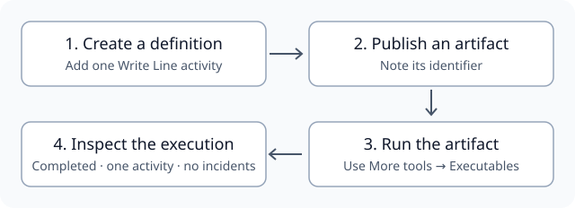
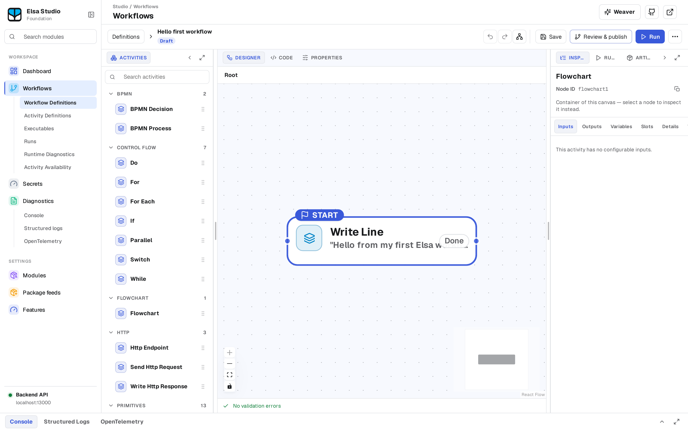
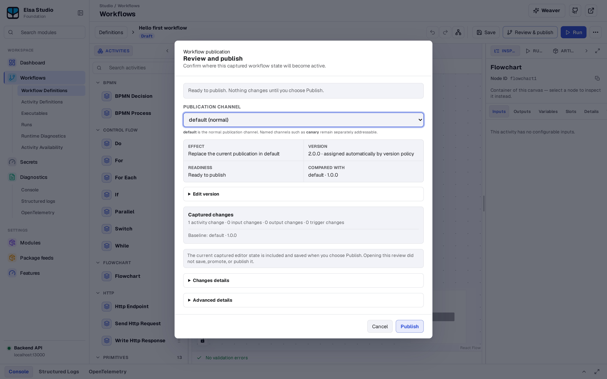
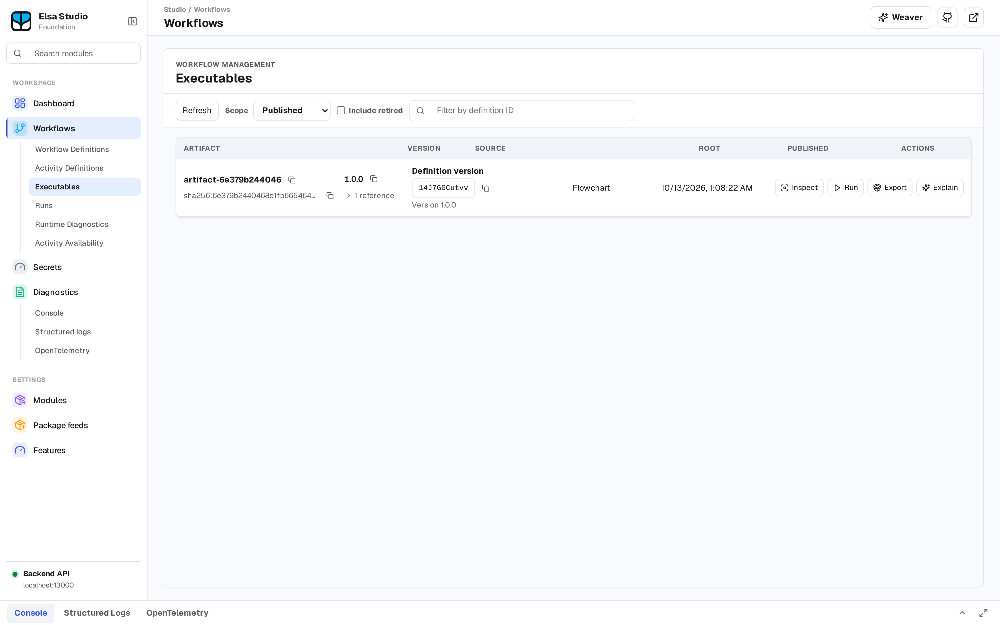
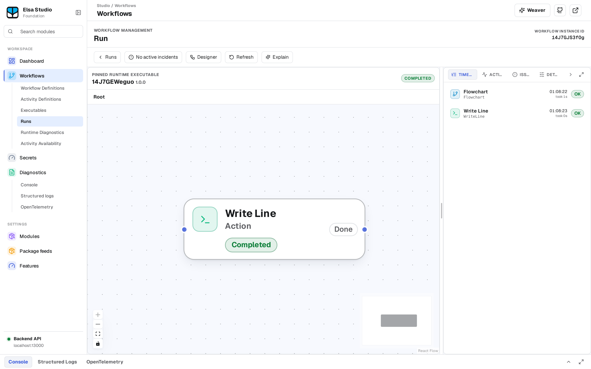

# Your first workflow

Start the [local Workbench and Studio demo](quickstart.md) and sign in to Studio.

You will publish a workflow containing one Write Line activity, run that published artifact, and inspect its result:



> **Tested with** Studio revision `7cb2f2c2`, Write Line `4.0.5-preview` and Flowchart `4.0.3-preview`. The screenshots show definition `14J7GEWeguo` and run `14J7GJS3fOg`. This walkthrough follows the published-image pair's recorded UI journey; later preview versions can change labels or behaviour.

## Create and publish

1. Open **Workflow Definitions** and create a workflow using the default Flowchart.
2. Choose **Add activity**, search for `WriteLine`, and select **Write Line** (singular).
3. Set **Text** to a recognizable message, such as `Hello from my first Elsa workflow`.
4. Choose **Review & publish**. In the **Review and publish** dialog, choose **Publish**. Note the published artifact identifier.


*The Workflow Definitions list with the new draft.*



*The designer with one Write Line activity.*



*The Review and publish dialog. The proposed version depends on what is already published.*

## Run the published workflow

Open **Workflows → Executables** and run the artifact you just published. The editor's Run action starts a draft test run; use Executables to follow this published-workflow journey.



*The published artifact in Executables.*

After it starts, choose **Open Run** in the status line, or open **Workflows → Runs**. Check that it belongs to the published artifact and has status **Completed**. Its timeline should contain exactly one completed Write Line activity. Open the run-details **Activity** and **Issues** tabs (they appear as ACTIVITY / ISSUES). At 1024 px on this pinned Studio the labels can clip; hover a tab or widen the window. The run should have zero incidents and an empty Issues view.



*The completed run and its timeline.*

In your demo terminal, inspect the Workbench output:

```bash
docker compose -p elsa-first-workflow -f docker-compose.images.yml logs --no-color elsa-workbench
```

Use the `-p` project name you chose in the quickstart (that flag overrides the compose file's `name: elsa-stack`). Your unique message should appear once for this run. If you ran the workflow again, account for those additional runs when reading the log.

## Understand the result

You created a definition, published an artifact, and executed that artifact. The [How a workflow executes](https://github.com/elsa-workflows/elsa-foundation/blob/main/docs/how-a-workflow-executes.md) guide explains the runtime path in more detail. Use the [local demo cleanup steps](quickstart.md#stop-the-demo) when you finish.

> *Good to know:* the [recorded browser verification](https://github.com/elsa-workflows/elsa-foundation/blob/69f067104c1a977d897911db7ecf16037cfbe542/docs/contributing/published-image-pair.md#recorded-image-provenance-and-hosted-result) covers a specific image pair and Linux/amd64 environment. It is automated technical evidence, rather than a human newcomer trial or proof for every later preview.

---

[Edit this page on GitHub](https://github.com/elsa-workflows/elsa-foundation/edit/main/website/docs/essentials/first-workflow.md).
