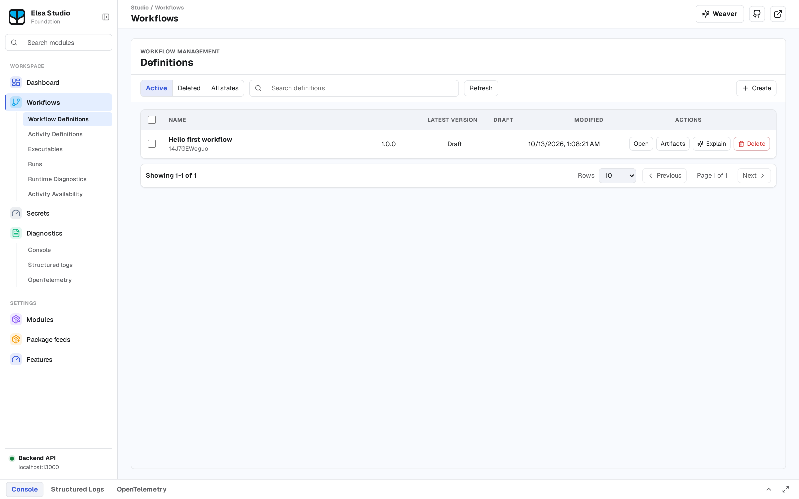

# Try Elsa locally

Run the reference Workbench server and Studio visual client with Docker, then create a workflow in your browser. You need Docker Engine with the Compose v2 plugin, network access to GitHub and Docker Hub, and unused local ports `13000` and `14000`.

> **Tested with** a pinned Elsa 4 preview image pair (digests in step 2 below), on Linux/amd64:
>
> | Image | Digest |
> | --- | --- |
> | Workbench | `sha256:73ef26e4…` |
> | Studio | `sha256:1a4401d2…` (Studio rev `7cb2f2c2`) |
> | Compose file | Foundation commit `48bfcea5` |
>
> This is a historical verification, not a claim that newer images or every platform pass. For the exact runs and limits, see the [published-image verification record](https://github.com/elsa-workflows/elsa-foundation/blob/69f067104c1a977d897911db7ecf16037cfbe542/docs/contributing/published-image-pair.md#recorded-image-provenance-and-hosted-result).

> **Demo only.** It contains public demo credentials and keys. Workflow data lives in the Workbench container's SQLite files and is lost when that container is removed; the named volume keeps only the Data Protection key ring. Keep valuable workflows in a separately configured persistent deployment.

## Prepare the demo

Create a new empty directory for the demo. Download the Compose file from the recorded Foundation checkpoint:

```bash
curl -fLo docker-compose.images.yml https://raw.githubusercontent.com/elsa-workflows/elsa-foundation/48bfcea5f5bc8c05189e9b5f334064e8408ffcba/docker/compose/docker-compose.images.yml
```

On Windows PowerShell, use `curl.exe` in place of `curl`.

Open the downloaded file and make these four replacements. Keep the other configuration, including the login-return origin, unchanged:

| Service | Setting | Value |
| --- | --- | --- |
| `elsa-workbench` | `image` | `elsaworkflows/elsa-workbench@sha256:73ef26e41760eaa4618a37cfbd7285002408f634e4089201b3864cb1f6147904` |
| `elsa-studio` | `image` | `elsaworkflows/elsa-studio@sha256:1a4401d2f5bee207c3edbc51d4157ecb23ba796fb1dacc9e5ff6775f6c4f6ad0` |
| `elsa-workbench` | `ports` entry | `"127.0.0.1:13000:8080"` |
| `elsa-studio` | `ports` entry | `"127.0.0.1:14000:8080"` |

The digests are image index digests from the verification record. The loopback (`127.0.0.1`) bindings keep the demo ports on your machine; do not expose this configuration to a network.

Pick a Compose project name. The commands below use `elsa-first-workflow`; if that name is already in use, choose another and use it everywhere. Before starting, check that no containers, network or volumes of that project exist and that ports `13000` and `14000` are free. Leave other projects' resources and listeners alone.

## Start and sign in

From the demo directory:

```bash
docker compose -p elsa-first-workflow -f docker-compose.images.yml config --quiet
docker compose -p elsa-first-workflow -f docker-compose.images.yml pull
docker compose -p elsa-first-workflow -f docker-compose.images.yml up --detach
```

Continue only if configuration validation and the pull succeed. Wait for Workbench to become ready and Studio to start. Open [Studio on localhost](http://localhost:14000) and sign in with the demo account, username `admin` and password `Password123!`.

After sign-in, Studio shows its workspace navigation. Once you have created a workflow, the Workflow Definitions list looks like this:



*Elsa Studio after sign-in.*

Continue with [Your first workflow](first-workflow.md). If startup or sign-in fails, inspect the services:

```bash
docker compose -p elsa-first-workflow -f docker-compose.images.yml ps
docker compose -p elsa-first-workflow -f docker-compose.images.yml logs --no-color elsa-workbench elsa-studio
```

The [Docker Compose guide](https://github.com/elsa-workflows/elsa-foundation/blob/69f067104c1a977d897911db7ecf16037cfbe542/docker/compose/README.md) explains the reference composition, connection settings and troubleshooting. To build the backend yourself, use the [backend source quickstart](https://github.com/elsa-workflows/elsa-foundation/blob/main/docs/contributing/backend-source-quickstart.md); its instructions and verification records have their own revision scope.

## Stop the demo

Use the same directory, file and unique project name:

```bash
docker compose -p elsa-first-workflow -f docker-compose.images.yml down
```

This removes the demo containers and their container-held workflow data. Named volumes remain. If you also want to discard this disposable project's volumes, add `--volumes` to that command after checking the project name. Preserve any data you need before removing its container or volumes.

---

[Edit this page on GitHub](https://github.com/elsa-workflows/elsa-foundation/edit/main/website/docs/essentials/quickstart.md).
