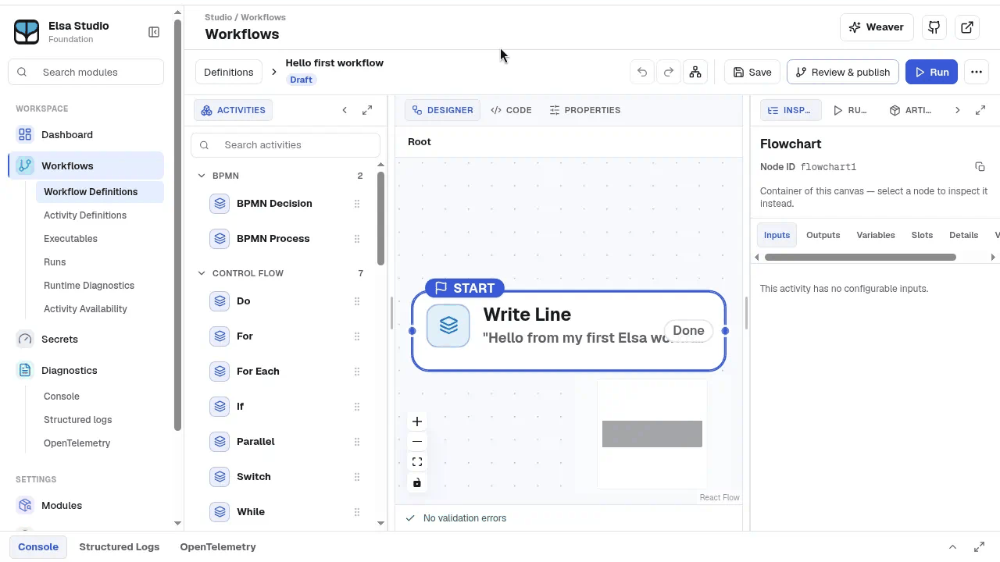
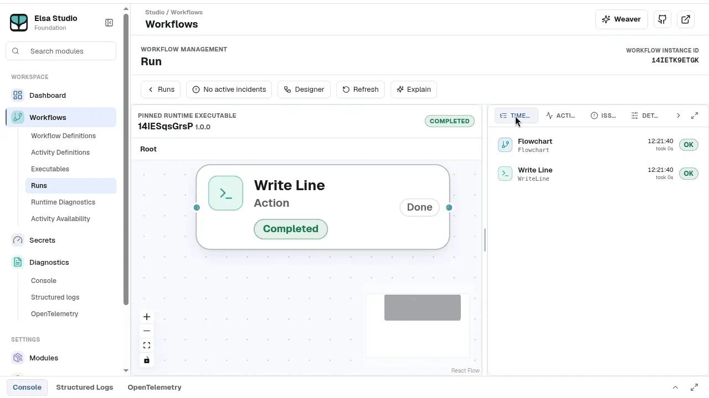

# Elsa Studio

Elsa Studio is the visual client used with an Elsa server. The Foundation [Docker quickstart](https://github.com/elsa-workflows/elsa-foundation/blob/main/docker/compose/README.md#quick-start--published-images-no-clone-or-build) documents the published Workbench and Studio reference pairing and its connection settings.

Studio's client source is maintained in the [Elsa Foundation Studio repository](https://github.com/elsa-workflows/elsa-foundation-studio). This page points to the Foundation guidance that is available today; check the server and Studio versions together when setting up a deployment.

## What Studio looks like

*The workflow designer (Studio rev `7cb2f2c2`, activities `4.0.4-preview`.)*

*Inspecting a completed run (Studio rev `7cb2f2c2`, activities `4.0.4-preview`.)*

---

[Edit this page on GitHub](https://github.com/elsa-workflows/elsa-foundation/edit/main/website/docs/studio/README.md).
